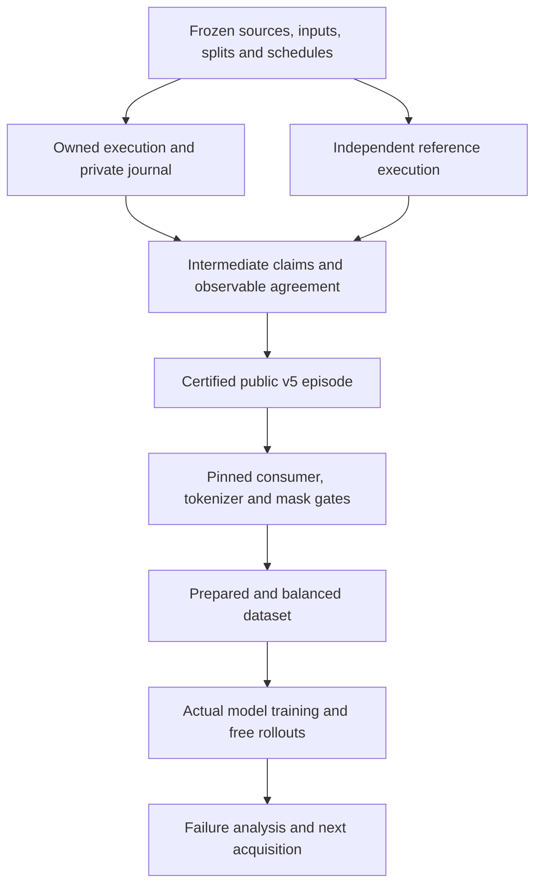

# tracing-js-self: survey and roadmap for high-quality JavaScript execution training data

**Review date:** 18 November 2026 (Europe/Berlin)  
**Repository:** <https://github.com/werg/tracing-js-self>  
**Reviewed revision:** `98bbf84f1f636a5a7a04dcd1be2d6587f4371d91` (`main`, merge of PR #39)  
**Purpose:** decide what to build, fix, measure, and defer to produce data that demonstrably teaches an LLM to execute JavaScript.  
**Scope:** repository and evidence review, local verification, and a proposed implementation plan. No repository source, issues, settings, or remote branches were changed.

**Clarified design priority:** the roadmap explicitly includes making the actual model-facing traces more semantically natural and higher level. The dedicated abstraction workstream in §5.6 runs alongside correctness and learning diagnosis; it is part of the intended system, not merely a display polish task.

## 1. Recommendation

The project has a substantial foundation: an owned interpreter, replayable private evidence, a source-grounded public execution language, independent V8 checks, native consumer admission, immutable provenance, global source-component splits, resumable collection, release packaging, and actual optimizer/evaluation tools. Much of the infrastructure that an initial roadmap would request is already implemented. [R1] [R2] [R3]

The next milestone should be:

> **A reproducible, bounded dataset whose intermediate execution claims are trustworthy and which demonstrably teaches a real model to complete JavaScript executions.**

Three workstreams deserve immediate attention:

1. **Close a demonstrated teacher-certification gap.** This review reproduced an incorrect strict-mode accessor execution. A version whose final answer exposes the error is correctly refused; a version that overwrites the affected value is accepted as `locally_verified` while emitting an intermediate value that JavaScript never produced. This makes independent intermediate-state and abrupt-completion checking a concrete requirement. It does not establish contamination of an existing native-admitted release. See §3.
2. **Diagnose the failed learning loop.** Existing trained models fail at their first selected action, usually before a valid semantic record can be parsed. Even the separate 256-update, one-input memorization trial did not complete its training example. Keep a frozen v5 control while checking targets, losses, decoding, and training/serving parity; then prove convergence on a tiny dataset. See §5. [R10] [R11] [R12]
3. **Advance semantic trace abstraction.** Make the learner's steps follow source-level calculations, decisions, calls, meaningful state changes, and causally significant effects. Extend the existing source-name and expression-fusion work into certified region/call/loop summaries and multiple valid levels of explanation. Audit the actual supervised bytes as well as the readable rendering. Start this design and certification work now, with versioned experiments beside the frozen learning control. See §5.6. [R4] [R33] [R34] [R35] [R36]

After those gates pass, broaden independent program diversity, preserve rare semantic coverage during sampling, establish meaningful unseen-program evaluation, and scale the pipeline using measured costs. Full ECMAScript compatibility is a longer-term option; it is not necessary to produce a useful first execution-learning dataset.

### Priority at a glance

| Priority | Work | Required result |
| --- | --- | --- |
| P0 | Strict accessor/profile repair and intermediate-label certification | The reproduced false local certification is eliminated; an independent authority detects overwritten intermediate errors |
| P0 | Exact target, decoder, and training/serving diagnosis | Explain where the first valid action fails, with token-level evidence and a reproducible parity check |
| P0 | Consolidate the merged baseline | One current producer/consumer/data/environment identity; historical receipts retain their actual revisions |
| P0/P1 | Make model-facing traces semantically natural and higher level | Source-oriented explanations and certified abstraction; measurable reduction of unnecessary mechanics in actual targets |
| P1 | Demonstrate learnability | Complete one-input execution, then a small feature-stratified held-in set, then new inputs |
| P1 | Improve corpus value | More independent source components and programs; measured semantic, exception, stateful, and asynchronous coverage |
| P1 | Prove transfer | Frozen component/project/composition holdouts, base-versus-trained comparisons, and separate source-only outcome evaluation |
| P2 | Extend language coverage | Prioritize supported-profile defects and features that recover useful independent programs |
| P2 | Scale and maintain | Whole-process resource bounds, qualified runner images, measured throughput, durable releases, and clear current documentation |

## 2. What exists today

### 2.1 Architecture and maturity

| Layer | Existing implementation | Assessment and next concern |
| --- | --- | --- |
| Source profiles | `src/frontend.js`, `src/training/profile.js`, TypeScript and module adapters | Explicit bounded profiles exist. Support in the legacy script, strict training, module, and browser paths must not be treated as interchangeable. |
| Owned execution | `src/runtime.js`, `src/spec-operations.js`, value tagging and host implementations | Considerable synchronous, async, Promise, closure, object, and effect machinery exists. Correctness within the admitted profile remains the first responsibility. |
| Private evidence | `validation.js`, `replay.js`, journal and graph validation | Strong reconstruction and exact replay catch inconsistency and tampering. Replay shares the interpreter's semantics, so a systematic interpreter error can replay consistently. |
| Public supervision | `effectful-compiler.js`, `semantic-source.js`, `format.js` | Source cell names, compound expressions, fused bindings and choices are real progress. Actual targets remain operation-plus-JSON; higher-level summaries and their executable certification need a dedicated workstream (§5.6). |
| Independent checking | `effectful-admit.js`, V8 reference workers, operation/branch instrumentation, optional engine262 | Final outcomes, effects, reachable graphs, and selected intermediate operations have separate checks. The new overwritten-error probe shows a remaining gap in intermediate authority. |
| Selected execution | `harness-v4.js`, `controller.js`, `model-driver.js` | Generated records, observations, effect dispatch, callbacks, continuation state, and cancellation have explicit authorities. Existing controls should be reused in all model experiments. |
| Corpus construction | `src/corpus/`, generation workers and recipe tools | Real sources, authored fixtures, generated programs, canonical inputs, failure retention, and resumable campaigns exist. Current usable diversity is much smaller than raw admission counts suggest. |
| Split isolation | `source-registry.mjs`, `source-clusters.mjs` | Cross-stream ancestor/clone components and project/composition holdouts already exist. Audit heuristic misses and effective diversity after deduplication and caps. |
| Native admission | Exact Megatoken consumer, tokenizer, visibility, fragmentation, and loss-mask checks | This is a meaningful additional gate. It does not by itself establish independent correctness of every intermediate teacher statement or learned execution. |
| Releases and operations | Campaign store, native preparation, complete audit bundles, locks, checksums, restoration tools | Substantial infrastructure is complete. Production runner qualification, aggregate quotas, and scale costs remain. |
| Learning and evaluation | Optimization smoke, native checkpoints, selected rollouts, comparison and source-only tools | Real optimization and inference have been performed. Useful learned execution has not yet been demonstrated. |

Sources: [R1] [R2] [R3] [R4] [R5] [R6] [R7].

### 2.2 Keep the different evidence levels visible

The intended data path should retain these distinct authorities:



A source being acquired, a function passing a reference run, a candidate being locally verified, native admission, a prepared unique row, and a successful model execution are different events. Report the denominator at each stage. Preserve refusals, duplicates, timeouts, and unsupported cases instead of allowing them to disappear from the headline count.

### 2.3 Measured baseline: what the numbers mean

| Evidence population | Result | Interpretation |
| --- | --- | --- |
| Fresh local review at `98bbf84…`, Node `24.22.3` | `npm test`: 945 tests, **940 passed, 0 failed, 5 skipped**; eight reference fixtures passed; approximately 140.9 seconds | The five skips require an external served native coordinator/model environment. This is a fresh local result, not a new complete native qualification. |
| Fresh contract and trace checks at `98bbf84…` | `npm run contracts:check` passed; `inspect-semantic-reasoning.mjs` passed all eight inspection fixtures | Generated contracts agree and the inspected counter/branch/compound/callback/error/property/random examples locally verify. |
| Retained I qualification | **945/945 unit passes**, eight reference fixtures, **40/40 attempted native probes**, out of 49 declared probes | Produced at `c2a64424…` with consumer `6e27a7c…`; the containing merge does not reattribute those results. All 49 feature-level model stages remain untested. |
| Historical D source campaign | **1,171 attempts → 987 admissions + 184 non-admissions** | A strong recorded census of that specific producer, consumer, and source population. |
| D native preparation | **965 exact-public representatives → 541 native-prepared examples** | Native preparation removes additional duplicates. An admission count is not the final number of unique trainable examples. |
| D capped dataset | **211 rows: 132 train / 27 validation / 52 test** | Only **21 conservative training components**, 47 training family labels, and **139,145 scored training tokens**. |
| C complete prepared epoch | **49 optimizer updates**, 32 examples, 29 family labels, 9,379 supervised lexical targets | Both initialized base and trained model score **0/4 held-in**; separately **0/8 held-out**. |
| Separate parallel-main complete-epoch experiment | **56 updates**, all 32 selected source IDs and all 56 planned windows exposed | Base and trained score **0/4 held-in** and **0/3 held-out**; the test examples represent only one independent component. |
| Separate one-input diagnostic | **256 updates**, one 48-token episode repeated, 12,288 supervised lexical targets | Base and trained score **0/1**. This is memorization evidence, not transfer evidence. |

The local suite was run without modifying tracked files. Native admission, GPU training, browser execution, and full corpus regeneration were not rerun in this review. The historical learning attempts are separate experiments with different identities and exposures; they must not be pooled as multiple seeds of one experiment. Sources: [R2] [R3] [R8] [R9] [R10] [R11] [R12] [R13].

## 3. Newly reproduced correctness and certification issue

### 3.1 Strict assignment to a getter-only property

In `src/runtime.js`, the accessor assignment path returns the assigned value when the setter is `undefined`. That matches a limited silent-failure behavior, but strict JavaScript assignment must throw when the object's `[[Set]]` fails. The strict training frontend explicitly requires `"use strict"`. The object-internals document already limits ordinary `[[Set]]` to a bounded sloppy-script subset; the problem is that this limitation is not enforced at the strict training boundary. [R14] [R15] [R16] [E1] [E2]

This review ran:

```js
"use strict";
function run() {
  const box = {};
  Object.defineProperty(box, "x", { get: () => 1 });
  try {
    box.x = 2;
  } catch (e) {
    return 7;
  }
  return box.x;
}
```

**Observed at the reviewed revision:** owned execution returns `1`; the original and independently instrumented V8 runs return `7`. `verifyEffectfulTrainingCase` returns `reference_outcome_mismatch`. This demonstrates a current teacher defect and a working final-outcome guard.

### 3.2 An overwritten error passes local certification

The more consequential case is:

```js
"use strict";
function run() {
  const box = {};
  Object.defineProperty(box, "x", { get: () => 1 });
  let answer = 0;
  try {
    answer = (box.x = 2);
  } catch (e) {
    answer = 7;
  }
  answer = 0;
  return answer;
}
```

Correct execution throws at `box.x = 2`, enters `catch`, sets `answer` to `7`, then sets it to `0`. It never sets `answer` to `2`.

**Observed:** local verification nevertheless returns `locally_verified`. The public teacher trace includes these actual records:

```text
bind {"name":"answer","value":["num",0]}
bind {"name":"answer","value":["num",2]}
bind {"name":"answer","value":["num",0]}
return {"value":["num",0],"invocation":"invocation1"}
```

The reference receipt reports `sourceChecks.status: "agreed"`, `computations: 0`, and `branches: 0`. Final results agree because the later assignment hides the error. The existing independent operation selection covers binary/unary/update/template and compound-assignment operations and selected branch predicates; it does not observe this plain assignment and abrupt control transfer. Same-interpreter replay and consistency of the selected trace do not supply the missing independent fact. [R17] [R18]

**Claim boundary:** this is a reproduced false local certification of an intermediate execution claim. No native consumer was configured for this probe, and no existing released dataset was shown to contain the case. A native-format/visibility pass would not, by itself, resolve the missing semantic authority.

### 3.3 Required repair and acceptance

1. Implement correct strict-mode failed-assignment behavior, or explicitly refuse that operation/profile combination before exporting a positive example. Do not rely on a later final-output mismatch to police the boundary.
2. Add the visible-result and overwritten-result cases as regressions. Include own and inherited getter-only properties, successful setters, throwing setters, assignment expressions inside `try`, and `finally` overrides within the supported profile. Treat general writable/non-writable data descriptors as explicit-refusal negative controls unless support is deliberately added; broad descriptor implementation is not required for this repair.
3. Check the exact intermediate binding sequence and abrupt completion against an independent execution authority. Avoid testing only the final return value.
4. Add an explicit statement/assignment/call-completion observation layer for the supported training profile. Instrument once-evaluated values and completions without reevaluating getters, coercions, property keys, or arguments. Compare instrumented reference behavior to uninstrumented behavior as well.
5. Audit previously generated candidates that exercised the affected operation. Requalify or quarantine susceptible rows under a new producer identity; retain old artifacts and their original evidence. Do not declare the entire corpus contaminated or relabel old receipts.
6. Add systematic mutation tests: a teacher implementation that corrupts an intermediate write or omits an exception, then restores the final state, must be rejected. Editing a journal after generation is insufficient because existing replay already addresses that different threat.

**Exit gate:** both examples execute correctly or are explicitly unsupported; the overwritten variant cannot obtain positive certification with `answer = 2`; representative intermediate-state mutants are caught independently; the repaired profile passes local, replay, source, and applicable native gates.

The general lesson is operational: every kind of fact placed in the supervised target needs an explicit authority and a tested coverage boundary. A smaller independently justified training profile is preferable to silently accepting a broader profile with unverified intermediate labels.

## 4. Definition of a good execution-training sample

Use the existing v5 episode and private sidecar as the foundation. Avoid introducing another production representation merely to make the plan look complete.

| Quality dimension | Required property | What to measure or test |
| --- | --- | --- |
| Correctness | Actual JS behavior and every supervised semantic claim are justified | Independent completion/effect/graph agreement; intermediate binding/mutation/call/exception checks; first-divergence reports |
| Causality | A prediction uses only source, inputs, and prior lawful observations | Future-observation canaries, public-prefix cutoffs, mask tests, separate private sidecars |
| State fidelity | Values, identity, aliasing, holes, closures, errors, and scheduling retain their distinctions | `undefined` vs missing, `-0`/NaN/infinities/BigInt, shared references vs copies, repeated invocation, pending-work accounting |
| Learnability | Targets are expressible and predictable under the actual model interface | Per-kind/field token loss, valid-record rate, record completion, free-running task success |
| Semantic naturalness | Explanation steps follow source concepts and meaningful changes at an appropriate level of detail | Source-name fidelity, redundant bookkeeping, semantic content per generated token, checked abstraction and human comprehension of actual targets |
| Diversity | New examples teach distinct programs, structures, interactions, and boundary behavior | Projects, conservative components, algorithms, paths, feature combinations, semantic difficulty distributions |
| Split integrity | Related sources and generated relatives remain within one split | Frozen lineage/clone components, project holdouts, composition holdouts, near-clone adversarial audit |
| Efficiency | Useful supervision is not overwhelmed by long repetitive scaffolding | Generated versus observed tokens, semantic coverage per scored token, length percentiles, component exposure caps |
| Reproducibility | A sample can be reconstructed and verified under the declared environment | Exact sources, input/schedule seeds, runtime and consumer versions, tokenizer, locks, recipe and admission receipts |
| Evaluation relevance | The sample helps the intended execution task | Held-in, new-input, unseen-source, effect/schedule, and source-only transfer results |
| Distribution readiness | The dataset's scope and source rights are explicit | Data card, source notices, license policy, known exclusions and private/public release status |

For ordinary successful or throwing JS executions, preserve the correct completion as a positive semantic label. Keep unsupported syntax, instrumentation failure, resource exhaustion, nontermination limits, and internal interpreter faults as separate dispositions. A timeout is not a JavaScript exception label.

## 5. Diagnose and establish learning before scaling

### 5.1 What the existing negative results actually show

The C full-epoch trained held-in arm fails as follows: one invalid native text action, one missing record separator, and two JSON syntax errors. The separate parallel-main full-epoch trained held-in arm has two separator and two JSON failures. The original outputs are unrelated vocabulary fragments; none reaches meaningful semantic validation. `firstSemanticInconsistency: null` in these records means there was no valid semantic action to inspect. [R10] [R11] [R19]

The single-input diagnostic used a newly initialized tiny native model with a vocabulary of 157,184. Its lexical loss decreased from approximately 12.148 to 11.061 after 256 updates, but its trained first action still failed native text-action rendering. Parameter changes and nonzero gradients establish optimization activity; they do not establish sufficient learning or correct inference conditioning. [R12]

Possible explanations include inadequate convergence from scratch, loss-component balance, token/target alignment, action/termination decoding, or training/serving context differences. None has been isolated by the retained evidence. More data, a larger machine, and a new trace grammar are hypotheses rather than demonstrated remedies.

### 5.2 First experiment: inspect exactly what is being learned

Extend the existing optimization and context-cost tools, rather than creating a disconnected trainer. Use one short admitted episode—initially the already measured `flag-intersection-pure`, after current qualification—and produce a readable per-record audit:

- Public conditioning context, target bytes, token IDs, tokenizer segmentation, record boundaries, and all observed/generated/structural/terminal masks.
- Loss and top-k next-token accuracy separately for record kind, separators, JSON keys, source names/reference IDs, literal values, and terminal structure.
- Conditional logits or equivalent native decoding state from training and serving at the same checkpoint and identical public prefix, with dropout disabled and declared numeric tolerance.
- Gradient and update norms for the lexical output head, structural/terminal heads, shared embeddings, and context encoder, broken down by objective.
- First-record greedy generation, end-of-record behavior, syntax validation, semantic validation, and complete-task success as separate metrics.
- Actual exposure to each generated target and checkpoint choice. Do not equate prepared members or cumulative pretraining steps with new scored supervision.

The native model uses recurrent event/facet state; its measured context cannot be reduced to a guessed flat prompt length. The retained C cost report distinguishes 9,379 supervised lexical positions, 50,069 new transcript tokens, 86,452 total ingested tokens including reconstructed prefixes, and up to 84 visible historical events. Reuse this measurement discipline for each new experiment. [R20]

**Acceptance:** explain the exact failing layer using executable diagnostics. A tokenization or conditioning mismatch must fail an automated check. If the path agrees but probabilities remain diffuse, classify the result as convergence/optimization evidence and run a separately declared convergence experiment.

### 5.3 Convergence ladder

These are **proposed engineering gates**, not achieved results or universal statistical thresholds:

| Step | Experiment | Exit gate before proceeding |
| --- | --- | --- |
| L0 | Controlled known-record transport through the existing adapter | Correct record routing, masks, validation, and termination. Explicitly report this as infrastructure evidence. |
| L1 | Learn one short fixed episode, new bounded diagnostic | Greedy complete execution succeeds after exact checkpoint reload and across ten process restarts; no injected choices or repaired bytes. |
| L2 | Learn 16–32 short, feature-stratified cases | At least 95% complete held-in executions, at least 99% valid first records over a sufficiently sized declared evaluation set, and zero false semantic admissions. |
| L3 | New inputs for known exact sources | Predeclared accuracy target by branch, value, alias, length, and exception slice; actual improvement over the frozen base. |
| L4 | Independent source components and compositions | Positive component-weighted transfer under a frozen evaluation design; checkpoint selection uses validation only. |
| L5 | Confirmatory useful-data claim | Multiple planned seeds, adequate independent components, a practical effect-size target, and complete confidence/uncertainty reporting. |

The old 256-update experiment remains a failed bounded attempt. A new experiment can allocate a different convergence budget and objective investigation, but it needs its own frozen declaration, full costs, and stop condition. Evaluate intermediate checkpoints on designated training diagnostics or validation; do not repeatedly inspect the final test set.

### 5.4 Separate model architecture from dataset usefulness

Retain the native Megatoken path and add a **separate conventional pretrained causal-LM diagnostic** over the same certified v5 records. This is a useful control because the user's objective is high-quality LLM execution data, while the current experiments also test a newly initialized model and its native action system.

The bridge should expose only the source, invocation inputs, prior public state/records, and lawful observations. It should supervise the generated records, mask observed content, and pass original model emissions through the same semantic checker. Validate its own tokenizer, context budget, and masks; retain source-component identities and sealed reference expectations. A flat-context model and the recurrent native model need separate context/cost accounting.

Choose one available, appropriately licensed code-capable pretrained checkpoint and freeze its revision. Compare its base and trained variants under one experiment. This does not require pretending that its outputs carry native Megatoken admission or SE/SC qualification.

The documented preceding-stage checkpoints, donor assets, hindsight targets, coordinator/worker ancestry, and production launch receipts remain prerequisites **if the existing SE/SC production route is pursued**. They are not universal prerequisites for a diagnostic of whether v5 supervision teaches an ordinary pretrained LLM. [R13]

### 5.5 Format and decoding experiments

Keep one v5 reference arm unchanged during the first diagnosis, while developing and certifying the semantic-abstraction candidates in §5.6 in parallel. Compare unconstrained decoding with a clearly labeled **syntax-only constrained v5 arm**. A constraint may enforce framing, record-kind vocabulary, JSON structure, and field syntax. It must not provide the correct value, branch, next operation, effect arguments, or return.

Report syntax-constrained and unconstrained success separately. A validator that rejects an incorrect answer is useful; one that silently replaces it with a teacher answer invalidates the execution measurement.

Design, inspect, and independently certify higher-level target candidates now. Once a model/interface control can learn, compare the candidates on matched source populations and declared training budgets. Use a versioned experimental adapter and a coordinated producer/controller/native-consumer migration for incompatible changes. The fixed reference arm isolates the cause of the current failures; it does not freeze progress toward a more natural execution language. Trace byte exact match is a debugging statistic; valid alternative reasoning should be judged against the semantic execution contract. [R4] [R5]

### 5.6 Dedicated workstream: semantically natural, higher-level execution traces

**Design objective:** the model should describe the program's meaningful execution using source concepts, checked relationships, and useful state changes. Detailed private execution evidence should justify that account. The public account need not reproduce the interpreter's instruction sequence.

This is an explicit product and research objective alongside correctness and learnability. A representation can be correct yet burden the learner with repetitive scaffolding; a concise-looking display can still leave the actual model target mechanical. Evaluate both abstraction and presentation.

#### Progress already implemented

The current compiler preserves source lexical names, gives anonymous pure calculations no artificial temporary identities, combines eligible adjacent pure binary calculations, fuses a calculation with its source binding, and folds eligible tests into a checked branch choice. These transformations require source and producer-dependency evidence. Pure-expression coordinates remain on the private certificate side. Compound expressions are bounded by the existing eight-operator/32-node budget. [R4] [R33] [R34]

For example, the existing direction can present an eligible source computation as:

```text
total = price * count + shipping -> 14
```

Here the illustrative inputs are `price = 4`, `count = 3`, and `shipping = 2`. Eligible cases can combine multiplication, addition, and the binding into one source-shaped explanation. This is meaningful progress already supported in part by the compiler.

There is a consequential distinction: the model currently learns canonical **record kind + JSON fields**, while `renderWitness` produces the readable `expression -> value` view. Improvements confined to the renderer do not change the supervised sequence. Current record kinds also provide no general call-summary, loop-summary, or state-delta-summary construct. [R35] [R36]

#### Four implementation increments

| Increment | Concrete work | Evidence required |
| --- | --- | --- |
| T1 — inspect the actual target | Build a paired gallery of source, raw model-facing records, readable rendering, native tokenization, and the semantic claim each record carries | Cover expressions, branches, object construction, aliases, helper calls, loops, throws/finally, async observations, callbacks and retained state; distinguish actual output from proposed syntax |
| T2 — remove redundant local mechanics | Extend safe expression/binding/branch fusion; prefer source names; combine eligible construction and initialization; eliminate duplicate pure reads and semantically unnecessary bookkeeping where proven | Correctness against source and committed state, alias and scope preservation, no changed getter/coercion/exception behavior, and measured improvement in actual generated tokens |
| T3 — introduce certified semantic summaries | Start with bounded pure helper calls and data-only regions; then support checked loop summaries and live-state deltas | Explicit source region, committed entry state, claimed result/delta and completion; independent checking of the summarized behavior; detailed private evidence retained |
| T4 — support flexible explanation granularity | Accept detailed and summarized derivations of the same execution; optionally train on multiple independently checked decompositions | Same observable behavior, true explicit intermediate claims, lawful information visibility, and split/lineage preservation for all variants |

For T2, an apparently redundant write may still trigger a setter, affect an alias, feed a captured cell, or precede an exception. An object can be constructed in one semantic step only when its partially initialized state is not observably exposed. An argument binding can be simplified only if parameter initialization, defaults, scope and captures remain correct. Keep these obligations explicit rather than identifying redundancy by equal final values.

For T3, define a summary's semantics before adding its syntax. A pure helper summary should bind the exact source function and relevant input state; a loop summary should explain the resulting state and completion under a bounded iteration relation. The model must predict the claimed result. The verifier checks or rejects that claim; it must not silently supply a result that the model failed to predict.

The following is **proposed readable notation, not a currently implemented record type**:

```js
function sum(xs) {
  let total = 0;
  for (let i = 0; i < xs.length; i++) total += xs[i];
  return total;
}
// Input: xs = [2, 3, 4]
```

```text
sum loop over xs:
  iterations = 3
  total: 0 -> 9
  xs unchanged
return 9
```

An initial supported summary would require an ordinary dense data array, appropriate primitive values, no relevant getters/proxies or mutation of the iteration input, and no omitted callback, external effect, or abrupt completion. General loops with early exits, alias-sensitive writes, exceptions or effects need richer summaries or explicit boundaries. A private final snapshot alone cannot certify the explanation.

#### Preserve causality and meaningful effects

Higher-level accounts should retain the causal skeleton of interaction. For an async read–compute–write task, a desired readable outline is:

```text
request read(key)
observe value = 7
next = value + 1 -> 8
request store(key, 8)
```

This outline illustrates the abstraction target; exact identifiers, suspension/resumption, completion and error obligations still need representation or a certified transport rule. The value `7` is available only after its observation. A summary cannot predict with that future value, merge separate effects into an invented atomic operation, or hide rejection and cleanup paths.

Preserve alias identity, source-cell identity, callback activation, exceptions/finally behavior and all causally significant scheduling. Routing or private machine bookkeeping can move out of the predicted text when its reconstruction is deterministic from public context and does not perform a semantic choice for the model. Prove each such transfer of responsibility in the public contract.

The false local certification in §3 is a regression for this workstream too: hiding its false intermediate binding through compression would not repair the teacher. Summaries must be certified against correct source execution, including caught exceptions and meaningful intermediate transitions.

#### Measure naturalness, abstraction and learning separately

For a fixed, feature-stratified gallery and corpus subset, report:

- Actual generated tokens, semantic records and transport fragments per execution, including the proportion spent on repeated keys, identifiers, bookkeeping and substantive claims.
- Source-name fidelity, unnecessary temporary identities, duplicate reads/bindings, and construction/call/Promise scaffolding, with semantic justification for every omission.
- Human comprehension on paired examples: can a reader reconstruct the computation, understand the branch, identify state changes, and account for effects/errors? Use a fixed rubric and preserve disagreements.
- Acceptance of equivalent checked decompositions and rejection of incorrect summaries, transient-state errors, omitted effects and future observations.
- Free-running model accuracy, first-failure depth, long-trace behavior and cost per correct execution under matched experimental controls.

Fewer tokens is a compactness result. Better source alignment and comprehension are naturalness results. Better complete execution and transfer are learning results. Publish all three instead of allowing one to stand in for the others.

**Promotion gate:** a candidate abstraction preserves the complete declared semantic contract, rejects the adversarial cases, measurably reduces unnecessary target mechanics or improves comprehension, and has separately measured learning/serving behavior. New executable records require coordinated changes to the producer, codec, controller, source certificates, native consumer, loss/visibility rules and versioned contracts. Begin T1 and the design of T2/T3 during the first week; retain a fixed learning control throughout.

## 6. Improve corpus value and diversity

### 6.1 Use the final native training inventory as the denominator

The D capped release has 132 train examples across 21 conservative components and 139,145 scored tokens. Its cap lowers the maximum training-component token share from about 44.59% to 7.17%, but training family labels also drop from 74 to 47. Capping is beneficial; the next selector should preserve rare semantic coverage within the caps. [R8] [R9]

The D admitted real-source cohort records 372 path signatures, 5,958 branch evaluations, 1,883 loop trips, 5,982 mutation events, eight thrown outcomes, maximum call depth 11, and **zero awaits**. These are the original D population's metrics, not the capped subset's or all repository fixtures' metrics. Authored asynchronous fixtures exist elsewhere. [R8]

The generated grammar currently contains 144 combinations of mapper, predicate, reducer, aliasing, and throw behavior, with a default 16 choices × four inputs. These are controlled variations of short synchronous array loops. They are useful composition exercises, but should not be described as 144 unrelated algorithms. [R21]

### 6.2 Build a coverage inventory for admitted production episodes

Extend existing difficulty and coverage-selection tools with a report computed **after native preparation and final sampling**. Preserve three distinct inventories: source candidates, admitted episodes, and actually consumed training targets. [R22]

Track at least:

- Language operations and interactions: coercion, lexical scope/TDZ, closures, property semantics, branches, loops, calls, abrupt completion, and supported built-ins.
- State: scalar versus graph outputs, mutation, aliasing, cycles, holes versus explicit `undefined`, captured state, and repeated invocations.
- Effects: request types, fulfilled/rejected observations, async suspension, callback reentry, subscriptions, cleanup, and recovery.
- Difficulty: executed path length, loop trips, call depth, live heap size, alias count, pending work, trace tokens, and needed historical context.
- Independence: original projects, conservative source components, family labels, exact-public duplicates, native duplicates, and source transformations.
- Utility: rare-feature coverage retained per token, training exposure by component, model failure layer, and incremental gain on designated development slices.

Add deterministic selection that retains representative short cases and rare feature combinations inside token/component budgets. Show which features and families are lost by each cap. Keep all frozen eligible evaluation rows intact; training sampling must not rebalance the test set after observing results.

### 6.3 Recommended source mixture

Use a measured mixture rather than maximizing one count:

| Stream | Purpose | Expansion direction |
| --- | --- | --- |
| Small authored semantic programs | Clean coverage and precise counterexamples | Interaction cases: aliasing with mutation, closures with shadowing, exceptions with finally, callbacks with retained state |
| Generated AST/grammar programs | Controlled difficulty and combinatorial coverage | Multiple program structures, nested control flow, recursion/helpers, object graphs, and effect schedules; preserve generator lineage |
| Pinned real utilities and algorithms | Real code style and less templated structure | More independent projects and algorithms inside the declared profile; dependency extraction with exact source provenance |
| Stateful/effectful scenarios | Teach execution across observations and turns | Supported async functions, Promise reactions, failures, subscriptions, repeated calls, cleanup, and recovery |
| Conformance-derived cases | Detect semantic boundary defects | Selected official tests with their actual harness and explicit feature/variant denominators |

Do not count renamed functions, wrapper changes, literal changes, input mutations, or schedule variants as new independent programs. If source transformation is needed, preserve original bytes and map generated sites honestly; prove the transformation's behavior for the admitted case.

### 6.4 Inputs should change behavior

Use existing deterministic seeds and novelty selection to target meaningful branches and boundaries: empty/singleton/larger collections; signs and zero; Unicode and UTF-16 boundaries; missing properties versus undefined; shared references versus equal copies; mutation through aliases; throw before/after an effect; zero/one/multiple loop trips; and supported delivery orders.

For unsafe canonical numeric inputs, preserve exact lexemes and the current precision refusal. A lossy JSON parse must not create an apparently correct label for a different input. Conversion, capture-name, and canonical-binding repairs already implemented should be requalified rather than added to the backlog as missing implementations. [R2] [R23]

Counterfactual pairs are useful: minimally change the input or one source operation so that a branch, state transition, effect, or result changes. Execute and certify both members independently. Keep the pair and its descendants within the same source component.

### 6.5 Initial scale target

Retain the repository's proposed **5,000–20,000 admitted episodes and 100–300 independent training components** as a planning range after the small learning gates. Its historical target of roughly 100 held-out families should be distinguished from this plan's stronger confirmatory target of **at least 100 conservative test components**. Report both denominators; several family labels can belong to one component. These numbers are not a guarantee of sufficient diversity or statistical power. [R2] [R3]

A first expansion can target 50 useful independent training components and a separately reserved development/test inventory before committing to the full range. Admission yield, semantic coverage, compute budget, and learning curves should decide the next increment. A million inputs from a handful of templates would not meet the intended goal.

## 7. Teacher validation and conformance roadmap

### 7.1 Write an authority matrix

For every generated record kind—`bind`, `compute`, `choose`, `allocate`, `read`, `write`, `call`, `transfer`, `return`, `throw`, `request`, Promise/job/await/resume transitions—document:

1. Which source construct and execution event justify it.
2. Which independent observation checks the claim.
3. Which state and inputs that checker can see.
4. What remains checked only by owned execution/replay.
5. Which unsupported combinations are refused.

Start with the proven gap: plain assignments and abrupt completion whose consequences disappear before the final graph. Expand to intermediate alias changes, overwritten property writes, getter/call ordering, captured-cell writes, and completion through `finally`.

An instrumented reference must not perturb evaluation order or invoke user code while inspecting it. Use stored values, descriptors and identity-aware snapshots where supported, and refuse observations that cannot be made faithfully. Compare original and instrumented final behavior; keep the instrumentation implementation independent of the owned transition code.

### 7.2 Differential and metamorphic testing

Extend the existing bounded generators into a reproducible differential campaign. Save exact seeds, minimized programs, inputs, reference outcomes, and first divergences. Useful relations include capture-safe alpha renaming, equivalent pure grouping, additional dead code where evaluation is unchanged, equivalent helper extraction, and explicit alias/copy changes with predictable differences. Each relation needs preconditions; JavaScript coercion and side effects make naive rewrites unsafe.

Mutation tests should attack the teacher and checkers, not only artifact hashes: skipped catch/finally, evaluation-order swaps, stale reads, alias splitting, incorrect closure cells, changed completion kind, duplicated effects, and dropped pending work. Maintain a bounded mutation score by semantic category; it is evidence of detector strength, not proof of completeness.

### 7.3 Conformance scope

Test262 is the official ECMAScript conformance suite. Use its harness, metadata, strict/non-strict variants, negative-test phases, async handling and module requirements correctly. A syntax-only selection, scalar slice, or native reference pass must not be called full interpreter conformance. [E3]

The repository already has separate syntax/execution/reference and owned slices. Expand them alongside the features actually used for training. Keep the optional pinned engine262 path as an additional authority for its supported subset; adoption of engine262 as the entire production runtime is a major separate decision, not a necessary first step. [R1] [R24]

## 8. Language and runtime expansion, ranked by value

Repair admitted-profile defects before adding broad language coverage. The current capability ledger has 49 declared probes, 40 native-positive probes, and nine probes that stop at earlier boundaries. All feature-level model-success cells remain untested. A native-positive row is useful infrastructure evidence, not a learned capability. [R6]

### 8.1 Rerun the current refusal census

The original D non-admissions include 48 capture-name refusals, 107 execution/profile unsupported cases, two canonical numeric mismatches, six worker timeouts, twelve Number/darts projection refusals, and nine source-initialization refusals. Later targeted work repaired and requalified specific subsets; it did not rerun all 1,171 original attempts as one new census. Do not subtract targeted recoveries from historical totals and call the result a measured current admission rate. [R8] [R23]

Run a new complete census at a frozen, repaired producer/consumer pair. Rank features by **new independent components and useful semantic coverage recovered**, estimated implementation cost, oracle complexity, and expected training value.

### 8.2 Provisional expansion order

| Order | Work | Rationale and boundary |
| --- | --- | --- |
| 1 | Strict assignment/descriptor correctness and abrupt completions | Demonstrated current defect; close profile leaks and certify intermediate claims first. |
| 2 | Bounded static top-level data initialization | Historical space-age sources expose extraction limits. Restrict to explicitly evaluable immutable data; do not introduce arbitrary module side effects. |
| 3 | Dense array and string spread / useful literal forms | Historical first blockers include 42 sparse/spread-literal cases. String spread requires code-point iteration; array holes and iterator behavior need separate cases. |
| 4 | Receiver semantics and callback `thisArg` | Useful real-source recovery; `this` is currently a strict-profile boundary. Implement reference/receiver rules explicitly and validate complete call semantics. |
| 5 | Named function-expression recursion and common control flow | Add when the current census shows useful source components; validate binding lifetime, recursion limits, switch fallthrough and labeled abrupt transfers. |
| 6 | Broader RegExp and replacement behavior | Historical first blockers include 33 general-RegExp cases. Scope separately: matching, Unicode, state/lastIndex, captures and callback replacement are substantial semantics. |
| 7 | Classes, generators, broader descriptors/iterators, general modules | Later profile releases justified by corpus needs and learning evidence, with corresponding oracle and native-consumer coverage. |
| 8 | General browser/Node APIs, arbitrary packages and wider concurrency | Product-specific long-term work. Declared capability adapters and controlled schedules remain the practical starting point. |

Historical first blockers are not guaranteed recoveries: after spread is supported, the same function may encounter unsupported RegExp or callback behavior. In particular, the exercised Exercism project is a frozen holdout; enabling its functions broadens evaluation and must not silently move them into training. Use distinct training projects to teach the same feature. [R8] [R23]

Already implemented bounded Promise, callback, subscription, conversion, capture, module, and array functionality should not be described as absent. New work is about unhandled combinations, independent certification, actual data coverage, and measured learner success.

## 9. Evaluation design

### 9.1 Separate endpoints and transfer dimensions

| Endpoint / split | What it answers |
| --- | --- |
| Exact training input | Can the model fit and emit a complete execution at all? |
| Same source, unseen input | Did it learn a computation rather than one stored result? |
| New source within known semantic families | Can learned operations compose in a new program? |
| New conservative source component | Does it transfer beyond clone/ancestor relatives? |
| New upstream project | Does it transfer beyond project-specific code and conventions? |
| Withheld feature composition | Can known operations combine in an unseen way? |
| Longer loops/calls/heap/history | Does execution persist beyond training difficulty bands? |
| New observation values and delivery orders | Does it use lawful feedback and respect scheduling? |
| Errors, effects, cleanup and retained state | Does it preserve the complete execution contract? |
| Source-only outcome/graph prediction | Does training improve execution understanding outside the selected-trace interface? |

Keep known-source input variation in an explicitly separate auxiliary evaluation. It should not be misrepresented as component-disjoint generalization. Existing source-only tooling and cohort/comparison code already provide a foundation; broaden their measured coverage. [R25] [R26]

### 9.2 Core metrics

Report complete-task pass@1 as the primary execution metric, with its exact eligible and attempted populations. Supplement it with:

- Native action rendering rate, v5 syntax-valid rate, semantic-valid record rate, and number of committed correct steps before the first failure.
- Completion kind/value or returned graph agreement, required mutation agreement, effect payload/order agreement, callback/Promise/pending-work obligations and cleanup.
- Accuracy by source component, feature, difficulty, and endpoint; both row-weighted and component-weighted summaries.
- False admissions, future-observation leakage, unauthorized effects, replayed native effects and fallback use as distinct hard gates.
- Generated tokens, observed/context tokens, wall time, memory, and cost per correct task. If no task succeeds, cost per correct task is undefined.
- Teacher-forced token losses as diagnostics only; they do not replace free-running accuracy.

Retain the first raw invalid model action and its original bytes. Do not permit a reviewer, oracle, retry policy, or formatter to repair it without creating a separately labeled assisted endpoint.

### 9.3 Controlled learning comparison

Once held-in and known-source gates pass, compare a frozen base, a trained trace-supervision arm, and—where meaningful—a source/outcome supervision control. Keep the source population and splits comparable; report both compute and token budgets because different objectives and tokenizers consume different work.

Freeze the test cohort and checkpoint-selection rule before training. Use validation for hyperparameters and checkpoint choice. Plan at least three optimizer seeds for a confirmatory claim, and report paired uncertainty at the independent component level. Define a practical gain threshold before launch; for example, a five-percentage-point improvement could be a useful starting decision threshold, but it is a proposed target to calibrate against the base and intended application.

Approximately 100 independent test components is a sensible initial design target already reflected in repository planning, not a universal power calculation. Estimate the needed sample size from a pilot and the desired effect size. A bootstrap over one component does not provide useful evidence of broad transfer. [R3] [R25]

### 9.4 External grounding

Research on scratchpads and execution-aware training gives a reason to test intermediate execution supervision, but does not prove this representation, model, or JavaScript dataset will work. Scratchpads investigate intermediate computation; NExT studies execution-aware reasoning and program repair, a different endpoint from this project's selected execution. [E4] [E5]

CRUXEval's original benchmark uses Python. It is useful as an output/input prediction design reference, not a direct JavaScript score. A JavaScript benchmark or translated subset requires verified JS semantics, its own runtime/harness, clear provenance, and benchmark-family holdouts. Do not include benchmark relatives in training or claim that lexical deduplication removes unknown pretraining contamination. [E6]

## 10. Operate and scale the data system

### 10.1 Reuse existing infrastructure

The repository already implements integrity-locked dependencies, atomic/checksummed campaign state, resume/retry identity, worker cancellation, failure retention, source registries, native preparation, deduplication and complete release verification. These are assets to maintain, not new backlog items. The open issue requesting an engine262 dependency lock is already addressed by `tools/spec-oracle/package-lock.json`, `oracle:install`, and the workflow's `npm ci` path; close it after recording the acceptance evidence. [R7] [R24] [R27]

### 10.2 Remaining scale work

- **Qualify a reproducible runner.** The committed release-environment lock leaves `containerDigest` unset; receipts record the actual host/image when available. Add a digest-pinned generation environment and, if GPU training is chosen, a separately qualified Torch/CUDA/driver configuration. [R31]
- **Bound the whole process tree.** Existing worker time/output/heap limits and group cancellation do not impose a total simultaneous CPU/RSS/PID/disk budget. Add runner-level quotas and failure tests that preserve the recoverable campaign prefix.
- **Match isolation to acquisition scope.** The optional Linux isolation currently qualifies the independent reference boundary. Acquisition, owned execution, native consumer and any additional model tools need their own boundary if arbitrary untrusted programs are introduced. Reviewed pinned-source operation can continue under its explicit policy.
- **Profile before distributing.** Measure extraction, owned execution, each reference pass, certification, native tokenization/admission, registry expansion, deduplication, packaging, and model loading separately.
- **Reduce repeated audit metadata carefully.** Compact campaign storage already shares registry evidence, while compatibility/prepared audit paths can expand it again. A shared content-addressed provenance representation requires a versioned, verifiable change rather than dropping evidence.
- **Shard deterministically.** Share a frozen global source registry and candidate identities across shards; make single-worker and sharded outputs agree modulo declared order. Preserve deterministic seeds, cross-campaign native deduplication, and all failure attempts. The current collector caps at eight workers and 10,000 candidates per campaign; the generated stream has 144 grammar combinations. Treat these as explicit operating limits when designing the next scale increment. [R32]
- **Preserve and restore releases.** Existing archives have durable receipts. For new releases, automate complete inventory verification and a fresh-machine restore/read/replay drill before CI artifact retention expires.

Track admitted distinct-component supervision per hour, actual scored tokens per hour, process-tree peak RSS, storage per useful target token, refusal mix, and deduplication yield. Do not optimize for raw candidate throughput alone. [R7] [R28] [R29]

### 10.3 Release and repository maintenance

Create one concise current baseline manifest and generated status page linking to immutable historical receipts. It should name the active source tree, consumer, tokenizer, environment, corpus, applicable gate results, latest learning result, and next experiment. The multiple historical handovers should remain as history, with clear navigation to current status.

At this review's repository-settings inspection, `main` was unprotected and no repository rulesets were configured. Configure a compact required-check set once the release policy is chosen; successful optional workflows are not enforcement. Ensure applicable browser and semantic-inspection paths have evidence for the release tree, since their workflows are PR/manual rather than ordinary push triggers. Current CI status is a moving observation; freeze a new receipt when the intended release gates finish. [R30]

Keep current private-audit releases distinct from a public dataset product. If publication is desired, choose explicit code/data distribution licenses and review upstream notices and redistribution permissions. This is a publication milestone, not a reason to delay internal learnability diagnostics on reviewed sources. [R29]

## 11. Implementation backlog with dependencies and acceptance

Effort ranges below are planning estimates for focused engineering, excluding model asset acquisition, long training runs, and unexpected semantic discoveries. They are not delivery promises. Use the gates, rather than calendar dates, to authorize larger experiments.

| ID | Priority / approximate effort | Concrete work and likely files | Depends on | Acceptance |
| --- | --- | --- | --- | --- |
| A1 | P0 / 1–3 engineer-days | Repair strict failed assignment or refuse unsupported strict accessor writes; `runtime.js`, `profile.js`, descriptor/exception tests | None | Both §3 reproducers behave correctly or refuse explicitly; no wrong positive intermediate label |
| A2 | P0 / 4–8 days initially | Independent assignment and abrupt-completion observations; `operation-reference.js`, reference worker, `effectful-admit.js`, source certificates | A1 for acceptance baseline | Overwritten wrong values and skipped catch/finally are caught; instrumentation preserves original behavior |
| A3 | P0 / 1–2 days | Current baseline manifest, full source/native census after repair, affected-data inventory; baseline/ledger tools | A1; current consumer/tokenizer | Exact pins and per-stage denominators; affected old rows requalified or excluded without rewriting history |
| B1 | P0 / 3–5 days | Native target/loss/decoder audit and training-serving parity; optimization runner plus companion trainer/selector | Current short certified sample | Readable bytes/tokens/masks, per-head metrics, reproducible parity, located failure layer |
| B2 | P1 / 3–7 days plus compute | New bounded convergence experiments; existing one-input and small-set tools | B1, A1/A2 sample certification | L1 and L2 gates; original emissions and exact reloads; declared failed attempts retained |
| B3 | P1 / 3–6 days plus compute | Pretrained causal-LM diagnostic bridge and syntax-only constrained arm | A1/A2, v5 frozen | Separate qualified tokenizer/masks; same semantic scorer; base-vs-trained and constrained-vs-unconstrained results |
| T1 | P0/P1 / 2–3 days | Audit actual model-facing naturalness; source/raw/rendered/tokenized gallery and semantic-density metrics | Existing certified fixtures | Existing progress and remaining mechanical overhead measured on actual target bytes |
| T2 | P1 / 4–8 days initially | Extend certified expression/decision fusion, source naming and safe state/construction simplification; compiler, source checks and controller | T1; applicable A2 checks | Less unnecessary bookkeeping with identical declared behavior and correct intermediate claims |
| T3/T4 | P1/P2 / 1–2 weeks for first bounded prototype | Pure-helper/region/loop summaries and alternative valid decompositions; coordinated experimental contracts and native adapter | T1/T2 design; independent certification; B2/B3 for learning comparison | Explicit summary semantics, adversarial checks, actual token/comprehension results and separate learned-execution comparison |
| C1 | P1 / 3–5 days | Post-preparation coverage report and coverage-preserving capped selector | A3 | Coverage lost/retained reported; rare eligible cases preserved; no split movement |
| C2 | P1 / 1–3 weeks incrementally | More independent projects/program structures, boundary inputs and async/exception scenarios | C1; useful B2/B3 signal before bulk scale | Higher independent-component and semantic coverage, actual native admission, honest family/input counts |
| C3 | P1 / 2–4 days | Split/clone stress audit and benchmark exclusion inventory | C2 source selection | Known transformed/short relatives stay together; giant components and misses reviewed; frozen project/composition holdouts |
| D1 | P1 / 3–5 days plus evaluation | Known-source new-input and disjoint-source pilot; feature/difficulty/error/effect slices | B2 or B3, C1/C3 | Useful complete execution and separately reported transfer slices; no first-action-only headline |
| D2 | P1/P2 / 1–2 weeks plus training | Frozen matched-budget confirmatory study, multiple seeds and output-only control | D1, adequate C2 diversity | Practical component-weighted gain with uncertainty, hard gates, validation-only selection and original failures |
| E1 | P2 / feature-specific | Evidence-led syntax/runtime expansion in §8 | Current refusal census; oracle and native capacity | Each feature passes frontend → owned → independent claims → public replay → native → model ladder where measured |
| E2 | P2 / 4–8 days | Qualified image, aggregate quotas and deterministic sharding | Measured target scale | Repeatable environment, bounded process tree, recoverable failures, equivalent sharded output |
| E3 | P2 / 2–4 days | Current status/data card, restore drill, issue cleanup, required checks | A3 and release decision | Contributor can reproduce one declared baseline/release; applicable gates enforce the chosen policy |

A2 can expand incrementally: first cover the demonstrated assignment/completion gap, then additional state claims. Until a category has adequate authority, constrain the dataset to certified categories or preserve an explicit diagnostic-only status. B1, T1 and much of C1 can proceed in parallel with semantic repairs. T2/T3 design and bounded verification need not wait for a successful model run; retain the fixed v5 control so representation and training-path changes can be evaluated separately.

## 12. First ten working days

### Days 1–2: make the baseline and blockers concrete

1. Branch from a frozen reviewed/release revision and record its matching consumer/tokenizer/environment.
2. Add the two strict-accessor reproducers and correct/refuse the behavior.
3. Inspect existing candidates for that affected path and produce a requalification list.
4. Create a small current-status manifest; mark the historical D/C/I evidence with its original pins.
5. Inspect the existing one-input training trace token by token and add per-loss-head/first-action metrics.
6. Start the naturalness gallery: show source, actual supervised bytes, readable rendering and token accounting for representative fixtures; identify the first two justified abstraction improvements.

### Days 3–5: strengthen certification and locate learning failure

1. Implement independent assignment and abrupt-completion observations for the bounded test profile.
2. Add overwritten-state and skipped-exception mutation tests.
3. Compare training and serving conditionals at the same checkpoint and prefix.
4. Run one new predeclared convergence diagnostic, with intermediate training-only diagnostics and fixed stopping conditions.
5. Design the separate pretrained bridge using the same public records and semantic scorer; freeze its dataset and actual tokenizer if proceeding.
6. Prototype one compatible source-expression/state simplification and specify one bounded higher-level summary with its proof obligations, without changing the frozen learning-control arm.

### Days 6–10: prove a small useful system or produce a precise diagnosis

1. Reach complete one-input execution, then the 16–32-case held-in gate; otherwise write a concrete failure report and continue the model/interface work.
2. Evaluate known-source new inputs only after held-in execution works.
3. Produce a post-native-preparation diversity/difficulty/semantic-coverage report for the current corpus.
4. Re-run the repaired full source census and rank independent components recovered by candidate feature changes.
5. Freeze the next development/test inventory and select the next source acquisition increment.
6. Publish the first before/after abstraction gallery with semantic checks and actual target token costs; add a learning comparison when the control model can execute.

**Deliverable at this checkpoint:** a reproducible small certified dataset, an exact learning diagnosis, a checked trace-abstraction prototype/gallery, and either measured complete execution or a well-localized remaining model/training blocker. A larger archive alone does not pass this milestone.

## 13. Subsequent milestones and stop/go decisions

| Milestone | Suggested horizon after initial diagnosis | Go condition | If it fails |
| --- | --- | --- | --- |
| Trustworthy small teacher | First 1–2 weeks | Demonstrated bug repaired; supported intermediate claims independently checked; no positive uncertified path | Narrow the training profile and improve certification before production generation |
| More natural semantic account | Design in week 1; bounded prototype in weeks 2–4 | Actual targets use more source-level calculations/regions with preserved causality, checked claims and measured reduction of unnecessary mechanics | Revise the abstraction and its certificate; preserve the last qualified format and the fixed learning control |
| Learnable small dataset | First 2–4 weeks, model-dependent | One-input and small-set complete execution; useful new-input performance | Investigate conditioning/optimization/model capacity; compare the pretrained control; defer bulk collection |
| Diverse execution pilot | Following 2–4 weeks | Broader independent components and effects/error coverage; useful disjoint-source result | Improve acquisition/selection or representation using development failures |
| Confirmed training-data utility | After sufficient sources and compute are available | Frozen multi-seed, matched-design improvement with semantic hard gates and uncertainty | Preserve the negative result; isolate the missing transfer dimension rather than enlarge the claim |
| Reproducible scalable dataset release | After the useful pilot | Qualified runner, resource limits, durable reproducible release and data card | Fix the measured operational bottleneck before increasing campaign size |

One experienced engineer with regular ML support could pursue much of the first useful pilot in roughly 6–10 weeks, but the learning and semantic gates determine actual progress. Full JS/Node/browser compatibility and the companion's production SE/SC asset pipeline are larger independent commitments.

## 14. Decisions that matter, with recommended defaults

| Decision | Recommended default | Why |
| --- | --- | --- |
| Immediate objective | Complete bounded JS execution on small unseen inputs | Provides a useful observable target while keeping semantic scope controllable |
| Learner path | Maintain native diagnosis and add one pretrained causal-LM control | Separates dataset utility from a newly initialized native model's learning state |
| Trace format | Keep a fixed v5 diagnostic control while developing certified higher-level targets | Isolates learning failures and advances the explicit naturalness/abstraction objective in parallel |
| First data scope | Strict functions plus explicitly certified state/effect profiles | Makes claims and independent checks tractable |
| Feature expansion | Repaired-profile correctness, then measured source recovery | Improves useful data instead of chasing nominal syntax coverage |
| Splits | Frozen conservative components, project and composition holdouts | Reuses existing infrastructure and avoids variant leakage |
| Scale | Small learning proof, then controlled diversity increments | Prevents spending on a pipeline whose learner cannot yet emit an action |
| Publication | Continue private audit releases; make public licensing a separate decision | Matches the current release status and preserves notices |

No owner decision is required to start the code audit, P0 fixes, diagnostics, or coverage analysis. A compute/model budget, production asset choice, and public distribution decision become necessary before those respective stages are launched.

## 15. Work to defer or avoid repeating

- Do not rebuild provenance, dependency locking, global splitting, resume/retry, or archive verification from scratch; they exist.
- Do not treat the open engine262 lock issue as unfinished implementation without checking its now-present acceptance evidence.
- Do not describe callbacks, Promise reactions, native admission, actual optimizer updates, or source-only evaluation as wholly missing.
- Do not combine original D data with overlapping F recoveries or count the separate historical learning attempts as replicate seeds.
- Do not promote observational native traces directly into owned semantic training data without the source/certification path.
- Develop higher-level trace candidates as versioned experiments now; promote an incompatible production grammar through coordinated semantic/native validation and measured learning comparisons.
- Do not claim general JavaScript compatibility from a finite positive probe ladder, or useful learning from lower loss and changed weights.
- Do not optimize dataset volume ahead of semantic authority, complete execution, and independent program diversity.

## 16. Reproduction notes for this review

The review checked out the exact revision named at the top, installed the root lock with `npm ci --ignore-scripts --no-audit --no-fund`, and ran:

```sh
node --version
npm test
npm run contracts:check
node tools/inspect-semantic-reasoning.mjs
```

Results are summarized in §2.3. The five skipped tests require `MEGATOKEN_ORCHESTRATION_SERVED`, `MEGATOKEN_PYTHON`, and `MEGATOKEN_REPOSITORY`. Their absence was not treated as a failure of the source runtime, nor as a passed native gate.

**Hosted CI snapshot, 18 November 2026 at 19:08 CET (18:08 UTC), exact `98bbf84…`:** five of seven push workflows had passed: [Node matrix/replay](https://github.com/werg/tracing-js-self/actions/runs/44363769447), [spec oracle](https://github.com/werg/tracing-js-self/actions/runs/44363769560), [real-world corpus](https://github.com/werg/tracing-js-self/actions/runs/44363769368), [real-source quality](https://github.com/werg/tracing-js-self/actions/runs/44363769570), and [external acquisition](https://github.com/werg/tracing-js-self/actions/runs/44363769373). [Native admission](https://github.com/werg/tracing-js-self/actions/runs/44363769299) and [Exercism owned verification](https://github.com/werg/tracing-js-self/actions/runs/44363769679) were still running. This is a timestamped observation, not a claim that the complete merged-revision qualification has passed. Browser and semantic-inspection workflows are PR/manual-triggered and supply no additional push-run result in this snapshot.

To reproduce the newly found certification issue from an installed exact checkout:

```sh
node --input-type=module <<'JS'
import { verifyEffectfulTrainingCase } from './src/training/index.js';

const source = `"use strict";
function run() {
  const box = {};
  Object.defineProperty(box, "x", { get: () => 1 });
  let answer = 0;
  try { answer = (box.x = 2); }
  catch (e) { answer = 7; }
  answer = 0;
  return answer;
}`;

const checked = await verifyEffectfulTrainingCase({
  source, entry: 'run', args: [], fixture: { calls: [] },
  family: 'review-overwritten-strict-assignment'
});
console.log(checked.status);
console.log(checked.exported?.sidecar?.reference?.sourceChecks);
for (const event of checked.exported?.public?.timeline ?? []) {
  if (event.kind === 'semantic') console.log(event.line);
}
JS
```

At `98bbf84…`, this prints `locally_verified`, zero independently checked computations/branches, and a `bind` of `answer` to `2`. That result is the basis for A1/A2. The example is deterministic and requires no external services, native model, or private artifact.

## 17. Sources and evidence

Repository links below are pinned to the reviewed commit for stable navigation. Results stored in those files retain their own original producer/consumer identities. The prose distinguishes observed review findings, repository-recorded measurements, and proposed targets.

### Repository sources

| Reference | Evidence |
| --- | --- |
| [R1], [R2], [R3] | README, consolidated resumption handover, and acceptance audit |
| [R4], [R5], [R6] | Semantic trace design, selected model driver, and finite capability ledger |
| [R7], [R8], [R9] | Resumable collection, D qualification, and capped training selection |
| [R10], [R11], [R12], [R13] | Separate C, parallel-main, and one-input learning experiments; production prerequisites |
| [R14], [R15], [R16], [R17], [R18] | Accessor implementation, strict frontend, profile limitations, and independent checking |
| [R19], [R20] | Original first-action failure and measured native context/token costs |
| [R21], [R22], [R23] | Generated program grammar, difficulty measurements, and source-refusal triage |
| [R24], [R27] | Locked oracle installation workflow and the historical dependency-lock issue |
| [R25], [R26] | Learning pilot, auxiliary evaluation, and strict comparison contracts |
| [R28], [R29], [R30] | Reference isolation, release packaging, and release-gate policy |
| [R31], [R32] | Release environment lock and bounded generation CLI |
| [R33], [R34], [R35], [R36] | Existing expression fusion, source-grounding, readable renderer, and actual model-facing codec |

[R1]: https://github.com/werg/tracing-js-self/blob/98bbf84f1f636a5a7a04dcd1be2d6587f4371d91/README.md
[R2]: https://github.com/werg/tracing-js-self/blob/98bbf84f1f636a5a7a04dcd1be2d6587f4371d91/docs/RESUMPTION_HANDOVER.md
[R3]: https://github.com/werg/tracing-js-self/blob/98bbf84f1f636a5a7a04dcd1be2d6587f4371d91/docs/PLAN_ACCEPTANCE_FINAL.md
[R4]: https://github.com/werg/tracing-js-self/blob/98bbf84f1f636a5a7a04dcd1be2d6587f4371d91/docs/SEMANTIC_REASONING_TRACE.md
[R5]: https://github.com/werg/tracing-js-self/blob/98bbf84f1f636a5a7a04dcd1be2d6587f4371d91/src/training/model-driver.js
[R6]: https://github.com/werg/tracing-js-self/blob/98bbf84f1f636a5a7a04dcd1be2d6587f4371d91/coverage/current-v5.json
[R7]: https://github.com/werg/tracing-js-self/blob/98bbf84f1f636a5a7a04dcd1be2d6587f4371d91/docs/RESUMABLE_CORPUS.md
[R8]: https://github.com/werg/tracing-js-self/blob/98bbf84f1f636a5a7a04dcd1be2d6587f4371d91/docs/REAL_SOURCE_D_QUALIFICATION.md
[R9]: https://github.com/werg/tracing-js-self/blob/98bbf84f1f636a5a7a04dcd1be2d6587f4371d91/docs/REAL_SOURCE_D_TRAINING_SELECTION.md
[R10]: https://github.com/werg/tracing-js-self/blob/98bbf84f1f636a5a7a04dcd1be2d6587f4371d91/docs/receipts/optimization-full-epoch-2026-11-18/README.md
[R11]: https://github.com/werg/tracing-js-self/blob/98bbf84f1f636a5a7a04dcd1be2d6587f4371d91/docs/receipts/learning-full-epoch-2026-11-18/README.md
[R12]: https://github.com/werg/tracing-js-self/blob/98bbf84f1f636a5a7a04dcd1be2d6587f4371d91/docs/receipts/learning-one-input-2026-11-18/README.md
[R13]: https://github.com/werg/tracing-js-self/blob/98bbf84f1f636a5a7a04dcd1be2d6587f4371d91/docs/OPTIMIZATION_HANDOVER.md
[R14]: https://github.com/werg/tracing-js-self/blob/98bbf84f1f636a5a7a04dcd1be2d6587f4371d91/src/runtime.js#L1359-L1371
[R15]: https://github.com/werg/tracing-js-self/blob/98bbf84f1f636a5a7a04dcd1be2d6587f4371d91/src/training/profile.js#L19-L25
[R16]: https://github.com/werg/tracing-js-self/blob/98bbf84f1f636a5a7a04dcd1be2d6587f4371d91/docs/OWNED_OBJECT_INTERNALS.md
[R17]: https://github.com/werg/tracing-js-self/blob/98bbf84f1f636a5a7a04dcd1be2d6587f4371d91/src/training/effectful-admit.js#L84-L118
[R18]: https://github.com/werg/tracing-js-self/blob/98bbf84f1f636a5a7a04dcd1be2d6587f4371d91/src/training/operation-reference.js
[R19]: https://github.com/werg/tracing-js-self/blob/98bbf84f1f636a5a7a04dcd1be2d6587f4371d91/docs/receipts/optimization-full-epoch-2026-11-18/rollouts/trained/0000/result.json
[R20]: https://github.com/werg/tracing-js-self/blob/98bbf84f1f636a5a7a04dcd1be2d6587f4371d91/docs/NATIVE_CONTEXT_COSTS.md
[R21]: https://github.com/werg/tracing-js-self/blob/98bbf84f1f636a5a7a04dcd1be2d6587f4371d91/src/corpus/generated-programs.mjs
[R22]: https://github.com/werg/tracing-js-self/blob/98bbf84f1f636a5a7a04dcd1be2d6587f4371d91/src/corpus/execution-difficulty.mjs
[R23]: https://github.com/werg/tracing-js-self/blob/98bbf84f1f636a5a7a04dcd1be2d6587f4371d91/docs/REAL_SOURCE_REFUSAL_TRIAGE.md
[R24]: https://github.com/werg/tracing-js-self/blob/98bbf84f1f636a5a7a04dcd1be2d6587f4371d91/.github/workflows/spec-baseline.yml
[R25]: https://github.com/werg/tracing-js-self/blob/98bbf84f1f636a5a7a04dcd1be2d6587f4371d91/docs/LEARNING_PILOT.md
[R26]: https://github.com/werg/tracing-js-self/blob/98bbf84f1f636a5a7a04dcd1be2d6587f4371d91/docs/LEARNING_COMPARISON.md
[R27]: https://github.com/werg/tracing-js-self/issues/13
[R28]: https://github.com/werg/tracing-js-self/blob/98bbf84f1f636a5a7a04dcd1be2d6587f4371d91/docs/REFERENCE_ISOLATION.md
[R29]: https://github.com/werg/tracing-js-self/blob/98bbf84f1f636a5a7a04dcd1be2d6587f4371d91/tools/package-semantic-release.py
[R30]: https://github.com/werg/tracing-js-self/blob/98bbf84f1f636a5a7a04dcd1be2d6587f4371d91/docs/RELEASE_GATES.md
[R31]: https://github.com/werg/tracing-js-self/blob/98bbf84f1f636a5a7a04dcd1be2d6587f4371d91/profiles/release-environment.lock.json
[R32]: https://github.com/werg/tracing-js-self/blob/98bbf84f1f636a5a7a04dcd1be2d6587f4371d91/tools/generate-effectful-training.mjs
[R33]: https://github.com/werg/tracing-js-self/blob/98bbf84f1f636a5a7a04dcd1be2d6587f4371d91/src/training/effectful-compiler.js#L200-L282
[R34]: https://github.com/werg/tracing-js-self/blob/98bbf84f1f636a5a7a04dcd1be2d6587f4371d91/src/training/semantic-source.js
[R35]: https://github.com/werg/tracing-js-self/blob/98bbf84f1f636a5a7a04dcd1be2d6587f4371d91/src/training/render.js
[R36]: https://github.com/werg/tracing-js-self/blob/98bbf84f1f636a5a7a04dcd1be2d6587f4371d91/src/training/format.js#L326-L341

### External primary references

[E1]: https://tc39.es/ecma262/2026/multipage/ordinary-and-exotic-objects-behaviours.html#sec-ordinarysetwithowndescriptor
[E2]: https://tc39.es/ecma262/2025/multipage/ecmascript-data-types-and-values.html#sec-putvalue
[E3]: https://github.com/tc39/test262
[E4]: https://arxiv.org/abs/2112.00114
[E5]: https://arxiv.org/abs/2404.14662
[E6]: https://github.com/facebookresearch/cruxeval

- **ECMAScript assignment semantics:** [OrdinarySetWithOwnDescriptor][E1] and [PutValue][E2].
- **Official conformance suite:** [Test262][E3], including its test interpretation/harness requirements.
- **Intermediate computation supervision:** [Show Your Work: Scratchpads for Intermediate Computation with Language Models][E4].
- **Execution-aware training for reasoning and repair:** [NExT: Teaching Large Language Models to Reason about Code Execution][E5].
- **Execution prediction benchmark design:** [CRUXEval][E6]; its original programs are Python.

