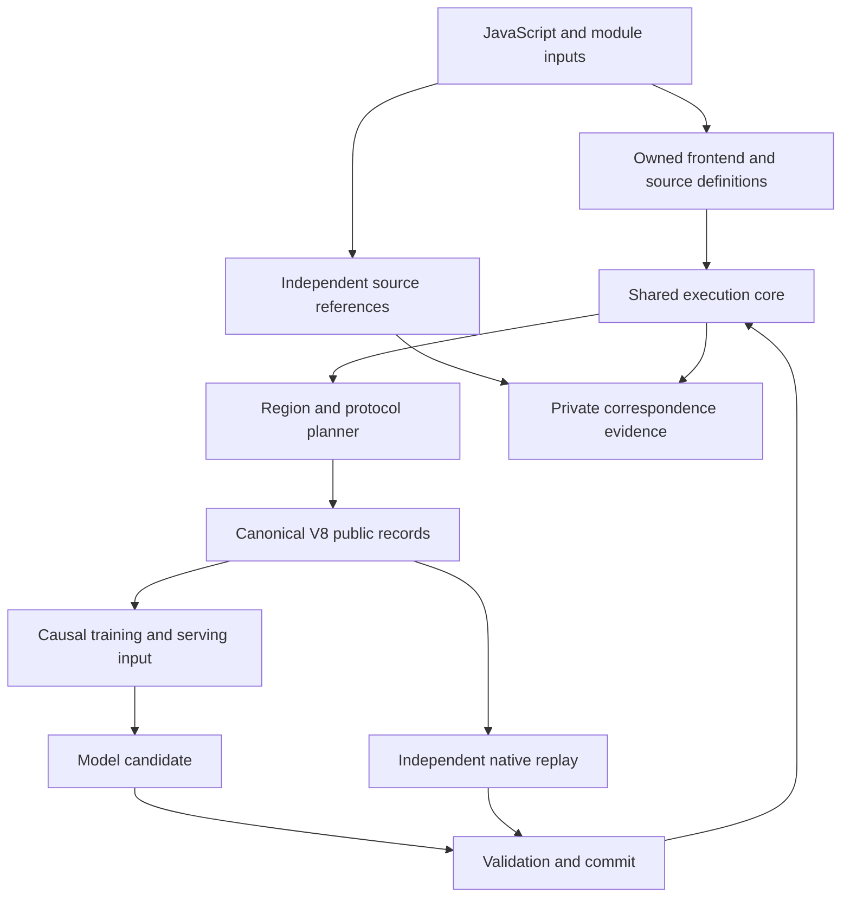

# Broad JavaScript Language Coverage and Complete V6 Cutover

## Design and implementation plan

**Prepared:** 20 November 2026, Europe/Berlin.  
**Status:** Proposed next program of work; this document does not claim that the expansion or cutover has already occurred.  
**Producer baseline:** `werg/tracing-js-self` at `4118412a854792e66f5385521f2fe236ef7b04fd`.  
**Native-consumer baseline:** `werg/megatoken` at `34cba28dc08d26c544ad4f0ed4bf338268b6f4f6`.  
**Measured semantic implementation:** producer `012c9fe49a082319bf98ac0c571596da925741a4` and consumer `39c4036564428e44cc89caf261f517d856482695`; later commits contain regression fixes, CI, documentation, and evidence.  
**Scope:** JavaScript semantics, the JavaScript reached through TypeScript and module adapters, the native consumer, training and serving, and retirement of active V6/V7 semantic-format dependencies.

All schedules, budgets, module boundaries, numerical acceptance targets, and new interfaces below are **proposals**. Existing behavior is identified as a baseline observation and linked to source. Existing receipts keep their original revisions. Proposed command or module names are not advertised as implemented APIs.

## Navigation

- [Starting point and evidence limits](#1-starting-point-and-evidence-limits)
- [Target and definitions of complete](#2-define-the-target-and-the-meaning-of-complete)
- [Target architecture](#3-target-architecture)
- [Language expansion workstreams](#4-language-expansion-workstreams)
- [Conformance and independent evidence](#5-conformance-independent-evidence-and-interaction-testing)
- [Data, ordinary training, and serving](#6-data-ordinary-training-and-serving-integration)
- [Learned execution and efficiency gates](#7-learned-execution-comprehension-and-efficiency-gates)
- [Complete V6 cutover runbook](#8-complete-v6-cutover-implementation-map-and-runbook)
- [Delivery plan and estimates](#9-delivery-plan-dependencies-and-reviewable-increments)
- [Risks and decisions](#10-risks-decisions-and-responses)
- [Final acceptance checklist](#11-final-acceptance-checklist)
- [Sources and maintenance](#12-sources-revision-discipline-and-document-maintenance)

## Executive recommendation

Build one version-neutral execution core, one V8 public execution contract, and one independent native implementation of that contract. Make compact operations, explicit protocol steps, and detailed execution different descriptions of the same resumable state. Expand the language by implementing general semantic mechanisms—references, coercion, calls, completion, cleanup, jobs, modules, and object internal methods—then derive compact descriptions from proved preconditions.

The current candidate is a substantial foundation, but it cannot become the complete replacement by changing a default constant. Its producer still wraps the V6 selected harness and witness representation; protocol execution cannot yet mix freely with host effects; the native V8 path still calls older validators; and ordinary native training has no complete V8 admission route. Those are architectural migration tasks, not documentation changes. [R3], [R4], [R5], [R6], [R7], [R8]

The program has three separately observable finish lines:

1. **Complete representation cutover:** every supported production route uses V8 from source admission through preparation, training, inference, checkpoint restoration, and release recovery. There is no active V6/V7 fallback or translation dependency.
2. **Broad language implementation:** a pinned ECMAScript edition has an explicit feature inventory and a complete execution route for each required feature, including difficult behavior now refused. Host facilities have separately declared contracts. The long-tail work is scheduled and owned rather than disappearing into an “unsupported” bucket.
3. **Qualified learned execution:** models trained and served through the ordinary pipeline meet independently scored usefulness, correctness, and cost gates on held-out programs. A representation can be technically migrated before this quality claim is earned; the project must not announce the entire program complete while this gate is still open.

The immediate sequence is: freeze the full denominator; remove structural V6 coupling; unify protocol and effect continuations; connect V8 to ordinary training and serving; expand semantics in dependency order; regenerate data and models; complete default-routing and legacy-removal code changes on the release branches; freeze and qualify that final pair; deploy it together; and prove that installed production paths work with legacy implementations absent.

## 1. Starting point and evidence limits

### 1.1 What is already delivered

The bounded candidate implements shared compact/detailed/protocol state, source checks, independent native admission, causal contexts, selected execution, and bounded model experiments. The final producer Node 20/22/24 matrix and all four native workflows passed. That is a valuable regression baseline, not proof of the broader language proposed here. [R1], [R2]

| Retained baseline | What it establishes | What it does not establish |
| --- | --- | --- |
| 665 expansion cases, 26 interoperability cases, 11 gallery cases | Every case in each declared population passed source qualification, native admission, exact token accounting, and physical packing. | Unrestricted ECMAScript coverage. The populations overlap and must not be added into a unique-case total. |
| 624 family executions, 208 equivalent-input checks, 52 distinguishing pairs | A concrete normalization and counterexample baseline. | Completeness of the semantic oracle or of the source language. |
| 27 selected real-source functions from a declared 78-function inventory | Qualification for those 27 functions. | Coverage of the other 51; they remain in the full real-source inventory and proposed expansion ledger, not in the measured 665-case population. |
| 37 dataset episodes, 1,021 examples, 33,850 generated tokens including EOS | Fresh split-bound admission and independently reproduced training data. | Broad data diversity or successful training. The two exports are the same 37 episodes. |
| 244 focused native V8 tests without skips | A strong bounded native regression gate. | A full language conformance result. |
| Earlier 256-step fit: 3/3 training-input completions, 0/3 separate-input completions; baseline 0/6 | A small in-sample feasibility result, revalidated at the current contract without new optimizer updates. | Generalization. Its historical 43 MB fitted archive is unavailable; retained-output audit is not repeated neural inference. |
| 228 declared comprehension tasks, no external-model responses | A prepared evaluation inventory. | Demonstrated reader comprehension or notation superiority. |

The expansion package currently spends approximately 86.58% of its generated tokens on detailed targets. The 90.21% historical flat-token reduction applies only to 42 matched source/input rows and mostly concerns submitted context. Neither figure should become a general efficiency claim. [R1], [R9]

The owned Test262 runtime slice is much smaller than the broader reference campaigns: eight files, six passing non-strict variants, two unsupported variants, and eight omitted strict variants. It uses a limited guest assertion harness rather than the full official harness. Building and qualifying the complete runner is therefore explicit implementation work. [R12]

### 1.2 Structural gaps to close first

| Observed gap | Consequence | Required design response |
| --- | --- | --- |
| `RegionExecutionHarness` wraps `SelectedExecutionHarness`; V8 compilation projects V6 witnesses, and detail uses the earlier detailed grammar. | V8 remains operationally dependent on older format machinery. | Extract reusable semantics into a neutral core; give V8 its own complete record, context, continuation, and admission contract. |
| Protocol selection requires a fresh invocation with no existing effects/callbacks; several host lifecycle operations refuse after protocol state exists. | Supported features cannot freely compose around requests, callbacks, or suspension. | One scheduler, continuation model, and obligation ledger across all record kinds. |
| The protocol source compiler rejects multiple complete adapter projectors and some undeclared effect/Promise/input combinations. | Runtime unification alone will not make the source teacher compositional. | A unified projection coordinator with event-level adapters, explicit transition ownership, and rejection of ambiguous or missing ownership. |
| Native V8 imports older scalar/detail helpers and renders some effects through V6; observed envelopes can be converted to V6 for validation. | Merely deleting the old CLI would leave live legacy dependencies. | Separate reusable value semantics from old wire validators; validate V8 directly. |
| V8 fitting and serving use dedicated scripts, while the normal training engine recognizes V7 and the older semantic experiment route. | A successful diagnostic does not qualify ordinary training, resume, export, and serving. | Integrate V8 admission and preparation into the standard data loader, training configuration, checkpoint, export, and serving route. |
| Source frontends, reference observers, modules, host payloads, and native replay have different bounds. | Parser acceptance or a successful runtime example can exaggerate end-to-end coverage. | One feature inventory with separate stage dispositions and exact profile requirements. |

These observations are grounded in the producer compiler/harness and native data/training sources, not inferred from filenames alone. Reuse a helper after removing its legacy contract dependency; a file containing `v7` in its historical name is not automatically defective, but renaming it alone is not migration. [R3], [R4], [R5], [R6], [R7], [R8]

## 2. Define the target and the meaning of complete

### 2.1 Standards and environment contract

Use the **ECMAScript 2026 edition** as the initial fixed language target, with an archived content hash and exact source/specification revision recorded during the first work package. Do not use the moving TC39 draft as a release target. Pin Test262 separately: its main branch can include proposals or later-edition tests, so classify each test against the selected language contract before freezing the denominator. [S1], [S2], [S3]

The feature inventory must cover lexical grammar and early errors, scripts and modules, strict and non-strict semantics, ordinary and exotic objects, functions and classes, standard built-ins, jobs and asynchronous control, dynamic source evaluation, weak references, and shared memory. Include every mandatory clause of the pinned edition in the long-term target. Decide normative-optional behavior clause by clause; implement the applicable Annex B web-legacy clauses as a named browser profile, with all behavior required by each selected clause.

Do not silently absorb unrelated host APIs into the language claim. Define these explicit environments:

| Environment | Included behavior | Qualification boundary |
| --- | --- | --- |
| Core ECMAScript | The pinned edition, its intrinsics, script/module execution, and required host hooks. | No arbitrary filesystem, network, DOM, or package access is implied. |
| Existing owned-service environment | Every service, callback, session, and graph-payload form currently supported by the production V6 path. | Full preservation is mandatory for the representation cutover. |
| Node integration profile | A pinned Node runtime and an enumerated first set of timers, events, buffers, streams, file/network adapters, and module-resolution behavior. | Add APIs by capability contract and tests, not by passing arbitrary native objects into the interpreter. |
| Browser integration profile | An enumerated DOM/event/fetch/timer/structured-clone subset, tested against the relevant web-platform suites. | Browser event-loop ordering and host-object behavior are specified independently of ECMAScript jobs. |
| Internationalization | A selected compatible ECMA-402 edition, locale/data versions, and ICU/time-zone dependencies. | Locale-sensitive outputs are pinned or checked against permitted results; environment differences are reported. |
| TypeScript input | A pinned compiler/options set and preserved original-to-generated source provenance. | Ownership and execution qualification apply to the emitted JavaScript; erased types do not prove runtime support. |

The first Node/browser API lists are selected from the frozen real-source refusal inventory. Later APIs remain named backlog entries with owners and acceptance conditions. The program does not claim that finite work implements every possible host library.

Centralize grammar configuration: the current strict frontend uses ES2022, region parsing uses 2026, some lowerers use `latest`, and TypeScript emits ES2022. The declared profile must control these choices consistently; syntax recognition and executable ownership remain separate checks. Iterator helpers belong in the 2026 inventory. Temporal and resource-management additions need separately pinned edition/extension decisions rather than being inferred from the moving draft or Test262 main. [R2], [S1], [S9]

### 2.2 Representation cutover acceptance

The V6 cutover is complete only when all of the following hold together:

- All default semantic-execution, selected-model, training, admission, and serving APIs/commands choose V8. Reusable owned-VM, archive, observational-trace, and independent-reference APIs retain their own explicit contracts.
- Every previously supported V6 production case executes through V8, including effects, retained callbacks, module/session boundaries, host data graphs, cancellation, and recovery. Compact eligibility may differ; correct detailed V8 execution is acceptable.
- Producer and native replay consume V8 records directly. No V6 witness encoder/decoder, V6 context envelope conversion, or V7 detail validator is needed on an active route.
- Normal training admission, data mixing, batch preparation, optimization, resume, evaluation, export, and serving accept and validate the same V8 contract. A standalone fitting script is insufficient.
- Active prepared datasets, native shards, source receipts, model bundles, and checkpoints are regenerated or explicitly requalified for the new contract. Incompatible historical artifacts fail clearly.
- Current release archives restore in a fresh environment without any legacy semantic package or compatibility shim.
- Production CI, smoke tests, documentation, and dependency checks reflect V8. Historical evidence retains its original name and meaning in an archive or Git history.
- A whole-release rollback has been rehearsed. It restores a mutually compatible producer, consumer, model, tokenizer, data, and policy set; it does not mix V6 and V8 within a running session.

The repositories are pre-release and explicitly permit direct changes to APIs and formats. No version bump, long deprecation period, automatic old-data migration, or compatibility shim is required. Contract digests and exact revision pins are still required for evidence and runtime compatibility. [R10]

### 2.3 Language coverage acceptance

Declare a profile complete only when every selected construct has an owned execution route, public meaning, independent native route, source correspondence, correct exceptional behavior, continuation/checkpoint behavior, and passing applicable tests. Replacing a required guest `TypeError` with “unsupported” does not count as language support.

Keep two milestones explicit: **broad practical coverage**, which removes the current major gaps and covers the frozen real-source inventory, and **edition-complete core implementation**, which closes every mandatory feature in the pinned specification inventory. Do not label the first milestone full ECMAScript conformance. Passing Test262 is necessary evidence but cannot prove completeness; its maintainers explicitly acknowledge omissions and possible test errors. [S2]

Maintain both the full edition target and a separately frozen intermediate release requirement set. The technical cutover must preserve every V6-supported production case and qualify its declared added features, but need not wait for the entire edition long tail. A `required_for_this_release` field does not remove an unsupported feature from the full edition ledger. Only the edition-completion milestone requires every mandatory edition obligation to be closed.

Resource bounds remain necessary. Replace small feature-specific limits where possible with documented execution budgets, resumable processing, and measured scaling. An exhausted time, memory, event, or trace budget is `resource_limited`, not a semantic refusal or a passing result. Infinite loops and intentionally pending programs need an explicit observation horizon rather than a fabricated terminal outcome.

## 3. Target architecture

### 3.1 Separate meaning, public representation, and evidence



The producer and native consumer have separate implementations and state instances. “Shared” means one semantic contract within each implementation, not a common evaluator that could reproduce the same bug in both. Source references and private expected outcomes never enter model prompts or generated targets.

The diagram combines two lanes. Source execution, teacher projection, and reference execution belong to offline admission/evaluation. Live serving uses published immutable definitions, committed public state, and original model candidates. It cannot invoke the teacher to construct, complete, or repair the next candidate. Native live validation checks its own candidate/prefix state; it does not receive an offline expected answer.

Extract the producer's reusable execution machinery from the older selected harness in small equivalence-preserving steps. Keep original behavior covered while moving state transitions to neutral modules. Then make V8 the direct client and retire older public clients. Do not build a second general interpreter solely to avoid old filenames, and do not wrap an opaque call to a native JavaScript engine as a supposedly explained computation.

### 3.2 One state model

The core state needs the following separately versioned-by-digest components:

| State component | Required content and invariant |
| --- | --- |
| Values and heap | Exact Number/BigInt/string/Symbol values; object identity; descriptors, prototype links, extensibility, internal slots, and private brands. Preserve holes versus `undefined`, negative zero, NaN behavior, and UTF-16 code-unit semantics. |
| Environments and references | Lexical and variable environments, initialized/uninitialized cells, captures, bindings, strictness, home object, `this`, `super`, `new.target`, and realm ownership. A reference is retained until the correct GetValue/PutValue operation. |
| Frames and continuations | Owned function/code identity, instruction/region boundary, live values, evaluated argument prefixes, pending result destination, and suspended protocol operation. Resume never repeats completed guest work. |
| Completion and cleanup | Normal/return/throw/break/continue completions, actual targets, nested finally handlers, iterator-close obligations, and any adopted resource-disposal work. Guest cleanup may override a pending completion according to the selected language semantics. |
| Jobs and agents | Ready and suspended jobs, Promise capabilities/reactions, async resumptions, per-agent ordering constraints, observed scheduling choices, and wake-up dependencies. |
| External work | Authorized requests, transport receipts, callback/subscription lifetimes, graph ownership transfers, cancellation state, and recovery obligations. |
| Modules and realms | Module records, dependency graph, live import/export cells, evaluation state, async dependencies, namespace identities, and realm-specific intrinsics. |
| Public history | Immutable committed prefix, exact context identity, current prediction boundary, acknowledged history, and a separate observation-ingestion cursor. |

Keep private source correspondence, reference outcomes, and normalization proofs separate from public state. Public liveness reduction must preserve everything needed by **all permitted continuations**, not only the continuation taken in one teacher run.

### 3.3 A uniform resumable-operation interface

Define an internal transition interface with outcomes such as `continue`, `invoke_guest`, `await_observation`, `enqueue_job`, `suspend`, and `complete`. These are proposed internal categories, not required model-visible keywords. Every abstract operation declares its inputs, side-effect boundaries, result destination, and completion behavior.

An object-to-primitive conversion, Proxy trap, iterator step, constructor initializer, Promise reaction, module evaluation, or host callback must use that interface. A hook may call another hook, throw, suspend where permitted, or modify shared state. Hard-coded assumptions that an entire protocol runs in one untouched invocation must disappear.

For example, converting an object during an array callback can invoke a getter, which calls a function, whose finally block closes an iterator. Each boundary preserves the caller's partially evaluated state and pending completion. Compact work before and after those calls remains possible without re-running the source or hiding the calls.

### 3.4 Transactional validation without changing JavaScript side effects

For each proposed public record, decode canonical bytes, validate identity and context, independently derive the permitted transition, stage the record's state changes, and commit the changes plus receipt together. A stale or malformed candidate leaves the previously committed state unchanged.

Do **not** treat a whole JavaScript operation as atomic when the language exposes partial effects. Array-length reduction can delete properties before failing; a getter can mutate state before throwing; iteration can publish work before cleanup. Represent those legitimate earlier effects as committed transitions and resume the operation with its pending exception. Never roll them back merely because a later compact claim failed.

External dispatch needs a durable outbox and operation identity. Within the owned ledger, dispatch is not duplicated. Across process crashes, exactly-once effects require an idempotent service or a durable service receipt; otherwise report an indeterminate outcome and stop unsafe automatic retries. A transport acknowledgement must not be confused with semantic acceptance or private source success.

### 3.5 V8 owns detail, contexts, and checkpoints

Define detailed V8 records as first-class members of the V8 contract, using neutral typed values and transition definitions. They must be adequate for every required source operation even when no compact transformation applies. Extract useful older validation code into neutral modules; do not call the V6 wire codec to manufacture receipts or parse V7 detail under a new label.

Keep one canonical spelling per contract digest. Canonical decoding rejects duplicate keys, malformed UTF-8, noncanonical numbers, missing fields, unknown fields, and unbound identities. Schema acceptance does not imply semantic truth. Identity-preserving allocation, reference resolution, scheduling, and observable operations still require independent validation.

Checkpoint restoration must reconstruct or verify the complete live continuation, including in-progress abstract operations, jobs, retained callbacks, module evaluation, weak-reference constraints, and external obligations. Test a checkpoint at every newly introduced suspension boundary. Neither restored source nor a replay-based facade may repeat already performed external work.

### 3.6 Preserve compactness as an optimization

Compact eligibility is a checked predicate over immutable source definitions and committed state. Establish guards without invoking guest getters, Proxy traps, or coercion hooks. A failed guard selects detailed V8 before the affected work commits. Once side effects occur, resume from the precise detailed/protocol continuation.

Prefer ordered operations such as map, filter, search, fold, scan, grouping, copying, and typed memory operations with explicit traversal and callback meaning. Sparse arrays, accessors, custom iterators, species constructors, mutation during traversal, and callbacks require the corresponding semantic boundaries. Never reassociate Number arithmetic or equate hole-skipping with dense traversal to obtain a shorter target.

Measure compact-region coverage, complete-episode coverage, and detailed-token share separately. Large counts of trivial compact additions do not compensate for expensive unmodeled callbacks. Use demand from real refusals and detailed-token attribution to rank subsequent optimizations after correctness is established.

### 3.7 Correspondence for alternative lawful decompositions

The current source scorer conservatively qualifies exact certified public/context projections. Preserve that score, but add a separately validated correspondence check before using alternative decompositions in model comparisons. It should relate source control points, observable transitions, rooted object identities, live cells, and permitted future continuations. It must distinguish equivalent detail/compact boundaries from omitted effects or a different program that happens to return the same value. [R13]

Begin with a canonical projection for every feature. Extend accepted alternatives only when a local refinement check proves they simulate the same source-derived operation and preserve its continuation obligations. Apply identical semantic scoring criteria to V6 and V8 comparison arms. Keep `publicly_complete`, `source_qualified`, `unqualified_projection`, and `semantically_wrong` as different outcomes. A legal-looking but unscored alternative is not silently promoted to success or treated as proof of a semantic bug.

## 4. Language expansion workstreams

The order below follows shared semantic dependencies. Several workstreams can run concurrently after the execution-state foundation is stable. Every row is an end-to-end task: frontend, owned execution, public transitions, source evidence, native implementation, checkpointing, training admission, and tests. A builtin present in the owned runtime is not automatically qualified at every later layer.

| Workstream | Current boundary to remove | Required expansion | Dependencies |
| --- | --- | --- | --- |
| References, bindings, and control | Bounded local blocks; flat iterable declarations; incomplete early-error and general pattern coverage. | Full reference evaluation, declaration/assignment/parameter patterns, lexical environments, strict/non-strict execution, labels, abrupt completion, recursion, and generic calls. | Shared state and native detail contract. |
| Coercion and ordinary objects | Direct Number conversion and bounded descriptors; several intrinsic errors and hook paths refuse. | General conversion operations, descriptor validation, property keys, exotic error paths, array-length partial failure, dynamic prototype behavior, and observable enumeration. | References and resumable calls. |
| Functions, construction, and Proxy | Qualified class/private slice and ordinary data get/set Proxy slice. | Full function/constructor behavior, private accessors, super references, bound functions, all Proxy internal methods, revocation, invariants, and error continuations. | General objects, references, completion. |
| Collections and builtin algorithms | Dense bounded pure traversal and selected builtin profiles. | Sparse/generic/effectful traversal, mutating arrays, Map/Set/weak collections, string/number/BigInt/Math/JSON/Date/Error families, and edition-selected additions. | Coercion, object methods, calls. |
| Iteration, generators, and cleanup | Flat patterns, bounded custom `for…of`, qualified synchronous generators. | General destructuring/spread, arbitrary iterator results, custom delegation, re-entrancy errors, async iteration/generators, and disposal if included by the selected edition. | Calls, completion, async jobs. |
| Promises and asynchronous jobs | Scalar resolution, bounded joins, no general adoption/thenables/normal finally. | Resolution procedure, assimilation, capabilities, reactions, combinators, subclass/species behavior, async functions, precise cleanup jobs, and host interaction. | Unified scheduler and protocol/effect composition. |
| Modules and TypeScript | Live cells, synchronous cycles, acyclic top-level await; limited returned graphs. | Real module records, async dependency cycles, dynamic import, namespaces, import errors, persistent sessions, host resolution, and broad emitted-JS qualification. | Environments, jobs, realms, graph bridge. |
| Text, binary data, and numeric edge behavior | Limited RegExp profiles and 1,024-byte binary profile. | Full selected-edition RegExp behavior, string hooks, typed-array species and coercion, resizable/detached/transferred storage, and scalable bounds. | General objects and coercion. |
| Dynamic code and realms | Dynamic evaluation is outside the current candidate. | Direct/indirect eval, Function-family constructors, code provenance, runtime declarations, realm-specific intrinsics, and selected Annex B behavior. | Mature frontend, environments, source publication. |
| Weak references and shared memory | GC observability and cross-agent scheduling are outside the current candidate. | Weak reachability constraints, finalization jobs, agent-cluster state, atomic/wait operations, and memory-event validation. | Scheduler, object identities, explicit nondeterminism. |
| Host and application integration | Restricted graph payloads, callbacks, module/session facades, DOM/native APIs. | End-to-end owned graphs and capabilities; qualified Node/browser profiles; durable sessions, streaming, cancellation, and recovery. | The shared transition interface; exact per-host contracts. |

The baseline profile matrix provides the exact existing restrictions. The work below expands them rather than relabeling them. [R2]

### 4.1 References, environments, patterns, and control flow

**Design.** Represent an evaluated reference independently of the value obtained from it. Preserve base identity, property key, strictness, receiver, and the appropriate environment or home-object relation. Evaluate left-hand sides, computed keys, defaults, argument lists, and writes in their specified order. Use environment records and cells to model temporal dead zones, lexical shadowing, per-iteration bindings, closure capture, and global/script/module distinctions.

Unify and qualify the existing bounded implementations of nested declaration/assignment/parameter/catch patterns, rest, computed keys, loops, switch, labels, recursion, and ordinary/arrow functions through direct V8 source/public/native execution. Complete the refused forms and interactions using the common iterator/property/call machinery. Implement missing general reference operations, argument/global-environment behavior, and non-strict semantics. Cover the selected edition's tail-position requirements as well as bounded recursion. Audit parser early errors separately from runtime exceptions.

**Acceptance examples.** A computed property key mutates the right-hand object before a subsequent read; a default closes its iterator after throwing; destructuring assignment targets a setter; a closure captures a different lexical cell on each loop iteration; a finally block overrides a labeled break; a parameter initializer observes a temporal dead zone; a recursive function checkpoints during a callback and resumes without repeating earlier work.

**Completion gate.** Every declared pattern/control variant has positive, exceptional, aliasing, and resumed tests in JS and Python. Unsupported syntax is still reported in the full inventory until its implementation is qualified. No generic “evaluate source” public record substitutes for the missing transitions.

### 4.2 General conversion and object semantics

**Design.** Centralize independently implemented abstract operations for primitive conversion, property keys, numeric/string conversion, equality, comparison, property descriptors, and ordinary object internal methods. Preserve lazy hook lookup, receiver identity, fallback order, and exceptions. Python implementation must explicitly model JS types; Python truthiness, integer arithmetic, Unicode length, dictionary ordering, and float rendering are not substitutes.

Extend descriptor handling, prototype changes, nonextensibility, accessors, deletion, own-key ordering, integer-index treatment, and ordinary enumeration under mutation. Array length changes must preserve partial deletions before an error. Model conversion through Symbols, `valueOf`, `toString`, and nested hooks wherever the language requires it, not only direct `Number(...)` calls.

**Acceptance examples.** Hook lookup throws before the fallback method is consulted; a conversion returns an object and triggers the required error; string and numeric property keys alias correctly; a setter receives a derived receiver; changing a prototype during enumeration affects only behavior permitted by the specification; shortening an array encounters a nonconfigurable index; Number and BigInt mixed operations take the correct path.

**Completion gate.** Independently computed descriptor/heap deltas, hook-call order, and surviving completion agree at every boundary. An intrinsic guest exception is represented as execution, not rejected as an unknown protocol shape.

### 4.3 Function objects, classes, construction, and full Proxy behavior

**Design.** Make callability and constructability explicit capabilities of an owned object. Support normal/arrow/bound/generator/async function distinctions, home objects, `this`, `new.target`, super-property references, field initialization, private accessors, brand checks, and constructor return behavior. Tie intrinsic prototypes and constructors to realms.

Implement the Proxy internal-method family using a common trap lookup/invocation/invariant-check pattern. Cover prototype queries/changes, extensibility, own keys, descriptors, define/delete/has/get/set, calls, construction, and revocation. Re-read live handler and target state at the correct boundaries. Retain the target invariants even when a trap returns a plausible result.

**Acceptance examples.** A revoked Proxy throws after restoration; a Proxy trap mutates the target before invariant validation; `Reflect` forwarding preserves a receiver; a bound constructor preserves new-target behavior; a derived constructor returns a primitive at an invalid point; a private accessor throws while a surrounding finally changes state; an array Proxy changes a traversal's length or property set.

**Completion gate.** Every supported internal method has normal, invariant-failure, trap-throw, nested-call, and checkpoint tests. The source observer must inspect owned metadata without accidentally executing user accessors merely to gather evidence.

### 4.4 Arrays, collections, and standard built-ins

**Design.** Implement builtin algorithms as resumable owned operations. Preserve each algorithm's traversal direction, length snapshot/live-length rules, hole treatment, callback receiver, species/constructor behavior, and mutation visibility. Add generic array-like receivers, effectful callbacks, sort comparison, copying and splicing, and alias-preserving result allocation.

Extend Map/Set and weak collections with key identity, equality rules, insertion/deletion order, live iterators, and mutation during callbacks. Build out Object/Reflect, Boolean/Number/BigInt/String/Symbol, Math, JSON, Date, Error/AggregateError, and the selected edition's remaining standard families. Generate the exact builtin checklist from the pinned specification; do not assume a proposal is standardized because an engine or Test262 supports it.

Date/time, random state, locale data, and implementation-approximated numeric functions need declared environment inputs or permitted-result checks. Pure deterministic semantics remain independently checked computations. JSON revivers/replacers and stringification hooks must preserve guest calls and property order. Foreign libraries must enter through qualified host adapters, not masquerade as owned built-ins.

**Acceptance examples.** Sparse `map` differs from a dense loop; `reduce` finds the correct initial element; sort comparison mutates an array and throws; a species constructor returns an unusual object; Map deletion/reinsertion changes an active iterator; JSON invokes getters and `toJSON` in the required order; string indexing and iteration differ for surrogate pairs.

**Completion gate.** All applicable builtin Test262 variants pass, effectful callback traces have independent ordering evidence, and compact rewrites pass executed distinguishing pairs. Expand configured size budgets and test near/at/over-limit cases without silently truncating input.

### 4.5 Iterators, generators, binding, and disposal

**Design.** Use one iterator record and close protocol for `for…of`, spread, patterns, builtin consumers, and delegation. Track acquisition, cached methods where required, receiver, completion, result-object checks, and whether closing is still owed. Implement malformed result and noncallable method behavior as language exceptions.

Generalize generator continuations to parameter evaluation, custom `yield*` delegation, missing throw/return paths, re-entrancy checks, and nested loop cleanup. Add async-from-sync iteration, `for await…of`, async generator request queues, and awaited closing. If resource management is present in the chosen edition or an explicitly adopted extension, implement it on the same cleanup framework with distinct synchronous/asynchronous disposal and error-combination rules; otherwise keep it in the named next-edition backlog.

**Acceptance examples.** `return` is replaced while iteration is active; delegation lacks `throw`; a synchronous generator yields from finally while processing return; an async iterator's close rejects; a destructuring binding default in an async function body awaits and then throws; nested labeled control closes only the iterators it actually exits; a suspended generator is restored with an outstanding cleanup obligation.

**Completion gate.** Checkpoints at every yield/await/close boundary produce the same permitted future behavior and no duplicate call. The scheduler and iterator consumer agree on whether a result is an owned computation, an asynchronous job, or an external observation.

### 4.6 Promises, async functions, and scheduling

**Design.** Implement Promise resolution, adoption, thenable assimilation, reaction jobs, resolving functions, self-resolution, rejection propagation, and cleanup jobs as explicit owned transitions. Reading `then` may itself invoke guest code; a callable thenable introduces its own work and settlement authority. Preserve first-call behavior without collapsing distinct jobs into an instantaneous assignment.

Complete `then`, `catch`, `finally`, `all`, `race`, `allSettled`, `any`, subclass/species behavior, and edition-selected APIs. Async functions and async generators reuse the same job and continuation model. Host requests, timers, microtasks, and retained callbacks need explicit scheduling constraints; Node and browser queue rules are environment-specific, not assumed to be one universal FIFO. [S4], [S7], [S8]

**Acceptance examples.** A then getter throws; a thenable invokes both resolving functions and throws; a Promise resolves to itself; adoption interleaves with an already queued microtask; a `finally` callback returns a Promise or primitive and still preserves the required jobs; concurrent joins receive duplicate/late settlements; an external graph result contains a callable `then`; an abort races with callback delivery.

**Completion gate.** Adversarial traces cover all settlement owners and scheduling boundaries, with exact ready/running/waiting state. The native consumer and source execution agree on allowed event order and surviving completion. Unhandled-rejection reporting is a named host policy; it must not be confused with the Promise's semantic state.

### 4.7 Modules, persistent sessions, and TypeScript

**Design.** Replace unsupported corners of source flattening with explicit module records and environment cells. Model linking, import resolution, initialization, evaluation, namespaces, errors, async dependencies, and top-level-await cycles. A dynamic import is a host resolution operation followed by owned module work; it does not authorize arbitrary filesystem or package access.

Provide persistent session checkpoints with live module state, exported closures, namespace receivers, retained host capabilities, and pending evaluation. Test restored sessions by continuing real work rather than replaying an old final result. Preserve original source, compiler version/options, emitted JavaScript, source maps, dependency graph, and transformation lineage for TypeScript. Include runtime-emitting features, not only erased annotations.

**Acceptance examples.** A synchronous cycle reads an uninitialized import; an async cycle remains pending or fails as specified; dynamic imports share module identity; namespace descriptors remain correct; an exported function retains mutated cells across calls and restore; a module error prevents dependent evaluation; an input graph contains aliases shared with an exported result.

**Completion gate.** Host Node/V8 module execution is an independent source reference, never the owned implementation. The independent Python consumer implements and validates the declared module transitions. All selected host resolution behavior is pinned. Source maps establish provenance but are not accepted as proof of semantics. The current 78-function and module inventories keep every refusal until the new route actually qualifies it. [R11]

### 4.8 Text processing and binary memory

**Design.** Generalize RegExp construction and execution, flags, captures, Unicode semantics, replacement/split/match/search hooks, stateful `lastIndex`, and subclass/override behavior according to the pinned edition. Keep a clear boundary between an owned algorithm and a third-party/native implementation whose behavior must be independently qualified. Avoid opaque delegation presented as an explained result.

Expand ArrayBuffer/SharedArrayBuffer, typed arrays, and DataView to constructor/coercion variants, views and aliases, resizing, detachment, transfer, out-of-bounds transitions, species, and overlapping copies. Replace the current small buffer profile with explicit scalable memory/trace budgets. Host buffer bridges must define copies versus shared backing storage.

**Acceptance examples.** A conversion detaches a buffer between validation and access; resize invalidates a length-tracking view; overlapping copies preserve the required order; BigInt and Number typed arrays reject invalid conversions; a RegExp replacement callback changes `lastIndex`; malformed or isolated surrogates retain exact JS string semantics.

**Completion gate.** Cross-language byte and numeric behavior agrees independently. Tests cover boundary sizes, endian behavior, aliasing, detachment during hooks, and failure after partial effects. Shared-memory concurrency belongs to the next workstream rather than being inferred from single-agent atomic tests.

### 4.9 Dynamic evaluation, realm boundaries, and optional legacy behavior

**Design.** Make dynamic code explicit source publication: exact bytes, creation site, code kind, strictness, realm, lexical access, and dependency identity are recorded before generated claims refer to the new code. Direct eval uses the proper lexical context; indirect eval and Function-family construction use their defined environments. Do not execute model-generated source merely because it parses; dynamic source must arise from already authorized owned execution or an observed input capability.

Handle runtime declaration effects, syntax/early errors, function-source inspection, realm-specific intrinsics, cross-realm constructors, and adopted Annex B clauses. Separate the trusted implementation of parsing/compilation from the model's claims about execution. Source publication costs count in the actual prompt and context budget.

**Acceptance examples.** Direct and indirect eval observe different bindings; strict eval does not leak a declaration; constructed functions do not capture the caller's lexical variables; a dynamic parse error is caught by the surrounding program; cross-realm instanceof/Array checks use the correct identities; a restored session retains its published dynamic code without reexecuting it.

**Completion gate.** Dynamic programs retain complete source provenance, independent execution, native replay, causal publication, and resource accounting. A policy that excludes dynamic code can remain a named application profile, but it does not satisfy the edition-complete core milestone.

### 4.10 Weak references, finalization, agents, and the memory model

**Design.** Add weak-reference and finalization state without pretending that garbage collection occurs at a deterministic source location. Keep strong/weak reachability, kept-alive constraints, registered holdings, unregister tokens, and cleanup-job eligibility explicit. A collector decision may be recorded as a permitted environmental choice, but the consumer must validate the resulting constraints; the model cannot invent an illegal reclamation. Tests cannot demand that collection or cleanup happen by an arbitrary wall-clock deadline. [S5]

For shared memory, model agent clusters, shared data blocks, agent events, atomic order, reads-from choices, waits, notifications, and host synchronization. Use a bounded memory-event validator/model checker for traces and litmus tests. Simple sequential interleavings are useful for an initial data-race-free profile, but are not a complete oracle for race-containing observations from other implementations. Every produced execution must satisfy the specification's allowed relations and declared progress requirements; an implementation need not produce every permitted outcome. Record exploration coverage separately. [S6]

**Acceptance examples.** A weak target remains alive for the required execution interval; unregister prevents an eligible finalization callback; finalization re-enters owned code; one agent waits while another notifies; a buffer is shared across restored sessions; valid race outcomes are accepted and forbidden outcomes rejected; cancellation leaves no waiting host worker.

**Completion gate.** Distinguish deterministic replay of one recorded execution from coverage of all permitted outcomes. Publish explored bounds and schedule counts. Do not claim full weak-reference or memory-model qualification from a single deterministic scheduler, forced-GC example, or ordinary atomic operation.

### 4.11 Host graphs, applications, and long-lived sessions

**Design.** Complete the owned-graph request and result path end to end: aliases, cycles, holes, Symbols, descriptors, captured owned callables, and supported capabilities must survive serialization according to an explicit ownership policy. Opaque native handles are capabilities with allowed operations and lifetimes, not arbitrary public object graphs.

Bring all existing V6 host services and session APIs onto the common V8 transition engine. Then add the chosen Node/browser contracts, structured cloning, streaming/backpressure, timers, subscriptions, and cancellation. Browser tasks and microtasks, and Node's event-loop behavior, have separate reference harnesses. A full DOM is not a prerequisite for the core-language cutover, but the selected application profile must state exactly what is missing. [S7], [S8]

**Acceptance examples.** A request sends the same object twice; a callback returns a graph sharing an existing owned object; two subscriptions capture the same cell; cancellation races with a stream chunk; a process crashes after dispatch but before acknowledgement; an adapter restarts without duplicating a non-idempotent write; a module session invokes an exported function after restoration.

**Completion gate.** Every former V6 production service works through V8 with exact payload and lifecycle parity. Independent admission, replay, native serving, and release restoration must execute those paths with real adapters, not only fixture-injected completions.

### 4.12 New editions and standardized additions

Maintain a separate, explicit work queue for changes after the fixed 2026 baseline. Initially inventory Temporal, synchronous/asynchronous resource management, and other adopted additions against their own exact specifications. Give each the same frontend-to-native acceptance contract as a core workstream. Temporal needs calendar/time-zone data and arithmetic qualification; disposal needs cleanup ordering, async completion, and error-combination support. Do not infer either from a host tool's use of a similarly named API.

Track feature proposal status independently of implementation readiness. A feature may be available experimentally without becoming part of the release's conformance claim. Moving to a new edition requires a new inventory and measured delta; it does not require an unnecessary compatibility framework during pre-release development.

## 5. Conformance, independent evidence, and interaction testing

### 5.1 One machine-readable coverage ledger

Create a scope manifest that binds the specification snapshot, Test262 revision, source/consumer revisions, contract digests, parser/compiler versions, host profiles, Unicode/locale/time-zone data, tokenizer and codec identities, and resource policies. Each feature maps to its normative obligation, implementation owner, affected source paths, tests, evidence, and current limits.

Track stages separately: parsing/early errors; owned execution; independent outcome and intermediate checks; public detailed/protocol execution; compact recognition; native replay; checkpoint restoration; dataset export; ordinary training; serving; and learned usefulness. Status values are `passed`, `failed`, `unsupported`, `resource_limited`, `infrastructure_error`, and `unrun`. A source feature accepted by a parser must not inherit green cells in later stages.

For Test262, freeze runnable variants before selecting work. Variant identity includes test bytes, mode, module dependencies, harness files, edition classification, and host configuration. Reconcile these totals on every run:

```text
catalog = in_profile + outside_profile
in_profile = passed + failed + unsupported + resource_limited
             + infrastructure_error + unrun
```

An implementation gap in a required feature remains `unsupported` inside the denominator. `outside_profile` requires an explicit reason such as a post-edition feature or a deliberately unselected host contract; it cannot be used to hide a failing implementation. Publish counts per feature, semantic operation, strictness, module mode, positive/negative test, and asynchronous/agent configuration as well as the aggregate.

### 5.2 Qualify the runner itself

Implement the official Test262 interpretation rules: fresh realms; required harness files and includes; mode-dependent strictness; unmodified raw tests; module dependencies; expected error phase/type; asynchronous completion; and required host bindings. Exclude fixture files from the standalone-test count. Keep nondeterministic tests identified so a pass without exercising a conditional assertion does not imply that branch was covered. [S3]

Runner qualification must deliberately detect skipped assertions, a polluted reused realm, omitted includes, an error thrown in the wrong phase, premature async completion, duplicate/missing completion, and modification of raw source. Compare the original unmodified source with any instrumented reference before using instrumentation as evidence. Broad host-engine reference runs remain distinct from execution in the owned implementation.

Use dependency-selected shards for ordinary changes and the complete pinned applicable inventory for release qualification. Resume only with identical code, harness, manifest, and resource settings. Preserve each initial failure and its retry; a passing retry does not erase instability.

### 5.3 Independent authorities

Use complementary checks: original-source reference execution; validated reference instrumentation; independently derived intermediate claims; JS/public/Python state agreement; cross-engine differential execution where applicable; and specification adjudication of disagreements. Do not use an engine majority vote as the final authority.

Compare rooted identity graphs, descriptors, prototypes, sparse structure, property order, captures, receivers, calls, exceptions, cleanup, effects, and continuations—not just serialized return values. Gather private observations without introducing extra user-visible calls. In particular, an observer must not call a getter or Proxy trap just to inspect its alleged state.

The teacher's own claimed operands or answers must not be the sole inputs used to verify those claims. Maintain an authority matrix explaining which independent observation or semantic rule challenges each public record family.

### 5.4 Generated, metamorphic, and adversarial tests

Generate programs with recorded preconditions and bounded sizes. Transformations may include safe alpha-renaming, equivalent loop forms, alternate compact/detail decompositions, and changed physical fragmentation. Every transformation needs executed counterexamples at its eligibility boundary. Avoid unsafe algebraic rewrites, effect reordering, hole/undefined conflation, or renaming through direct eval.

Mutate results, writes, receivers, completion targets, resolver ownership, job order, checkpoint cells, observation authority, masks, and source certificates. Require the intended validator to reject the mutation for the intended reason, rather than passing because an unrelated parse error happened first.

For each new resumable operation, checkpoint before and after every boundary, restore, then explore the same permitted future operations. Compare complete future behavior and resource ownership under identical recorded external choices, or against the appropriate allowed-outcome relation for independently scheduled executions. This catches hidden-state mismatches that equal immediate outputs miss without inventing determinism.

### 5.5 Composition is a first-class denominator

Maintain a versioned interaction matrix. Minimum required combinations include:

- Getter or Proxy trap → coercion → callback → finally.
- Array callback → sparse/inherited property → mutation → throw.
- Nested binding default → custom iterator → early close → overridden completion.
- Synchronous generator delegation → iterator close → finally that yields; separately, async generator cleanup that awaits.
- Promise assimilation → competing microtask → host delivery → cancellation.
- Class initializer/private accessor → Proxy receiver → abrupt construction.
- Module cycle/top-level await → live binding → retained exported callback.
- Binary conversion → resize/detach → access through an existing alias.
- Dynamic eval → lexical capture → checkpoint → later invocation.
- Multi-agent wait/notify or finalization → host callback → restoration.
- Promise work → Proxy/iterator/class operation → host observation in one episode, with every participating source projector/observer and native continuation checked.

Use risk-based three-way and deeper combinations in addition to pairwise coverage. Publish the selected combinations and omissions. Reentrant callbacks must be tested at depths beyond one; never-called and repeatedly-called callbacks must be represented where the API permits them.

### 5.6 Operational gate

Require all applicable release tests to pass, zero observed accepted false claims, no silent corpus drops, and zero leaked owned resources in the declared lifecycle campaign. Provision required native/model/OS assets in a dedicated release environment so required gates cannot pass by skipping. Hardware-specific checks may be outside a declared deployment profile, but are not reported as executed successes.

Suggested campaign planning budgets are at least 100,000 generated semantic cases across the expansion program and 10,000 targeted claim/state mutations, with recorded seeds and reduced reproducers. These are proposed workload budgets, not proof thresholds; actual release confidence comes from coverage, independent oracles, and observed outcomes. Scale budgets after measuring runtime and identifying which transitions they exercise.

## 6. Data, ordinary training, and serving integration

### 6.1 Rebuild the data supply around final admission

Start from original source and input/environment declarations. Compile and source-check directly into V8; freeze global family/component membership; then perform fresh native admission on the final split-bound artifacts. Only after that should the ordinary preparation route produce training shards. Renaming a V6 file or changing its schema label is not conversion.

Expand beyond the current 37 episodes using both standards-derived programs and real application code with reproducible entry points, inputs, dependencies, and host behavior. Retain the full 78-function real-source inventory immediately, including the 51 not qualified by the current population. Add new projects and versions using a frozen acquisition policy, with source provenance, licenses, and executable harnesses. Do not select the final evaluation population only from cases that already compile.

Build connected components before splitting, using project/version lineage, copied/forked source, transpilation/minification, normalized algorithm families, generated variants, mutations, and alternative inputs/schedules for the same program. Keep related positive and negative cases together. Do not split a large connected component to manufacture attractive train/test percentages.

Report input holdout, new-program holdout, new-family holdout, and new-project/time holdout separately. Public benchmark exposure in model pretraining may be unknown; disclose that limitation and include privately frozen compositional evaluation cases. Keep pilot/tuning examples out of confirmatory evaluation.

### 6.2 One strict admission policy in the normal trainer

Replace the semantic stream's older preparation route and configuration with a V8 policy that binds:

- Source and dependency identities, source-check evidence, producer and native revisions.
- Exact public records, reconstructed contexts, native receipt, and continuation rules.
- Family/component registry, split membership, and transform lineage.
- Tokenizer bytes, codec implementation, special/control-token mapping, and physical packing settings.
- Observed/generated/EOS/padding masks, complete-example boundaries, and prepared-data digest.
- Model architecture/geometry and the training/serving interpretation of every control field.

Validate the prepared manifest before allocating model/optimizer resources, and validate semantic batch annotations at entry. Reject missing, old, unknown, or conflicting semantic schemas. Do not set a generic `verified_success` flag to bypass missing V8 admission; that flag must be derived from the required checks and bound evidence.

The current diagnostic fitter marks prepared supervision as a successful externally tested episode to enter the generic training path. Do not carry that override into production admission or interpret it as learned model success. Give source-admitted target eligibility and measured model-execution outcome separate evidence fields. Generic `allow_unverified_data` must not bypass the V8 policy, receipt, or split checks. [R15]

Route the existing semantic training stages through this policy and update their example configurations and supply checks. Preserve unrelated multimodal formats and model-architecture versioning. This plan retires legacy **semantic** V6/V7 routes, not every unrelated version number in the native repository. [R6], [R7], [R14]

### 6.3 Preserve exact causal supervision

For every example, reconstruct the exact bytes and controls used in serving. Prompt/observation tokens are not prediction targets; generated records and their declared terminal tokens are. Retain masks over the actual physical encoding, not just the logical JSON. Decode original tokens back to bytes and verify reconstruction.

Perturb future observations and require all earlier model-visible prefixes and targets to remain unchanged. Prevent private source receipts, future replies, expected outputs, and reference traces from entering prompts. Check context overflow and every supported fragment boundary, including partial UTF-8 and split record boundaries where the physical protocol permits them.

Compare training and serving states at the same boundary: visible bytes, routing, control IDs, masks, cache interpretation, current continuation, and generated-history ownership. Reject a mismatch before treating a failed generation as an optimization problem.

### 6.4 Use the ordinary model lifecycle

Run preparation → normal training loader → actual optimizer update → checkpoint → resume → export → reload → selected execution through the supported commands. Retain parameter-change checks, optimizer-step counts, learning-rate state, random state, decoder controls, and native acknowledgement evidence. The existing bounded fit script remains a diagnostic, not the only proof that V8 can train.

Bind the V8 policy and registry digest in checkpoint critical configuration and check them on ordinary resume, stage transitions, distributed-training initialization/coordination/export, and readiness checks. Missing or stale policy fails closed. A successful first load does not qualify a later resume with different data or controls.

The canonical selected service should use V8's staged-candidate and acknowledgement behavior. Consolidate the older selected-serving route and update producer callers, orchestration, runtime context registration, request dispatch, and lifecycle collection together. Admit model bundles by exact contract/codec/model identities; do not auto-detect an old format and silently switch adapters.

Making the wire interface and admission route canonical does not enable learned execution by default. Until section 7 passes, model selection remains explicitly experimental or disabled; owned execution and controlled selections remain labeled data/engineering paths. They must not repair or replace outputs inside a purported learned evaluation.

Add **live serving-session restoration**, separately from model training checkpoints. The current V8 service has no dedicated checkpoint/restore operations, while the older selected service has them. Implement a session checkpoint or a fully verified reconstruction from acknowledged public history, including model/cache state or an equivalent reconstruction, random/counter state, budgets already consumed, retained callbacks, child invocations, and pending obligations. Restore in a fresh process and continue through real work without redispatch. Unacknowledged candidates stay in attempt evidence but never become accepted restored history. [R16]

Do not retire V6 lifecycle entry points until their retained callbacks, multiple turns, child work, request dispatch, cancellation, and crash recovery have passing end-to-end V8 replacements. Temporary development coexistence is removed before the final cutover gate; missing replacement behavior is not solved by disabling the old route.

Require complete downloadable bundles for every published model-quality claim: weights, model configuration, tokenizer/codec identities, optimizer/resume state when claimed, transducer or other required model state, and serving metadata. Test reload from those retained bytes in a fresh environment. Missing historical weights remain a disclosed gap; create new reproducible experiments instead of claiming to reproduce that unavailable archive.

### 6.5 Data release reproducibility

Independently reproduce the final corpus and compare canonical examples, source/native receipts, split membership, masks, and physical packing. Execution timestamps may differ; semantic and training content must have a declared equivalence rule and checksum manifest. Retain original failures, complete logs, and all exported records. A verifier that only checks hashes establishes integrity, not a fresh semantic run.

## 7. Learned execution, comprehension, and efficiency gates

### 7.1 Separate four questions

| Experiment | Hold fixed | Vary | Main question |
| --- | --- | --- | --- |
| Notation comprehension | Semantics and public information | Formal, hybrid, or prose presentation | Can a model correctly interpret the same meaning? |
| Granularity | Notation and semantic task | Detailed, moderate-region, larger certified-region descriptions | Which abstraction level preserves understanding efficiently? |
| Learned execution | Frozen source tasks, environment, budgets, scoring | Complete V6 versus V8 pipeline on their common supported domain | Does V8 complete the same work at least as reliably? |
| Expanded-domain usefulness | Frozen new-feature tasks and budgets | Model/checkpoint or training ablations | Can the new language coverage be used successfully where V6 had no qualified route? |

Measure serving efficiency only after the relevant usefulness gate passes. Compare matched training compute as the primary controlled condition and matched semantic examples as a secondary condition. Equal optimizer updates can contain unequal tokens and computation.

Freeze the shared-support comparison population from the declared release contract and V6 baseline **before screening V8**. A V8 refusal or admission failure on a V6-qualified task remains an unsuccessful outcome in that population. Newly supported tasks belong to the separate expanded-domain experiment.

### 7.2 Predeclare the experiment

Freeze source-component splits, task/seed inventory, checkpoint selection, model and tokenizer identities, prompts, decoding settings, inference effort, retries, context limits, hardware/load policy, scoring, and analysis. Counterbalance presentation/order for notation tasks. Use a separate pilot to estimate variance, paired discordance, cluster dependence, and sample size before opening the final holdout.

The independent unit is the source-lineage/program component. Inputs, syntax variants, host schedules, and decoding seeds within a component are correlated observations. Report cluster-aware intervals, per-family results, and a deployment-weighted aggregate. Do not count thousands of variants of one algorithm as thousands of independent generalization successes.

A fixed-checkpoint result is conditional on that checkpoint. Claims about the training method or representation need an analysis that accounts for variation across independently trained model seeds as well as program components. Decoder seeds are not independent training runs. Select the number of training seeds and the two-level analysis in the pilot; task-only intervals cannot establish a multi-seed method claim.

Primary outcome is **source-qualified whole-execution success within the fixed budget**. Required-feature refusal, truncated generation, exhausted budgets, and unscored projections remain visible and do not count as success. Correctly produced guest exceptions count according to the task's expected semantics. Record publicly complete but source-unqualified runs separately.

### 7.3 Proposed promotion thresholds

The following are recommended starting requirements for the planning discussion, not established product SLOs or achieved results. Freeze final values after the pilot and before the confirmatory study; do not relax them because a final run fails.

| Gate | Proposed requirement | Interpretation |
| --- | --- | --- |
| Semantic integrity | Zero observed accepted false claims, illegal effects, future-data leaks, or invalid resumed states in the release and mutation campaigns. | A finite tested safety gate, not a universal proof. |
| Absolute learned usefulness | Overall held-out success lower 95% confidence bound at least 95%; each mandatory high-risk family lower bound at least 90%. | A weak V6 baseline cannot make a weak V8 model acceptable. Family intervals need a predeclared multiplicity policy. |
| Noninferiority on shared support | Lower bound of a paired cluster-aware 95% interval for V8 minus V6 success exceeds −1 percentage point. | Compare the same supported work and operational budget. |
| Planning power | At least 90% power for the approved noninferiority margin, using separate-pilot estimates. | Sample size follows uncertainty, not a convenient existing corpus size. |
| Reader comprehension | On the frozen source-free task inventory, lower 95% accuracy bound at least 90%, and lower paired 95% bound for the accuracy difference above −1 percentage point against the canonical baseline. | Collect real external-model responses; renderer snapshots and a task declaration do not close this gate. Separate model-specific results from general readability claims. |
| Efficiency claim | Upper 95% interval for total cost per source-qualified success below 0.90 of V6. | Required to claim a material efficiency gain; migration alone does not imply it. |
| Operational performance guardrail | Upper 95% confidence bound for the p95 latency ratio no greater than 1.10 on shared-support workloads; memory and maximum-context SLOs frozen separately. | A proposed limit for default operational use, distinct from proving cost superiority. |

If an efficiency superiority claim is not met but correctness and usefulness are, a representation cutover may still be justified by coverage and maintainability **provided its operational budgets pass and the trade-off is stated**. Do not claim the old empirical efficiency objective was achieved. If learned usefulness fails, retain a clearly labeled technical migration result and continue the model/data work; do not call the full adoption program complete.

The current one-program results do not meet these proposed generalization gates. A complete study needs independent programs, held-out semantic families where meaningful, application projects, and multi-seed training runs. Exact sample counts and compute allocations are outputs of the pilot, not promises this document can infer from the 37-episode dataset.

### 7.4 Count all consumed work

Report generated tokens, submitted/observed context, framing, EOS, physical fragments, prediction attempts, rejected bytes, retries, failures, cancellations, verification time, prefill/decode time, cache behavior, peak memory, and end-to-end latency. Measure after the real serializers and production tokenizer. Flat and native accounting remain separate systems; tokenizer components are not assumed additive across merge boundaries.

Define cost per qualified success as total consumed cost over **all** declared attempts divided by the number of source-qualified completed executions. With no successes it is undefined, not zero. Unknown-cost attempts block an unqualified superiority claim. A baseline with no useful completions also makes an efficiency comparison unsuitable for promotion.

Declare the primary cost unit before measurement. Recommended: measured machine-time cost in fixed normalized compute units, with predeclared accelerator-time and CPU-time weights for the exact hardware; also publish those raw times and token counts separately. If actual billed serving cost is used instead, freeze its tariff and accounting boundary. Count at most one qualified completion per declared task/input/schedule/decoder-seed episode; internal retries add cost and cannot add successes.

Measure end-to-end latency from admitted input to verified completion, including queues and verification. Report actual elapsed times for every attempt. For the promotion p95, use a predeclared all-episode penalty rule: assign unsuccessful episodes the full allowed episode deadline, while retaining their actual durations separately. A registered censoring/survival analysis may replace this rule, but successful-only latency and cheap-refusal averages cannot satisfy the guardrail.

Randomize paired runs within controlled hardware/load blocks. Report cold-cache and warm-cache regimes, concurrency, precision, context lengths, and verifier overhead. Scripted engineering streams must never enter the learned-success denominator. New-feature workloads unsupported by V6 need absolute cost/usefulness results, not an artificial comparison against V6's cheap refusal.

### 7.5 Stopping and failure policy

Use a fixed confirmatory sample unless a sequential design and its error control were registered first. Stop immediately for a serious integrity failure and retain all observations. A budget, futility, or infrastructure stop is inconclusive; it does not authorize shrinking the denominator or selecting only favorable seeds.

Evaluate gates in order: semantic integrity, absolute usefulness, noninferiority where applicable, operational budgets, then efficiency superiority. Store the exact analysis code and full dispositions. Repeatedly inspecting an interval until it looks favorable is not an acceptance procedure.

## 8. Complete V6 cutover: implementation map and runbook

### 8.1 Producer migration map

Paths below are existing integration points, not instructions to preserve their current abstraction boundaries. Proposed neutral/detail modules may be introduced where they simplify direct reuse. [R3], [R4], [R5], [R14]

| Surface and existing paths | Required change | Acceptance evidence |
| --- | --- | --- |
| `src/training/controller.js`, `harness-v4.js`, `format.js`; `src/semantic/region-harness.js`, `regions.js`, `detailed-v7.js` | Extract typed state transitions and shared values; make V8 detail, context, continuation, and selected harness direct clients. Remove hidden V6 text round-trips and old-episode replay. | Current state/behavior regression plus installed-package tests with legacy encode/decode/restore unavailable. |
| `src/semantic/compiler-v8.js`, `protocol-source-compiler-v8.js`, `effectful-teacher-v8.js` | Certify source and owned execution independently of a V6 artifact; emit V8 directly. Replace mutually exclusive whole-episode protocol projectors with composable operation adapters. | Entirely detailed, compact, protocol, and mixed executions qualify without producing any V6 intermediate artifact. |
| `src/training/profile.js`, `src/frontend.js`, `runtime.js`, `values.js`, `spec-operations.js` | Centralize grammar/edition policy and extend owned semantic mechanisms. | Feature and exception tests reach source/public/native stages, not just parser acceptance. |
| `src/training/source-check.js`, `operation-reference.js`, `branch-reference.js`, `completion-reference.js`; protocol observation modules | Extend independent correspondence and authority coverage. | Teacher mutations are rejected for semantic disagreement; observer instrumentation preserves original behavior. |
| `src/training/index.js`, `src/semantic/index.js`, `src/natlang-selected.js`, `src/training/model-driver.js`, `package.json` | Route supported imports, selected environments, model driver, and default commands to V8 consistently. | Import and CLI tests exercise every default entry point; fresh/retained callbacks and services preserve parity. |
| `src/semantic/dataset-v8.js`, `causal-lm-v8.js`, `family-registry-v8.js`; effectful generation, causal export, frozen-evaluation and capability-ledger tools | Make production preparation/evaluation use the active V8 contract and global split registry. Remove older defaults; the current capability tool defaults to V7. | Fresh corpus/readmission, default command receipts, exact actual-tokenizer costs, no silent schema selection. |
| `src/evaluated-modules.js`, module session/facade files, `src/typescript.js`, `src/semantic/module-v8.js` | Preserve module/TS provenance and implement qualified live V8 sessions. | Restore without reinitialization, duplicate imports, or repeated host effects. |
| `contracts/`, generators, native policies, workflows, release-package/restore tools | Generate one active semantic contract and qualify the final cross-repository pair. Replace production V6/V7 release lanes after semantic parity. | All required final-head checks pass and release restoration works without legacy runtime dependencies. |

### 8.2 Native migration map

| Surface and existing paths | Required change | Acceptance evidence |
| --- | --- | --- |
| `src/megatoken/data/native_v8.py`, `prefix_v8.py`, `algorithm_v8.py`, `protocol_v8.py`, `semantic_contract_v8.py` | Validate V8 directly; remove V8-to-V6 envelope conversion and V6 witness-rendered obligation receipts. Extract genuinely shared V7 value/heap/hash semantics into neutral code. | Native V8 tests pass with V6/V7 wire modules absent; malformed envelope/receipt mutations fail. |
| `data/recipes.py`, `semantic_corpus.py`, `stages.json`, semantic preparation/admission tools | Register V8 as the semantic training stream's sole active preparation route. | Stage supply is freshly source/native admitted, split-bound, and reproducible. |
| `training/config.py`, `training/engine.py`, semantic launch/preflight modules | Add strict V8 policy and native prepared-supply validation; eliminate fall-through to older experiments. | Missing/old/unknown semantic annotations fail before optimization; ordinary V8 batches run without diagnostic bypasses. |
| `configs/train/semantic-common.example.yaml`, `semantic-effectful.example.yaml`, `configs/semantic/train-seed-*.json` | Rebuild example/seed configurations and their prepared roots for the active policy. | Documented default commands prepare, train, resume, and evaluate a real admitted V8 episode. |
| `semantic_model_adapter.py`, `semantic_model_v8.py`, `scripts/serve_selected_semantic.py`, `scripts/serve_semantic_v8.py` | Consolidate selected semantic serving around transactional V8 selection and acknowledgement. Retire the older service route. | Real model bytes pass the same context/mask/commit checks used during training; invalid selections preserve accepted state. |
| `multitrack_runtime.py`, `semantic_orchestration.py`, data lifecycle/request modules | Replace V6-only execution-context registration and witness-based dispatch; port full orchestration/callback/cancellation behavior. | Multiple tracks, service calls, child work, failure, timeout, cancellation, and restoration run through V8 with no leaked resources. |
| `controls.py`, training semantic evaluation/budget/analysis, experiment scripts | Use active V8 controls, metrics, and exact record accounting. | Captured preparation/training/serving inputs agree; legacy controls cannot be selected by a normal path. |
| Contract/harness workflows, fixtures, packaging and restore | Replace old production semantic lanes only after mapping every required behavior to a V8 gate. | Full native regression, mandatory no-skip semantic release gate, complete bundle download/reload, and final-pair CI. |

Do not delete a legacy test solely because it imports an old module. Map its required behavior to a replacement V8 test and record that mapping before retirement. General Python/model/multimodal tests remain in force.

The native dependency/removal inventory must explicitly include the following existing paths; they may be deleted, replaced, or reduced to neutral semantics only after their required behavior is preserved:

- Wire and envelope dependencies: `src/megatoken/data/semantic_contract.py`, `witness_v6.py`, and `detailed_v7.py`, including their callers in `prefix_v8.py` and `native_v8.py`.
- Older semantic preparation/admission/context machinery: `data/semantic_harness_v6.py`, `semantic_admission.py`, `semantic_context.py`, and `semantic_corpus.py` under `src/megatoken/`.
- Active preparation, inference, and lifecycle commands: `scripts/admit_semantic_harness.py`, `prepare_semantic_corpus.py`, `prepare_semantic_experiments.py`, `collect_semantic_lifecycle.py`, `check_semantic_inference.py`, and `validate_semantic_orchestration.py`.
- Production semantic workflows: `.github/workflows/semantic-contract.yml` and `.github/workflows/selected-harness-v4.yml`, replaced by equivalent paired V8 gates rather than simply removed.

### 8.3 Artifact disposition

| Artifact | Cutover treatment |
| --- | --- |
| Original source, inputs, dependency locks, declared environment plans | Reuse with original provenance; rerun source certification under the new implementation. |
| Public traces, contexts, continuations, admission receipts, split-bound targets | Regenerate and freshly admit. Never relabel old bytes. |
| Prepared shards, causal exports, token/mask caches, coverage/cost reports | Rebuild with the final tokenizer, codec, contract, and policy; independently verify. |
| Model parameters | Reuse as initialization only when architecture/token identities are compatible and declared. Requalify actual V8 behavior; prior V6 training is not V8 qualification. |
| Optimizer/resume state and served bundles | Regenerate or explicitly validate compatibility, including every model state file. Do not claim exact resume if the data/control interpretation changed incompatibly. |
| Live checkpoints/sessions | Bind to one release pair. Drain, complete, or safely cancel before switching; do not translate in-flight effects opportunistically. |
| Historical receipts and original failed runs | Keep immutable with original identities. Place historical readers outside installed production dependencies or recover them from Git history. |

### 8.4 Promotion sequence

1. **Freeze the release contract and parity inventory.** Enumerate every supported V6 production entry point, corpus family, service, callback/session behavior, and recovery route. Bind ownership and a replacement test. Freeze the new declared coverage scope and budgets.
2. **Land foundation changes incrementally.** Separate neutral-core extraction, direct V8 detail, source compilation, protocol/effect composition, and native direct validation into reviewable increments. Push completed increments promptly. Require equivalence evidence after moves and semantic evidence after behavior changes.
3. **Integrate ordinary preparation, training, and serving.** Run the full normal lifecycle with actual model inference and optimizer work. Retain the complete model and data artifacts. Candidate commands may coexist temporarily during development, but no automatic runtime fallback is allowed in the final product.
4. **Freeze a candidate implementation pair.** Use immutable opposite-repository CI inputs and a pair receipt once both commits exist. Avoid a circular requirement that a commit embed its own final SHA or that two source commits contain each other's final SHA. The record binds the exact pair, contract, source authorities, model, tokenizer, data, and environment. This is a candidate freeze, not yet the final shipped-pair qualification.
5. **Regenerate and qualify the candidate.** Run required source/native populations, owned conformance variants, host integration, checkpoint/restore, masks/costs, ordinary training/serving, operational budgets, and release restoration. Run section 7's learned studies separately; their success controls learned-selection promotion, not whether the technical representation migration can proceed. Preserve exact candidate identities.
6. **Run side-effect-safe shadow qualification.** Feed the same recorded observations to old/new paths in isolation. Only one route may dispatch live writes. Compare identities, effects, completion, resource ownership, and measured cost—not only final scalars.
7. **Prepare the actual default and removal changes.** On the reviewed release branches, switch semantic APIs/configuration and remove old production exports, registered preparation paths, wire validators, serving adapters, and workflows after parity is established. Extract shared primitives first. Rebuild installed packages with legacy implementations absent. These are executable changes, so candidate receipts alone cannot qualify them.
8. **Freeze and qualify the final shipped pair.** After all default/removal code changes, freeze the exact two commits and final artifacts. Run required source/native/conformance, lifecycle, ordinary training/serving, absence, operational, CI, and fresh-environment restore gates on that pair. Rerun affected artifact/model studies; retain unaffected earlier evidence only with an explicit unchanged-input/code/content identity proof and its original execution identity. No executable change after this freeze inherits the result automatically.
9. **Promote one immutable release unit.** Deploy the validated pair, data/policy, tokenizer, and model bundle together. The bundle is for controlled/diagnostic use unless section 7's learned-quality gate passed. Drain old sessions or keep them explicitly on their old release until completion; no session mixes formats. In an actual service use a predeclared small cohort before expansion; in this prototype use representative isolated sessions and stress/recovery runs.
10. **Close the operational and removal proof.** Verify actual deployed/default entry points, runtime dependency traces, resource accounting, rollback rehearsal, and final-head status. Publish the checklist and both technical and learned-adoption status. A failed rollout triggers whole-release rollback and a new qualified pair; it does not reopen a silent V6 fallback.

### 8.5 Rollback and failure handling

Rollback is a whole-release operation: stop new admission to the failing pair, preserve logs and durable dispatch receipts, drain or cancel according to the declared service contract, and restore the previously qualified producer/consumer/model/tokenizer/data/policy set for new sessions. Never roll back by replaying already committed external effects.

A partially deployed pair must fail its compatibility handshake before accepting work. A session's checkpoint records its release identity and cannot be resumed under a mismatched engine. If a non-idempotent external operation has an uncertain outcome, require service reconciliation rather than repeating it automatically.

Rehearse failures before rollout: invalid checkpoint, missing model state, mismatched codec, interrupted upload, absent prepared shard, consumer outage, malformed observation, stale acknowledgement, and crash on each side of dispatch/commit. Preserve original failed attempts. A rollback does not turn the failed release's evidence green.

### 8.6 Proof that the cutover is complete

Use static dependency checks, installed-package tests, and runtime instrumentation together. A text search for `v6` alone is insufficient: historical citations and negative tests legitimately contain the name, while a renamed adapter can still implement the old wire format.

Required final evidence:

- Every supported default API and CLI produces/consumes V8 and refuses old semantic input explicitly.
- All previous production behavior has a mapped passing V8 replacement test.
- No active import, dynamic load, subprocess, or fallback reaches a V6/V7 semantic wire implementation.
- No normal preparation/training path accepts an unadmitted semantic episode or defaults to older schema handling.
- Model serving, orchestration, cancellation, and checkpoint restoration use the same active contract as training.
- All active artifacts bind the final exact pair; fresh-environment package restoration succeeds.
- Contract mismatch and legacy-artifact controls fail before state mutation or external dispatch.
- Both repositories' final main-branch or release-head gates pass on the actual shipped pair.

Only then mark **V6 representation cutover complete**. Mark the broader adoption program complete only after its declared language and learned-usefulness gates are also satisfied.

## 9. Delivery plan, dependencies, and reviewable increments

### 9.1 Milestones and exit gates

Each milestone is a series of small paired changes where needed, not one large PR. The owner is an accountable role; individual names should be assigned when implementation begins. Calendar ranges are planning estimates for a six-person engineering/research team with working CI and model-compute access. They are not commitments.

| Milestone | Deliverables | Depends on | Accountable roles | Exit gate |
| --- | --- | --- | --- | --- |
| Scope and baseline | Full feature/variant manifest, V6 parity map, current refusal/cost attribution, edition/parser alignment plan. | Current candidate. | Technical lead + conformance owner. | Every required behavior has an owner, denominator, evidence stage, and planned test. |
| Qualified conformance runner | Official harness/modes/errors/modules/async/agent support and runner fault controls. | Scope. | Conformance owner + JS engineer. | Harness controls pass; full catalog is classified with no silent omissions. |
| Neutral execution and direct V8 | Typed core, direct source certification, native V8 detail/envelopes/receipts, explicit guest-error transitions. | Scope. | JS runtime + native owner. | Existing populations pass without V6 intermediate production or replay. |
| Protocol/effect composition | Unified continuations/jobs/obligations and composable source projectors. | Neutral execution. | JS runtime + native owner. | Mixed Promise/protocol/host episode, reentrancy, cancellation, and restore pass independently. |
| Ordinary training and serving | V8 data recipe/policy, standard trainer/resume/export, selected service, live-session restore, lifecycle parity. | Direct V8; composition for effectful cases. | Native + ML/data owner. | Real optimizer and inference lifecycle works through standard paths with no admission override. |
| Practical semantic breadth | References/coercion/objects, richer arrays/collections, full relevant Promise jobs, construction/Proxy, iterators/generators, modules/TS, host graphs. | Core + runner; async branches require scheduler. | Two JS engineers + native owner. | Every selected release feature and every formerly supported V6 case has complete source/native coverage. |
| Edition long-tail completion | Remaining mandatory builtins, dynamic eval/realms, weak references, agent memory model, normative obligations, chosen Annex B/Intl profiles. | Relevant semantic foundations. | Runtime/conformance lead + specialist support. | No mandatory in-profile feature remains unsupported; all applicable tests pass with explicit finite coverage limits. |
| Data and experiment delivery | Regenerated diverse corpus, independent replication, reproducible ordinary training, complete frozen-study execution and retained artifacts. | Stable declared semantic scope and standard pipeline. | ML/data + conformance owners. | Experiments and complete dispositions are reproducible; successful quality claims are not inferred from completion of a run. |
| Learned-usefulness promotion | Confirmatory comprehension, absolute execution usefulness, noninferiority, and operational-quality results. | Data/experiment delivery and sufficient independent evaluation. | ML/data + independent evaluation owners. | Required section 7 gates pass. If they fail or are inconclusive, this milestone remains blocked. |
| Coordinated default cutover | Default-routing and legacy-removal code, final pair freeze/receipt, regenerated artifacts, absence checks, recovery rehearsal, and side-effect-safe deployment. | Required scope, parity, training/serving, operational gates. | Release owner + both repository owners. | The actual shipped pair, after all executable changes, and its complete release archive pass the required checks. |
| Operational closure and removal proof | Confirmed deployed/default routes, runtime absence evidence, refreshed docs, current coverage reports, and rollback readiness. | Qualified default deployment. | Both repository owners + independent reviewer. | Section 8.6 evidence is complete; any subsequent executable fix requires renewed affected qualification. Full-program claims also require language and learned-quality gates. |

**Technical cutover path:** shared state and direct V8 → protocol/effect composition → required async/module/lifecycle parity → source/native and ordinary-pipeline qualification → default/removal changes → final-pair qualification → coordinated deployment and operational proof. **Learned-adoption path:** stable semantic/data pipeline → frozen experiments → successful section 7 gates. The technical path may finish while learned selection remains explicitly experimental or disabled; the learned and full-program milestones then remain incomplete. Conformance-runner work, ordinary training integration, and independent ordinary-semantic slices can proceed in parallel once their interfaces are fixed.

Edition long-tail implementation may continue after the technical representation switch. That sequencing is useful, but does not turn an unfinished edition-completeness goal into a completed one. Publish separate statuses throughout.

### 9.2 Suggested first implementation series

1. Add the scope manifest, full Test262 variant ledger, V6 production-route inventory, and exact baseline reports. Make no new coverage claim.
2. Qualify the full Test262 runner, starting with realm/assertion/strictness/negative controls and adding module/async/agent execution in separate increments.
3. Extract neutral JS typed values and selected transitions, preserving behavior and exact before/after state comparisons.
4. Give V8 direct detail/context/continuation handling and a source-certification path that does not require a V6 artifact.
5. Remove native V8-to-V6 envelope/receipt conversion and older detail-wire validation; retain independent semantic primitives in neutral modules.
6. Replace exclusive protocol projectors with composable operation adapters and one ownership coordinator.
7. Qualify protocol → effect → callback → protocol composition, including guest errors and interrupted cleanup.
8. Add strict V8 preparation and training policy to the ordinary recipe, batch loader, resume/launch checks, configurations, and stage supply.
9. Consolidate selected serving and add live-session restore with lifecycle parity and exact training/serving capture tests.
10. Generalize references, conversions, guest-error objects, and nested binding/control interactions; include `in`, `delete`, and missing source/native paths.
11. Complete Promise resolution/adoption/finally and combinators, then async-function/generator and module interactions.
12. Expand arrays/collections, class/Proxy internal methods, iterator consumers and delegation in independently qualified slices.
13. Expand module/session/TS behavior and end-to-end owned graphs; qualify the selected Node/browser adapters.
14. Complete binary/RegExp/intrinsic families and the selected edition's iterator helpers; separate compact optimizations from semantic additions.
15. Run the dynamic-code/realm, weak-reference, shared-memory, and remaining normative-inventory workstreams as a parallel edition-completion branch with specialist review. They block an edition-completeness claim; they block the intermediate technical cutover only where the frozen release/parity inventory requires them.
16. Regenerate technical-release data, qualify ordinary training/serving, and retain complete downloadable models and source/native evidence. Run confirmatory learned-usefulness studies on their own promotion branch; failed quality gates keep learned adoption blocked rather than silently changing the technical release's scope.
17. Prepare paired default changes and legacy removal, freeze the resulting exact pair, qualify it with absence/restore checks and affected evidence, then deploy it as one unit.

Within each numbered item, keep changes small enough to review one semantic invariant or integration boundary at a time. Commit and push completed increments promptly. Do not queue a large unpushed cross-repository rewrite. Each contract-changing increment pairs producer/consumer fixtures and tests; intermediate receipts retain their actual revisions.

### 9.3 Planning envelope and staffing

Recommended initial staffing: two JS/runtime engineers, one native/Python engineer, one data/model engineer, one conformance/release engineer, and one technical lead with hands-on semantics/review responsibility. Bring in memory-model, GC, or internationalization expertise for the corresponding long-tail gates. Independent review should challenge both implementations rather than mechanically mirror their code.

A reasonable **planning envelope**, subject to a two-to-three-week discovery re-estimate:

| Period | Primary work | Qualification expected |
| --- | --- | --- |
| Weeks 1–3 | Scope, parity inventory, runner audit, refusal triage, architecture prototypes. | Reliable denominators and a revised estimate; no new completeness claim. |
| Weeks 3–10 | Neutral core, direct V8, source/native detail, composable projectors, ordinary training integration. | Existing supported behavior runs without active legacy wire dependence in candidate paths. |
| Weeks 8–22 | General ordinary semantics, Promise jobs, objects/Proxy/classes, iteration, modules, lifecycle and host graphs. | Broad practical source/native coverage and ordinary live-session recovery. |
| Weeks 18–32 | Practical qualification, data/model studies, release recovery, default/removal changes, final-pair qualification, deployment. | Complete representation cutover if its required gates pass. Model-quality failure can extend learned-adoption timing even if the technical cutover finishes. |
| Weeks 24–72+ | Edition long tail, dynamic evaluation/realms, weak references/agents, remaining builtins and selected host profiles. | Edition/profile completion only when its full obligations and tests pass; high uncertainty remains here. |

These overlapping ranges assume sustained dedicated capacity. Agent-assisted implementation may accelerate code and test generation, but it does not eliminate independent-oracle work, model training, or hard semantic interactions. Re-estimate after the inventory, after the first mixed protocol/effect implementation, and after the first real ordinary-pipeline model study.

### 9.4 Compute and data budgeting

Estimate the workload before launching it. A confirmatory episode count is approximately:

```text
program components × inputs × environment schedules × decoding seeds
× independently trained model seeds × comparison arms
```

For capacity illustration only, 1,000 components × 2 inputs × 2 schedules × 3 decoding seeds × 3 trained seeds × 2 arms is 72,000 episodes. At hypothetical means of 1,000 generated tokens and 10,000 submitted context tokens per episode, that is 72 million generated and 720 million submitted tokens before extra failed attempts. These are arithmetic examples, not measurements or a powered sample-size recommendation.

Budget source execution, native admission, tokenizer work, storage, verification, and failed/retried generations as well as model compute. Use pilot throughput to select hardware, concurrency, time limits, and checkpoint frequency. Keep resource pressure from qualification jobs separate from latency measurement, and never widen a timeout after seeing failure without creating a newly declared run.

## 10. Risks, decisions, and responses

| Risk | Early indicator | Required response |
| --- | --- | --- |
| Renamed legacy dependency | V8 succeeds only when older wire modules are installed. | Block cutover; extract neutral semantics and require absence tests. |
| Protocol feature islands | Individual slices pass but mixed effects/callbacks refuse or lose state. | Prioritize shared continuations/projectors and interaction gates before adding more isolated slices. |
| Common bug in producer and verifier | Both accept the same mutated claim or depend on teacher operands. | Strengthen independent source/specification authorities and mutation controls. |
| Guest behavior confused with admission failure | Valid TypeErrors or partial effects produce unsupported status. | Add explicit guest-error/abrupt transitions; keep four-way error classification. |
| Hidden semantic regression during cleanup | Legacy tests disappear without replacement; callback/session routes are disabled. | Require the old-behavior-to-new-test map and lifecycle parity before retirement. |
| Training path bypass | A diagnostic fits after changing a verification flag while the ordinary loader rejects V8. | Implement strict policy in the ordinary loader/resume path; reject bypass flags for semantic admission. |
| Artificially optimistic model study | Failed V8 cases disappear from shared support; related variants cross splits; one lucky training seed dominates. | Freeze domains/components before screening and account for both program and trained-seed variation. |
| False determinism | GC, agent, or host behavior is forced to match one reference schedule. | Use allowed-outcome relations, recorded external choices, and separate exploration coverage. |
| Unreproducible model result | Retained outputs exist but a required weights/state file is missing. | Publish and reload the complete bundle; classify missing-asset claims as nonreproduced. |
| Unsafe rollback | A restored session repeats a request or loses its acknowledgement boundary. | Bind release/session identity; durable dispatch receipts; no automatic retry of indeterminate non-idempotent work. |
| Moving target | Parser `latest`, Test262 main, or host updates change the denominator mid-study. | Pin editions/commits/configurations; treat upgrades as new declared experiments. |
| Expanding scope without a finish line | “Unsupported” cases move between profiles to improve percentages. | Keep the full manifest, owner, target milestone, and change history; do not redefine required scope after observing results. |

Recommended decisions to freeze in the first milestone: the ECMAScript edition and errata policy; exact Annex B/Intl/host profiles; required V6 parity inventory; initial application priorities; resource limits; operational cost units; model-quality margins; and who signs off each independent gate. This document supplies recommended defaults and a mechanism for resolving those choices; it does not require blocking useful foundation work on every later research decision.

## 11. Final acceptance checklist

### Language and semantic implementation

- [ ] Every required feature in the fixed edition/profile manifest has an owner, implementation, independent oracle, and passing tests.
- [ ] General references/coercion, objects/Proxy/construction, iteration/generators, Promise jobs/async functions, modules, builtins, dynamic code, and declared GC/agent behavior are covered at their stated milestones.
- [ ] Required guest exceptions, partial side effects, and cleanup are represented correctly.
- [ ] The complete owned Test262 runner is qualified; every applicable variant has a reconciled disposition and required variants pass.
- [ ] Cross-feature, reentrant, malformed-state, causal, and checkpoint campaigns pass without hidden exclusions.

### Complete V6 representation retirement

- [ ] Direct V8 source compilation and detail do not create or consume V6/V7 semantic wire artifacts.
- [ ] Every supported former V6 production lifecycle has an end-to-end V8 replacement.
- [ ] Ordinary data recipes, training policy, batch loading, resume, export, serving, and readiness checks use V8 directly.
- [ ] Live sessions restore from acknowledged state in a fresh process without repeated external work.
- [ ] All semantic defaults agree, and installed production packages work with legacy implementations absent.
- [ ] Active artifacts were regenerated or explicitly qualified; historical evidence remains immutable and separate.
- [ ] The final producer/consumer/model/data pair passed actual-head CI and fresh-environment release restoration.
- [ ] Whole-release rollback was rehearsed with in-flight state and external-effect accounting.

### Evidence and learned adoption

- [ ] The full data and model artifacts are downloadable, checksummed, and independently reloadable.
- [ ] Source admission, native validity, training-target eligibility, and model-generated success are distinct fields.
- [ ] Evaluation domains and components were frozen before candidate screening; no failure disappeared from the denominator.
- [ ] Learned usefulness, noninferiority where applicable, and operational budgets passed their preregistered gates.
- [ ] Actual reader-comprehension responses and their registered analysis support the adopted notation's claim; the declared task inventory alone is not counted as a result.
- [ ] Any claimed efficiency improvement passed its separate comparison; unknown costs and zero-success arms were not hidden.
- [ ] The published completion statement names which of the three finish lines is satisfied and does not imply the others.

## 12. Sources, revision discipline, and document maintenance

Repository observations were checked at the exact producer and consumer revisions named at the start. The final candidate evidence has its own earlier measured code pair and is not relabeled as a new run. Official standards and documentation were consulted on 20 November 2026. Release implementation must archive and hash the actual specification/test/host snapshots it adopts.

The numerical gates and schedules are design proposals. No new conformance campaign, model training, language implementation, or default switch was executed to create this plan. The next implementation series should update a separate live status ledger from receipts; keep this design's original assumptions and subsequent decisions visible.

### Repository sources

- **R1 — Completed bounded candidate and measured scope:** [completion ledger][R1], with [complete population evidence](https://github.com/werg/tracing-js-self/tree/4118412a854792e66f5385521f2fe236ef7b04fd/coverage/language-expansion/native-v8-012c9fe-all).
- **R2 — Current profile matrix and limits:** [V8 regions][R2]; [strict frontend](https://github.com/werg/tracing-js-self/blob/4118412a854792e66f5385521f2fe236ef7b04fd/src/training/profile.js).
- **R3 — Producer selected state and legacy coupling:** [region harness][R3]; [selected controller](https://github.com/werg/tracing-js-self/blob/4118412a854792e66f5385521f2fe236ef7b04fd/src/training/controller.js).
- **R4 — Source compilation and projection:** [V8 compiler][R4]; [protocol projector](https://github.com/werg/tracing-js-self/blob/4118412a854792e66f5385521f2fe236ef7b04fd/src/semantic/protocol-source-compiler-v8.js).
- **R5 — Detailed and production wire contracts:** [detailed grammar implementation][R5]; [V6 production contract](https://github.com/werg/tracing-js-self/blob/4118412a854792e66f5385521f2fe236ef7b04fd/docs/PRODUCTION_TRACE_V6.md).
- **R6 — Native candidate status:** [native README][R6]; [semantic recipe registration](https://github.com/werg/megatoken/blob/34cba28dc08d26c544ad4f0ed4bf338268b6f4f6/src/megatoken/data/recipes.py).
- **R7 — Ordinary native training path:** [training engine][R7]; [training configuration](https://github.com/werg/megatoken/blob/34cba28dc08d26c544ad4f0ed4bf338268b6f4f6/src/megatoken/training/config.py); [stage definitions](https://github.com/werg/megatoken/blob/34cba28dc08d26c544ad4f0ed4bf338268b6f4f6/src/megatoken/data/stages.json).
- **R8 — Native V8 replay and old-format helpers:** [native V8 implementation][R8]; [prefix envelope handling](https://github.com/werg/megatoken/blob/34cba28dc08d26c544ad4f0ed4bf338268b6f4f6/src/megatoken/data/prefix_v8.py).
- **R9 — Cost, data, and model evidence:** [evidence index][R9]; [current model result](https://github.com/werg/tracing-js-self/tree/4118412a854792e66f5385521f2fe236ef7b04fd/coverage/language-expansion/native-v8-fit-39c4036); [independent dataset replication](https://github.com/werg/tracing-js-self/tree/4118412a854792e66f5385521f2fe236ef7b04fd/coverage/language-expansion/dataset-v8-012c9fe-independent).
- **R10 — Pre-release compatibility policy:** [producer guidelines][R10]; [native guidelines](https://github.com/werg/megatoken/blob/34cba28dc08d26c544ad4f0ed4bf338268b6f4f6/AGENTS.md).
- **R11 — Current modules and TypeScript qualification:** [module design and limits][R11].
- **R12 — Current owned Test262 execution:** [runtime slice][R12]; [exact eight-file lock](https://github.com/werg/tracing-js-self/blob/4118412a854792e66f5385521f2fe236ef7b04fd/coverage/test262-runtime.lock.json).
- **R13 — Source-scored selected execution:** [study/scorer implementation][R13]; [frozen experiment protocol](https://github.com/werg/tracing-js-self/blob/4118412a854792e66f5385521f2fe236ef7b04fd/docs/SEMANTIC_V8_EXECUTION.md).
- **R14 — Active producer integration and coverage defaults:** [selected application environment][R14]; [training exports](https://github.com/werg/tracing-js-self/blob/4118412a854792e66f5385521f2fe236ef7b04fd/src/training/index.js); [capability tool](https://github.com/werg/tracing-js-self/blob/4118412a854792e66f5385521f2fe236ef7b04fd/tools/generate-capability-ledger.mjs).
- **R15 — Diagnostic fitter and supervision handling:** [native bounded fitter][R15].
- **R16 — Serving session lifecycle:** [V8 model adapter][R16]; [V8 service operations](https://github.com/werg/megatoken/blob/34cba28dc08d26c544ad4f0ed4bf338268b6f4f6/scripts/serve_semantic_v8.py); [older selected adapter](https://github.com/werg/megatoken/blob/34cba28dc08d26c544ad4f0ed4bf338268b6f4f6/src/megatoken/semantic_model_adapter.py); [multitrack runtime](https://github.com/werg/megatoken/blob/34cba28dc08d26c544ad4f0ed4bf338268b6f4f6/src/megatoken/multitrack_runtime.py).

### Primary standards and host sources

- **S1 — Fixed language target:** [ECMAScript 2026, 17th edition][S1]. The [conformance clause](https://262.ecma-international.org/17.0/#sec-conformance) defines the relevant implementation obligations; the inventory is broader than any finite test suite.
- **S2 — Test262 scope and limitations:** [official README][S2].
- **S3 — Test262 runner semantics:** [official interpretation requirements][S3].
- **S4 — Jobs and host enqueue operations:** [ECMAScript 2026 §9.5][S4].
- **S5 — Weak-reference and finalization processing:** [ECMAScript 2026 §9.9][S5].
- **S6 — Shared-memory semantics:** [ECMAScript 2026 §29][S6].
- **S7 — Browser-host scheduling:** [WHATWG HTML event loops][S7]. This is a living standard; pin a snapshot for a release claim.
- **S8 — Node scheduling distinction:** [Node 24 queueMicrotask/process.nextTick documentation][S8], retrieved as Node 24.22.3. Pin the actual host binary and module mode in experiments.
- **S9 — Post-edition feature inventory:** [Temporal specification proposal][S9] and the [rolling control-abstraction chapter](https://tc39.es/ecma262/multipage/control-abstraction-objects.html). These moving sources do not redefine the fixed 2026 target.

[R1]: https://github.com/werg/tracing-js-self/blob/4118412a854792e66f5385521f2fe236ef7b04fd/docs/LANGUAGE_COVERAGE_STATUS.md
[R2]: https://github.com/werg/tracing-js-self/blob/4118412a854792e66f5385521f2fe236ef7b04fd/docs/SEMANTIC_REGIONS_V8.md
[R3]: https://github.com/werg/tracing-js-self/blob/4118412a854792e66f5385521f2fe236ef7b04fd/src/semantic/region-harness.js
[R4]: https://github.com/werg/tracing-js-self/blob/4118412a854792e66f5385521f2fe236ef7b04fd/src/semantic/compiler-v8.js
[R5]: https://github.com/werg/tracing-js-self/blob/4118412a854792e66f5385521f2fe236ef7b04fd/src/semantic/detailed-v7.js
[R6]: https://github.com/werg/megatoken/blob/34cba28dc08d26c544ad4f0ed4bf338268b6f4f6/README.md
[R7]: https://github.com/werg/megatoken/blob/34cba28dc08d26c544ad4f0ed4bf338268b6f4f6/src/megatoken/training/engine.py
[R8]: https://github.com/werg/megatoken/blob/34cba28dc08d26c544ad4f0ed4bf338268b6f4f6/src/megatoken/data/native_v8.py
[R9]: https://github.com/werg/tracing-js-self/tree/4118412a854792e66f5385521f2fe236ef7b04fd/coverage/language-expansion
[R10]: https://github.com/werg/tracing-js-self/blob/4118412a854792e66f5385521f2fe236ef7b04fd/AGENTS.md
[R11]: https://github.com/werg/tracing-js-self/blob/4118412a854792e66f5385521f2fe236ef7b04fd/docs/SEMANTIC_V8_MODULES.md
[R12]: https://github.com/werg/tracing-js-self/blob/4118412a854792e66f5385521f2fe236ef7b04fd/docs/TEST262_RUNTIME_SLICE.md
[R13]: https://github.com/werg/tracing-js-self/blob/4118412a854792e66f5385521f2fe236ef7b04fd/src/semantic/execution-study-v8.js
[R14]: https://github.com/werg/tracing-js-self/blob/4118412a854792e66f5385521f2fe236ef7b04fd/src/natlang-selected.js
[R15]: https://github.com/werg/megatoken/blob/34cba28dc08d26c544ad4f0ed4bf338268b6f4f6/scripts/fit_semantic_v8.py
[R16]: https://github.com/werg/megatoken/blob/34cba28dc08d26c544ad4f0ed4bf338268b6f4f6/src/megatoken/semantic_model_v8.py
[S1]: https://262.ecma-international.org/17.0/
[S2]: https://github.com/tc39/test262/blob/main/README.md
[S3]: https://github.com/tc39/test262/blob/main/INTERPRETING.md
[S4]: https://262.ecma-international.org/17.0/#sec-jobs
[S5]: https://262.ecma-international.org/17.0/#sec-processing-model-of-weakref-and-finalizationregistry-targets
[S6]: https://262.ecma-international.org/17.0/#sec-memory-model
[S7]: https://html.spec.whatwg.org/multipage/webappapis.html#event-loops
[S8]: https://nodejs.org/docs/latest-v24.x/api/process.html#when-to-use-queuemicrotask-vs-processnexttick
[S9]: https://tc39.es/proposal-temporal/


