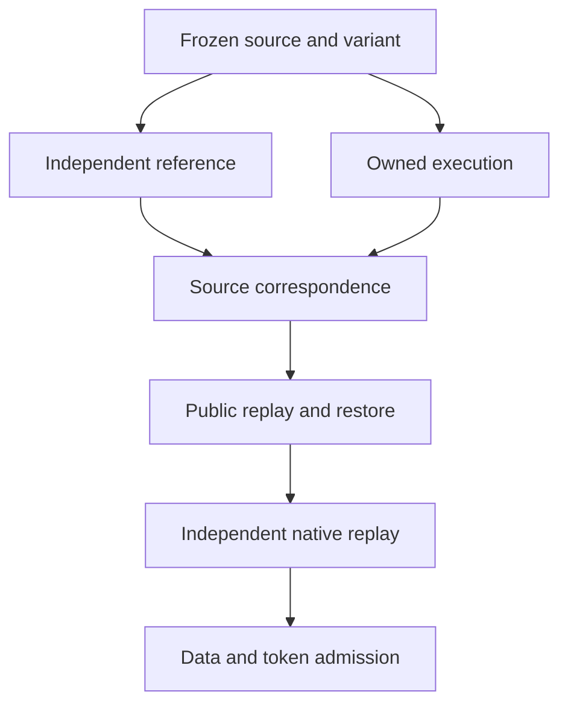

# Language coverage beyond the current supported scope
## Design and implementation plan for tracing-js-self and megatoken

**Status:** Proposed engineering design; no new language implementation is claimed by this document.  
**Prepared:** 20 November 2026.  
**Producer baseline:** `werg/tracing-js-self@4118412a854792e66f5385521f2fe236ef7b04fd`.  
**Consumer baseline:** `werg/megatoken@34cba28dc08d26c544ad4f0ed4bf338268b6f4f6`.  
**Related work:** [producer PR #46](https://github.com/werg/tracing-js-self/pull/46), [consumer PR #37](https://github.com/werg/megatoken/pull/37), and the already merged [consumer PR #36](https://github.com/werg/megatoken/pull/36).

This is a follow-on plan for expanding language coverage. It uses the completed bounded engineering scope as its starting point. It does not turn that scope into a promise of unrestricted JavaScript or make model training a prerequisite for implementing correct language semantics.

## Contents

1. [Recommendation and completion boundaries](#1-recommendation-and-completion-boundaries)
2. [Baseline and the meaning of coverage](#2-baseline-and-the-meaning-of-coverage)
3. [Language and host targets](#3-language-and-host-targets)
4. [Three reproduced gaps to fix first](#4-three-reproduced-gaps-to-fix-first)
5. [Hardest-first backlog](#5-hardest-first-backlog)
6. [Shared execution architecture](#6-shared-execution-architecture)
7. [Core language work packages](#7-core-language-work-packages)
8. [Separately qualified extensions](#8-separately-qualified-extensions)
9. [Conformance and qualification system](#9-conformance-and-qualification-system)
10. [Implementation map across both repositories](#10-implementation-map-across-both-repositories)
11. [Milestones, PR sequence, and parallel work](#11-milestones-pr-sequence-and-parallel-work)
12. [Sandbox feasibility and external dependencies](#12-sandbox-feasibility-and-external-dependencies)
13. [Effort, risks, and decision rules](#13-effort-risks-and-decision-rules)
14. [Definition of done](#14-definition-of-done)
15. [Reproduction appendix](#15-reproduction-appendix)
16. [Sources and evidence boundaries](#16-sources-and-evidence-boundaries)

## 1. Recommendation and completion boundaries

**Expand the existing shared interpreter and trace machine through reusable, resumable semantic operations.** The central work is preserving what happens when an operation invokes guest code, changes state partway through, throws, schedules work, or resumes later. Adding syntax recognizers or removing refusals cannot establish that behavior.

The existing system already contains useful bounded implementations of classes, private state, generators, custom iteration, coercion, Promise executors, modules, and binary memory. Its remaining gaps are a mixture of missing runtime behavior, known runtime defects, narrower public representations, missing independent observations, and incomplete native qualification. The plan separates those categories before assigning implementation work. [Current coverage matrix][r-matrix]

The recommended expansion has three deliverable boundaries:

| Boundary | What completion means | What remains separately measured |
| --- | --- | --- |
| **Broader deterministic core** | Correct single-agent execution and independently checked traces for explicitly declared language profiles, including reentrant properties/coercion, Promise jobs, async iteration, and retained module evaluation. | Unsupported standard-library corners and environment-specific features remain visible in the catalog. |
| **Broad single-agent language coverage** | The core plus the declared ECMAScript edition's syntax, environments, dynamic evaluation, construction, builtins, RegExp, and ordinary memory behavior, within explicit resource bounds. | Multi-agent memory, observable collection, and host APIs have separate qualification profiles. Any required language feature still excluded prevents a claim of full ECMAScript conformance. |
| **Environment and advanced profiles** | Explicitly qualified agents/shared memory, weak references and finalization, host integrations, internationalization, and post-baseline additions. | Each profile names its host, oracle, scheduling policy, data dependencies, and remaining limits. |

“Full ECMAScript conformance” is an eventual claim with a much higher bar than any finite milestone here. A complete disposition table is useful evidence, but it is not equivalent to passing every required test. Likewise, one deterministic execution of a concurrent program is not proof that all allowed concurrent behaviors are represented.

Keep model comprehension, learned execution, serving cost, and production-default promotion as a separate research track. The existing candidate remains an engineering format until those studies support a promotion decision. The current documentation explicitly retains v6 as the production default. [Candidate status][r-matrix] [Training boundary][r-training]

### Recommended first deliverable

A coordinated producer/consumer increment should establish the shared operation/error substrate and correct the three reproduced scheduling gaps in Section 4. Its public profiles should then admit those exact cases only after independent source and native checks pass. That is the first meaningful expansion; a larger matrix with unchanged semantics is not the deliverable.

## 2. Baseline and the meaning of coverage

### 2.1 Evidence carried forward

The retained complete-population qualification measures producer `012c9fe49a082319bf98ac0c571596da925741a4` and consumer `39c4036564428e44cc89caf261f517d856482695`. It reports:

- **665 expansion cases, 26 interoperability cases, and 11 gallery cases** passing source and independent native admission. These are separate, potentially overlapping populations.
- **244 native component tests**, with no failures, errors, or skips in that retained component run.
- A production dataset of **37 episodes and 1,021 complete examples**, containing **33,850 generated tokens including EOS**. Independent replication reproduces the same population; it does not double it.
- Zero optimizer steps in those dataset receipts. Token accounting and successful replay do not establish learned execution.

These are bounded, revision-specific claims. The reviewed producer and consumer heads listed above include later integration/documentation work; the retained measurements keep their original identities. Future semantic changes require new evidence. [Qualification receipt][r-qualified] [Dataset receipt][r-dataset-receipt] [Independent completion audit][r-audit]

### 2.2 Coverage is a vector

A feature is identified by its source form, semantic operation, execution mode, input domain, host profile, and resource bounds. Track these stages separately:

| Stage | Question answered | Evidence |
| --- | --- | --- |
| Parse and static semantics | Is the source accepted or rejected at the correct phase? | Original-source parse/early-error tests, including mode and scope. |
| Owned execution | Does the interpreter execute the intended semantics? | Guest execution, independent observations, and exact replay. |
| Public representation | Can every relevant transition be expressed and independently checked? | Checked public records and full retained state. |
| Source correspondence | Does the emitted execution correspond to the original source and input? | An independent source authority with declared observables. |
| Native replay and continuation | Does the separate consumer reconstruct the same state, contexts, and allowed next actions? | Independent Python execution and malformed-state rejection. |
| Data admission | Can complete examples be exported with correct lineage, causal context, tokens, masks, and EOS? | Fresh bound source/native receipts and packing checks. |
| Compact representation | Can some work be safely summarized with fewer records? | Guarded region equivalence and exact cost measurements. |
| Learned usefulness | Does a model execute unseen cases accurately and efficiently? | A separately designed training/evaluation study. |

Parsing a class does not qualify its constructor continuation. An owned Promise builtin does not qualify its scheduling behavior. A detailed trace can be fully valid even when no compact region is available. The current producer/native interfaces already distinguish several of these gates; preserve that distinction. [Extension interfaces][r-extensions] [Native validation][n-native] [Dataset contract][r-training]

### 2.3 What is already supported, and what expands next

The following matrix is a starting inventory, not a replacement for executable per-case dispositions.

| Family | Current bounded starting point | Expansion beyond it |
| --- | --- | --- |
| Primitive/local computation | Arithmetic, lazy choices, mutable cells, and compact blocks around checked boundaries. | Nested-frame compact regions, richer local inputs, wider numeric/operator coverage, and operation-specific guards. |
| Ordinary objects and closures | Symbols, descriptors, prototypes, accessors, live captured cells, receiver restoration, and selected array mutation. | General references/internal methods, first-class intrinsic identities, partial failures, and wider observable lookup. |
| Coercion and errors | Owned arithmetic coercion; source-qualified direct synchronous `Number` and callback/cleanup throws. | Getter/Proxy selection, general conversion goals, object property keys, checked intrinsic errors, and composition across APIs. |
| Proxy | Source-qualified get/set on bounded ordinary-data targets and handlers. | Other traps, nesting, revocation, accessor/exotic targets, construction, and invariant-triggered guest errors. |
| Classes and constructors | Ordinary constructors, base/derived classes, fields, private brands/methods, actual `newTarget`, object substitution, and throwing initializers. | Super-property references, constructor arrows sharing live `this`, private accessors, invalid derived paths, builtin heritage, and Proxy construction. |
| Patterns and iteration | General pattern machinery exists in the runtime; public custom iteration covers synchronous `for…of` and flat initialized array declarations. | Nested/assignment/parameter/catch patterns, general spread/consumers, checked malformed-result errors, and nested close obligations. |
| Generators and async | Source-qualified synchronous generators and bounded delegation; owned async functions and await. | General delegation/cleanup, `for await…of`, async-from-sync adapters, async generators, and request queues. |
| Promises | Owned broad builtin surface; public/source support for bounded executors and `all`/`race`. | Correct assimilation jobs, then getters, repeated thenables, normal callable `finally`, general combinators/iterables, species, and async-return composition. |
| Enumeration | Stable ordinary chains, shadowing, Symbol exclusion, UTF-16 string indices, cursors, and abrupt exits. | Structural mutations, exotic chains, richer bindings, and a deliberate admissible-behavior oracle. |
| Binary memory | Fixed ordinary buffers, typed views/DataView, shared backing, selected growth, and single-agent atomics. | Resizable/detached/transferred ordinary buffers, conversion hooks, species, wider constructors, and abrupt public operations. |
| RegExp and text | Bounded literal matching/replacement plus separately pinned scanners. | An owned general matcher, Unicode/flags/captures, dynamic patterns, custom dispatch, and wider String APIs. |
| Modules | Live cells, synchronous cycles, bounded top-level await, and original ESM comparison. | Per-module evaluation state, general TLA scheduling, async cycles, namespaces, dynamic import, and real retained sessions. |
| TypeScript | Pinned 5.9.3 to ES2022 lowering, original bytes/maps, and selected erased/runtime-emitting examples. | Broader transform profiles, helper dependencies, exact provenance, and explicit limits on original-source claims. |
| Host effects | Declared operations, recorded requests/results, callbacks, timers, resource metadata, and selected codecs. | Per-operation end-to-end qualification, complete lifecycle recovery, broader callback/transport combinations, and explicit embeddings. |
| Realms/dynamic code/GC/agents | These are not qualified by the neighboring rows. | Dedicated state models, semantics, independent oracles, and environment-specific profiles. |

The matrix is grounded in the current [bounded coverage document][r-matrix], [owned memory profile][r-memory], [literal RegExp profile][r-regexp], [Promise boundary][r-promise], [module qualification][r-modules], and [host registry][r-host]. Some older planning prose predates the implemented class/generator/iterator work; current source and tests take precedence.

## 3. Language and host targets

### 3.1 Freeze an edition and executable inventory

Use **ECMAScript 2026, ECMA-262 17th edition**, as the initial normative language baseline. Freeze the relevant HTML/spec source revision, parser revision/options, Test262 revision, Unicode tables, and reference-engine identities in one manifest. The annual edition is a stable target; the moving draft is an explicitly separate target. [Edition publication][s-edition]

The repository already pins a Test262 acquisition at `d53ebc8b1931d9f1541e43d59650776e4b766248`. Preserve it for historical reproduction, then choose and record the suite revision for each new campaign. A newer suite may contain features outside the frozen edition. [Snapshot lock][r-test262-lock]

Proposed manifest fields:

```json
{
  "languageEdition": "ECMAScript 2026",
  "specificationDigest": "computed-from-retained-spec-bytes",
  "suiteRevision": "exact-selected-Test262-commit",
  "parser": {"name": "selected-parser", "version": "exact", "optionsDigest": "sha256"},
  "modes": ["script-sloppy", "script-strict", "module"],
  "hostProfile": "declared-single-agent-profile",
  "unicodeDataDigest": "sha256",
  "resourcePolicyDigest": "sha256",
  "producerRevision": "git-sha",
  "consumerRevision": "git-sha",
  "contractDigest": "sha256",
  "referenceEngines": [{"name": "node", "version": "exact", "engineVersion": "exact"}]
}
```

This is a proposed shape, not an existing accepted schema. Replace illustrative values with measured identities when implementing it.

### 3.2 Separate edition membership from current proposal status

The inspected 2026 snapshot includes synchronous iterator helpers. The TC39 finished-proposal registry, checked on 20 November 2026, lists **Temporal and Explicit Resource Management with expected publication year 2027**. Their inclusion in the moving draft or availability in an engine does not put them in this frozen annual baseline. A proposal README can lag the registry; retain the actual chosen specification bytes. [2026 specification][s-spec] [TC39 finished proposals][s-finished]

Create an explicit additions manifest for features such as `using`/`await using`, Temporal, and later iterator APIs. Do not mix their tests into a 2026 denominator without labeling them. Internationalization is governed separately by ECMA-402; pin that edition and its data dependencies independently. [Internationalization specification][s-intl]

### 3.3 Declare the embedding

The first broad core should use one agent, explicit realms, a declared Promise/microtask policy, deterministic fixture time/randomness, and an in-memory module resolver. It should not acquire filesystem, network, DOM, or process privileges merely because a language feature is accepted.

Distinguish:

- **Language semantics:** source evaluation, values, objects, jobs, modules, and standard builtins.
- **Embedding choices:** timer/task integration, module resolution/loading, clock/random input, cancellation, and external resources.
- **Platform packages:** Node APIs, DOM/Web APIs, npm packages, React/JSX runtimes, and application frameworks.

A bounded host operation already in the registry can be qualified independently. “JavaScript support” should never silently mean “every Node and browser API.”

### 3.4 Decide how equality is judged

| Behavior | Qualification rule |
| --- | --- |
| Deterministic scalar/state/callback order within the profile | Exact equality, preserving identities, signed zero, holes, descriptors, and relevant ordering. |
| Implementation-dependent formatting or numerical approximations | Use the specification's constraints or a clearly pinned engine profile; do not infer one portable answer from V8. |
| Mutated/exotic `for…in` behavior with permitted latitude | Constrain the slice to a required result, or validate an admissible result and required invariants. |
| Host results | Validate an observation against the host contract; record its provenance and causal delivery. |
| Shared-memory races or collection/finalizer timing | Validate allowed behavior and explicit event constraints; one observed schedule is not a universal oracle. |
| Execution beyond bounds | Report a resource disposition; never invent a guest exception to force termination. |

This matters immediately for enumeration: the specification permits latitude after certain structural changes and for specified exotic chains. Widening the present stable-chain profile requires a deliberate oracle, not unconditional equality with one engine. [Enumeration rules][s-enumeration]

## 4. Three reproduced gaps to fix first

These are fresh, read-only differential probes at the producer baseline, independently rerun while preparing this design. Environment: **Node v24.22.3, V8 13.6.233.17-node.63**. Full commands and source are in Section 15.

| Probe | Owned result | Native result | Interpretation |
| --- | --- | --- | --- |
| A pending Promise is adopted while direct reactions and a microtask compete | `"daq"` | `"dqa"` | Direct adopter settlement skips observable job ordering. |
| A distinct thenable resolves to itself once, then resolves to `7` on its second call | One call, rejection marker `"e"` | Two calls, fulfillment marker `"v7"` | A global seen-thenables guard is being treated as a JavaScript self-resolution error. |
| Two sibling modules each perform a top-level await | `"aAbB"` | `"abAB"` | Flattened initializers serialize siblings that should make progress independently. |

The first two concern owned-runtime behavior outside the current public/source Promise profile. The public profile explicitly refuses adoption and callable thenable resolution. The third is rejected by the current module source gate with `phase: "module-correspondence"` and reason `"Native original module graph and owned linked JavaScript differ"`. These findings therefore **do not establish that the existing bounded source gates admitted these incorrect executions**. [Promise guards][r-promise] [Executor refusal tests][r-executor-tests] [Module source gate][r-module-code]

### Design consequences

1. Replace synchronous adopter cascading with actual resolution/job transitions.
2. Distinguish a Promise being resolved with itself from a distinct thenable encountered more than once. A nonterminating thenable chain reaches a resource bound; repeated identity alone is not a language error.
3. Replace flattened module initialization with retained per-module evaluation state before broadening the TLA claim.
4. Keep the existing refusal boundaries until corrected producer behavior, public checks, independent observations, native replay, and admission all agree.

Promise resolving functions select `then` and may enqueue a job; thenable jobs create fresh resolving pairs. Promise-job enqueue order is a semantic constraint. Those distinctions explain why patching the final reaction order is insufficient. [Promise operations][s-promises] [Job scheduling][s-execution]

## 5. Hardest-first backlog

Difficulty is a design estimate combining semantic complexity, number of affected layers, and oracle difficulty. **5 = very high, 4 = high, 3 = moderate.** The order below ranks remaining work, not the amount of existing implementation.

Work identifiers are used throughout the document. Every core package includes producer/public/source/native integration; native support is not a later cleanup phase.

| Rank | ID | Remaining work | Difficulty | Main dependency or qualification constraint |
| ---: | --- | --- | ---: | --- |
| 1 | E01 | Multiple agents and the full shared-memory event model | 5 | C01/C02/C11; bounded event-graph checker and worker reference environment. |
| 2 | C05 | Realms, environments, dynamic evaluation, and tail-call behavior | 5 | C01 and static semantics; minimal realms first, relevant C04 traps before full object environments. |
| 3 | C01 | Resumable references/internal methods, checked guest errors, intrinsic identities | 5 | Foundational work; extend the current machine without parallel state. |
| 4 | C04 | General Proxy and exotic-object composition | 5 | C01; live traps, nested operations, post-callback invariants. |
| 5 | C03 | Retained modules, general TLA, namespaces, and dynamic import | 5 | C01/C02; separate loading, linking, evaluation, and async graph state. |
| 6 | C02 | Correct Promise resolution, jobs, finally, and async-return composition | 5 | C01 minimal call/error interface; repair the two observed Promise defects. |
| 7 | C06 | General owned RegExp and Unicode-sensitive text processing | 5 | C01/C10 interfaces; matcher state, captures, hooks, and Unicode data. |
| 8 | E03 | Complete host embedding and external-resource recovery profiles | 5 | C01/C02/C03; real transport/runtime qualification and outcome reconciliation. |
| 9 | E02 | Weak references and observable finalization | 5 | C05; reachability and job-liveness model, nondeterministic oracle. |
| 10 | C07 | Async iteration and async-generator request queues | 4 | C01/C02/C08; suspension and cleanup completion rules. |
| 11 | C09 | Remaining construction, super, private accessor, and heritage behavior | 4 | C01/C04/C05 as relevant; live constructor cells and constructibility. |
| 12 | C08 | General patterns, iterable consumers, and delegation | 4 | C01; nested close obligations and retained assignment references. |
| 13 | C11 | Resizable/detached memory and observable binary-operation hooks | 4 | C01/C10; backing identity and revalidation after callbacks. |
| 14 | Q01 | Original-source Test262 harness and full-denominator campaigns | 4 | Per-feature dependencies; official execution modes and host hooks. |
| 15 | C10 | Broad standard-library and enumeration behavior | 4 | C01/C04/C08; method-specific observability, species, and partial effects. |
| 16 | C13 | Safe compact regions over nested frames and richer state | 4 | Qualified underlying semantics and explicit capability guards. |
| 17 | C12 | Complete syntax, early errors, strict/sloppy modes, and legacy inventory | 4 | C05 where environment behavior is involved; parser acceptance is insufficient. |
| 18 | Q02 | Cross-feature observations, native parity, adversarial checks, and data admission | 4 | Continuous with every feature; complete cases and immutable evidence. |
| 19 | E04 | Internationalization, calendars/time-zone data, and portable time behavior | 4 | C01/C10; separately pinned ECMA-402/data/host profiles. |
| 20 | E05 | Post-2026 additions, beginning with explicit resource management | 4 | C01/C02/C07/C08; separately pinned specification/test cohorts. |
| 21 | C14 | Broader TypeScript transformation provenance and emitted constructs | 3 | The emitted JS features; exact compiler/helper dependency inventory. |

### How to execute this order without violating dependencies

Take the highest-ranked **ready** work. If it depends on another package, work its hardest prerequisite first. Do not substitute low-risk polish while a harder ready semantic task remains.

At kickoff, run bounded architecture experiments for E01, C05, and C01, and preserve the Section 4 probes as regression seeds. E01 needs a memory-model design and a scoped reference-host qualification before it can be completed. A local Node worker/shared-buffer smoke test already succeeds here; the missing work is the event model and its qualification, not assumed absence of workers.

C01 supplies the first implementation seam. Once that seam exists, start minimal C05 realm/environment work and C04 on one lane, C02 then C03 on another, and the difficult RegExp engine/harness work on a third. Complete Proxy-backed object environments after the relevant C04 traps exist. Q01/Q02 accompany those lanes. E01 advances through C01/C02/C11 prerequisites and its own experiments; its separate completion boundary keeps a broad core milestone finishable without claiming the hardest profile is already complete.

The separate model-quality/promotion study is intentionally outside this language backlog. It has its own budget and acceptance criteria in Section 9.7.

## 6. Shared execution architecture

### 6.1 Extend one authoritative state machine

Preserve the existing shared heap, lexical cells, captures, receivers, frame stack, pending completions, jobs, and host-request state. Existing compact, detailed, and protocol work already use one selected execution path. New language behavior should extend it. [Current shared machine][r-matrix] [Protocol interfaces][r-extensions]

Use three separate implementations of the relevant meaning:

1. The owned runtime executes the guest program.
2. The public machine checks the meaning of each emitted or selected claim.
3. The native consumer independently checks the same public contract.

The independent source observer remains a fourth authority for original-source behavior. It must not import the producer evaluator to obtain its expected answer. Static registries remain code-reviewed; a source artifact or model response cannot register new semantics.

### 6.2 Retain semantic operations at observable boundaries

A proposed operation frame is:

```text
operationId
ownerInvocationId
publishedSourceOperationId
operationKind
phase
operands and retained references
selectedCallable / receiver / arguments
childOperationId or childInvocationId
pendingCompletion
cleanupObligations
realmId
scriptOrModuleId
```

This is a design vocabulary, not a frozen wire schema. Use exact fields per operation and reject undeclared fields.

A data-property read may remain one checked transition. A lookup that invokes a getter must retain the selected method and pause for the call. A Proxy operation may pause for trap lookup, trap invocation, nested target inspection, and invariant checks. Public state names those semantic phases; teacher bytecode positions, private operand stacks, journal patches, and oracle outputs remain private.

A proposed internal advance interface returns one of:

```text
done(value)
guestThrow(errorIdentity, checkedRule)
invoke(callee, receiver, arguments, returnRole)
advanceChild(operation)
enqueue(job)
suspend(awaitedCapability, resumeRole)
```

An unsupported feature or resource bound is a separate execution disposition, not a value that guest `catch` can intercept. The interface must not permit an arbitrary model-generated `TypeError` claim: the checker derives the fault from an operation rule and current state.

### 6.3 Preserve references and completion values

Retain a reference until the corresponding read/write completes:

- Binding references retain environment/cell identity when resolved, plus strictness; unresolvable references have an explicit state.
- Property references retain the evaluated base, referenced-name value, receiver, and strictness, including whether the name has become a property key.
- Super references retain home-object information and the actual receiver.
- Private references retain the applicable private-name/brand identity.

Evaluating a computed-name expression and converting its result are separate phases. Preserve the unconverted value until the target edition requires conversion; then retain the converted key. Simple assignment can evaluate its RHS before that conversion. The 2026 GetValue/PutValue algorithms update the reference after conversion. This prevents premature coercion and repeated expression evaluation. [Reference records][s-values]

Reuse completion records for normal, return, throw, break, and continue, with an explicit `empty` sentinel distinct from guest `undefined`. Implement the required `UpdateEmpty` propagation for statement/script/eval results. Break/continue targets belong to their owning frame. Cleanup retains the pending completion and may replace it only under that cleanup algorithm's rules. Iterator close, `finally`, async-generator completion, and disposal share storage/dispatch while keeping distinct transition rules. [Completion records][s-values]

### 6.4 Commit one checked transition at a time

A selected public claim is applied to staged state and either commits completely or commits nothing. **A whole guest operation is not a transaction.** Valid earlier side effects remain when a later step throws.

For example, a trap may mutate its target before failing an invariant, and array-length truncation can delete some properties before a later deletion fails. Preserve those completed effects. Rejecting a false next record must not undo prior valid records.

Fallback is permitted before compact entry, or from the last committed continuation. It must never restart an already executed getter, callback, constructor, iterator step, module initializer, or host dispatch. Existing extension staging provides the right foundation. [Staged application contract][r-extensions]

### 6.5 Make jobs explicit

Retain job identity, kind, realm, active ScriptOrModule identity, enqueue sequence, owning operation, captured values, capability, and state. Restore the script/module context required by the enqueueing operation together with the realm; do not infer it from whichever invocation is currently active. The operation that enqueues a job assigns its sequence. Dispatch selects the allowed queue head at a valid execution checkpoint.

Do not derive runnable order by sorting the original registrations of all reactions. Do not add a job merely because a construct contains `async`: some async-generator work starts synchronously before its first suspension. Timer/task queues belong to the embedding; the language queue and its interaction with host `queueMicrotask` need a named policy.

Promise resolution, await, generator resumption, module readiness, and host delivery should use explicit capabilities. A generic detailed settlement must not bypass the component that owns a Promise's settlement.

### 6.6 Model intrinsic identities and realm ownership

Replace growing source-name exceptions with a bounded table of intrinsic identities and behaviors. Each entry declares callability, constructibility, prototype/descriptor relationships, implementation, and mutation policy.

Begin with intrinsics needed by the first slices. Capturing `Array.prototype.map` must retain the selected callable even if a property later changes. An overridden property must not accidentally invoke the original builtin because its source spelling is familiar.

Separate realm-owned intrinsics from identities whose scope is wider, such as the relevant agent-level Symbol identities. Keep private brands tied to class definitions. Cross-realm errors and constructors must preserve their actual realm identities.

### 6.7 Generalize compact eligibility through proofs

The current compact paths intentionally reject several rich-state and nested-invocation situations. Those checks should be replaced only by stronger, narrower proofs. [Region eligibility][r-regions] [Pure-core entry guard][r-pure] [Protocol heap guard][r-protocol-state]

A region's declared interface should identify:

- Live inputs, output destinations, and captured cells.
- Read/write footprint and preserved aliases.
- Required descriptors, prototype links, and selected intrinsic identities.
- Whether any permitted operation can invoke guest code or observe external state.
- Entry guards, invalidation conditions, and the continuation at exit.

Eligibility checks must not invoke getters or traps. Segment before guest calls and recheck relevant assumptions after them. Preserve untouched rich metadata even if the region reads one plain field. A low compact-coverage number is not grounds for deleting conservative guards.

## 7. Core language work packages

Each package below is a series of small vertical slices. “Complete” means the applicable gates in Section 14 pass for its declared profile, including the separate native implementation. Existing code should be reused where it already implements the needed behavior.

### C01 — References, internal methods, conversion, and checked errors

**Goal:** A reusable substrate for operations that select methods, call guest code, retain references, or raise language-defined errors.

**Implementation sequence:**

1. Introduce a common checked guest-error result and complete completion records, including `empty`/`UpdateEmpty`; preserve exception identity through catch/finally/rethrow and restore.
2. Factor the existing operation continuations into a narrow reusable interface. Migrate one current Number or property operation before converting the rest.
3. Add retained references and ordinary internal-method dispatch for get/set, descriptors, own keys, deletion, existence, prototypes, and extensibility.
4. Add conversion continuations with an explicit goal: primitive/hint, numeric, Number, String, property key, length, or index.
5. Introduce the minimal intrinsic table required by these slices.

Conversions must preserve their distinctions. Explicit `Number` conversion and unary numeric coercion have different domains; explicit `String` conversion differs from coercive string conversion. A selected conversion method is captured once, and a fallback lookup reads the then-current heap. Async hooks return objects immediately; conversion does not silently await them. [Conversion operations][s-abstract] [Existing owned arithmetic][r-spec-operations]

**Starting seams:** `src/runtime.js`, `src/spec-operations.js`, `src/owned-number-conversion.js`, `src/semantic/protocol-state-v8.js`, the Number/completion source adapters, and their native counterparts.

**Distinguishing tests:**

- A getter for `Symbol.toPrimitive` runs once and changes another method.
- `valueOf` returns an object and changes `toString` before fallback.
- A thrown getter/callback suppresses later conversion work.
- Simple, compound, logical, super, and destructuring assignments distinguish name-expression evaluation from key conversion at the edition-defined point.
- `base()[key()] += rhs()` preserves base/name/read/RHS/conversion/write order and the reference's converted-key state; use an edition-compatible oracle.
- Logical assignment skips the RHS and setter when appropriate.
- Postfix update returns the converted old value.
- A bad primitive-conversion result produces a checked guest error.
- Catch/rethrow preserves one error identity and all earlier mutations.
- A forged error claim, receiver, key, or continuation role is rejected.
- Script/eval statement values distinguish empty completions from undefined, including loop/break and try/finally paths.

**Exit:** Getter-based conversion and computed object keys work through source/public/native paths; intrinsic faults are guest completions; unsupported/resource outcomes remain distinct. The common mechanism is exercised by at least two different feature families, preventing a one-off abstraction.

### C02 — Promise resolution, reactions, and async composition

**Goal:** Correct the runtime defects before relaxing the public guards.

Retain resolving-pair first-call cells, selected `then`, Promise capabilities, actual job enqueue events, and each waiting continuation. A thenable job creates its own resolving pair controlling the Promise. The first-call state must become committed before reentrant getter/callback work.

Distinguish resolving-function invocation, final fulfillment/rejection, `PromiseResolve(C, value)`, a handler result, and await normalization. Remove direct adopter cascading as an observable semantic shortcut. Do not use a global seen-thenables set as a guest self-resolution rule.

**Vertical slices:**

1. Pending/settled Promise adoption with explicit jobs; both observed ordering probes become permanent regressions.
2. Then getters, callable thenables, first-call reentry, and genuine self resolution.
3. Normal callable `finally` through cleanup resolution and forwarding.
4. Implicit async returns and await composition using the same resolution mechanism.
5. General iterable `all`/`race`/`allSettled`/`any`, then selected remaining edition APIs and subclass/species behavior.
6. Separate host rejection tracking from core language settlement.

**Tests:** Then getter throws; thenable resolves then rejects then throws; finite repeated thenables; nonterminating thenables hitting a bound; cleanup returns a primitive/Promise/thenable or throws; empty/duplicate/rejecting combinator inputs; iterator errors; captured/aliased resolvers; ignored async-executor return; wrong capability or reordered job mutation. Add an explicit pair distinguishing `Promise.resolve(p) === p` under its constructor condition from resolving another Promise with `p` and an overridden observable `then`. Test an observable/throwing constructor getter and the corresponding await normalization.

**Exit:** Both Promise probes match the reference, each new job/phase restores exactly, negative controls reject forged settlements, and the matching source/native profiles admit complete episodes. Keep restrictions on still-unmodeled subclass/exotic cases explicit. [Current scheduler boundary][r-promise] [Native scheduler][n-scheduler]

### C03 — Retained modules and dynamic import

**Goal:** Replace initializer flattening with actual per-module environments and evaluation continuations.

Keep useful live-binding/export-resolution code, but retain a module registry with source/resolution identity, dependency edges, local/imported cells, resolved exports, namespace identity, status, cycle information, async dependency counts/parents/order, evaluation capability, error, and continuation. Retain per-module `import.meta` identity and initialized state; a minimal host can provide no properties, while repeated access and guest mutations still persist.

Separate loading, linking, and evaluation. First preserve synchronous graphs; next correct sibling TLA interleaving; then add asynchronous strongly connected components, error propagation, and repeated import behavior. A waiting cycle is not automatically a JavaScript error.

The specification's graph evaluation tracks async dependencies and readiness; one concatenated async function cannot represent the sibling behavior demonstrated above. [Module evaluation][s-modules] [Current lowering][r-linked-code]

**Dynamic import:** Start with the declared in-memory graph. Evaluate specifier/options under owned semantics, retain the request and resolution key, link/evaluate once, and resolve each import's capability through the Promise mechanism. Include import attributes in request equality and the declared cache/loading policy; name the supported module types. External loading later becomes an observed host effect binding exact source bytes.

**Namespaces:** Add their own checked exotic behavior. Preserve live exports, descriptors/keys, receiver-sensitive method calls, and registry identity. Include a module that exports a callable `then`; import completion must compose with resolution semantics.

**Tests:** Shared dependencies initialize once; sibling awaits interleave; valid async cycles; TDZ and ambiguous exports; dependency rejection prevents dependent effects; repeated imports share module/namespace identity; concurrent imports; namespace method receiver; `import.meta` identity/mutations; attribute/options order and request equivalence; Promise work crossing helpers before relative dynamic import; source or resolver-policy tampering; restore during loading/evaluation; no initializer replay.

**Exit:** The module probe passes source/public/native qualification; synchronous cases remain valid; general declared async graph cases restore from real module state. A history-replay facade is not labeled a retained checkpoint API. [Module qualification boundary][r-modules]

### C04 — General Proxy and exotic internal methods

**Goal:** Expand the existing bounded get/set implementation through C01.

Introduce slices for handler accessors, nested Proxies, revocation, richer targets, and the remaining internal-method traps. Then add call/construct behavior using the same callable capability checks as ordinary functions.

Trap selection is observable. Target and receiver remain separate. Invariants inspect the target state after the trap returns; freezing or changing a descriptor during the trap can change the required outcome. A false internal set result and a strict assignment exception are different operations. [Proxy algorithms][s-objects]

**Tests:** Trap getter replaces itself; nested/revoked Proxy; target mutation during trap; frozen data with NaN and signed-zero distinctions; absent accessor getter/setter; false `Reflect.set` versus strict assignment; duplicate/invalid own keys; nonextensible target constraints; descriptor conversion that calls getters; call/construct target identity; public forged invariant results.

**Exit:** Each declared trap has ordinary success, abrupt, invariant, reentry, and restore cases. Unimplemented exotic combinations still refuse. Private brands are never exposed by transparently unwrapping a Proxy. [Existing Proxy component][r-proxy]

### C05 — Environments, realms, dynamic code, and tail calls

**Goal:** Represent execution environments directly enough to support full source modes and bounded dynamic code.

Inventory declarative, object, function, global, and module environments; TDZ; per-iteration bindings; parameter environments; `this`/`super`/`new.target`; and mapped/unmapped arguments. Reuse existing cells and add missing relationships explicitly. Object-environment name resolution is resumable: `with` lookup can invoke Proxy traps or `Symbol.unscopables` getters. Minimal realm/environment support precedes C04; this full object-environment slice follows its required traps.

**Dynamic evaluation design:**

- Direct eval retains its lexical/variable environment and strictness rules.
- Indirect eval and Function-family construction use their required global/realm context.
- New source bytes are admitted, parsed, assigned source identities, and published before public claims refer to them.
- Syntax/static errors occur before executing that source.
- Source definitions and realm intrinsics are part of restore validation.
- Dynamic code runs through the owned frontend/runtime. Native eval/Function remain reference-engine mechanisms, never an execution fallback.

Start with bounded strings and no ambient host capabilities. This is difficult engineering work, but it is not inherently impossible in a CPU sandbox.

Add explicit realm identities and prototype/intrinsic graphs. Test cross-realm callability, constructors, errors, Symbols, and return graphs. Treat sloppy `with` and Annex B behavior as explicit inventory items rather than quietly routing them through strict semantics.

**Tail calls:** Inventory required tail positions and continuation obligations. Tail calls must release the replaced active frame while preserving any state that must survive. V8 stack overflow is not a normative oracle for proper-tail-call semantics; use bounded structural invariants and an appropriate independent reference.

**Tests:** Direct/indirect eval sees different bindings; eval strictness does not leak; Function construction ignores the caller lexical scope; parameters/defaults and body bindings differ correctly; per-iteration closures; uninitialized versus missing bindings; realm-specific errors; dynamic-source digest tampering; long tail-recursive execution with bounded active-frame storage. Add Proxy-backed `with`, inherited bindings, an unscopables getter, deletion during RHS evaluation, and strict/sloppy unresolved assignment. Preserve statement completion values: `eval("1; {}")` and `eval("1; var x;")` return 1, while `eval("1; if (false) 2;")` returns undefined; cover loop/break and try/finally variants and restore before consumption.

**Exit:** A declared dynamic-code/realm profile executes, replays, and restores without hidden host evaluation or source authority changes. Full global/legacy behavior remains separately enumerated until qualified. [Execution contexts and environments][s-execution] [Current strict source profile][r-profile]

### C06 — Owned RegExp and Unicode text processing

**Goal:** Move from bounded literal patterns to a general, serializable matcher without delegating guest matching to the host RegExp engine.

Start with a pattern AST and owned matching state. Preserve captures, choice/backtracking state, input position, flags, and `lastIndex`. A bounded backtracking implementation is a straightforward first design; its work budget must report resource exhaustion independently from “no match.” Add fast paths only after semantic equivalence checks.

Stage grammar and flags by explicit edition inventory: anchors/classes/quantifiers/groups/alternation, capture/backreference behavior, lookaround, named captures, Unicode and property data, and the relevant advanced set syntax. Every stage has parse-negative cases.

Build String/RegExp dispatch through ordinary method lookup and calls. Captured/overridden `exec` or symbol methods, replacement callbacks, `matchAll`, `search`, and `split` require observable protocols. Matching and callback replacement are separate continuations.

**Tests:** Distinguish repeated empty global `exec` matches from consumers that perform their own progress step; do not universally advance after an empty match. Cover greedy/lazy alternatives, captures restored after failed choices, UTF-16/code-point distinctions, lone surrogates, sticky/global behavior, replacement argument order, callback mutation/throw, and restore during matching/replacement. On genuine RegExp instances test object-valued `lastIndex` coercion and nonwritable failure; accessor tests belong to permitted custom RegExp-like dispatch paths. Retain builtin-exec internal-slot checks, including rejection of a Proxy receiver without those slots.

**Exit:** The declared grammar is matched by an owned engine, malformed patterns are language errors at the proper phase, budgets are honest, and Python independently validates matcher/operation transitions. Do not call a host matcher from both producer and consumer and label it independent semantics. [Current literal profile][r-regexp] [Text-processing specification][s-text]

### C07 — Async iteration and async generators

**Goal:** Compose existing iterator/generator state with the corrected scheduler.

Implement `for await…of` over custom async iterators before requiring async-generator syntax. Add an owned async-from-sync adapter. Retain acquisition, cached next method, iterator kind, step result, loop target, pending completion, next/close await continuations, and the applicable `closeOnRejection` policy.

Then extend generator objects with a FIFO request queue, one active request, each request's Promise capability, lifecycle phase, await reason, pending completion, and delegation state. Do not treat a queued return as unconditional cancellation of an unresolved await.

A direct async iterator and an async-from-sync adapter have different value-unwrapping behavior; test that distinction explicitly. Cleanup may itself await or yield, and must retain the original target/completion. [Iterator and async-generator reference][s-promises]

**Tests:** Async method absent versus noncallable; sync fallback; direct async iterator returning a Promise as its value; early close and close rejection; multiple pending next calls; return/throw while awaiting; cleanup that yields; completed behavior; custom async delegation; forged queue/capability mutations. Distinguish a rejected yielded value that closes the underlying synchronous iterator from rejection while unwrapping its return result, which must not cause a second close. Cover abrupt next/done/value access and pending-throw precedence; never implement a blanket close-on-every-error rule.

**Exit:** Each acquisition, await, yield, request settlement, and close boundary restores exactly. The native consumer enforces the same legal next operation and queue ownership. [Current generator protocol][r-generators]

### C08 — General patterns, iterable consumers, and delegation

**Goal:** Qualify the general patterns that already exist in the frontend/runtime and fill actual semantic gaps.

Retain pattern position, environment initialization, evaluated assignment references, partially built outputs, excluded property keys, iterator records, and a stack of close obligations. Avoid translating patterns to repeated property/index reads that change effects.

**Slices:** Nested array bindings; assignment/member patterns; parameter and catch patterns; loop-header patterns; object rest; array/call/constructor spread; arbitrary iterable library consumers; custom synchronous delegation and malformed-result errors.

**Tests:** Cached next versus live return/throw lookup; holes not reading value; default only on undefined; nested close order; step/done/value/default/body/close failures; assignment returns RHS identity; computed rest exclusions converted once; Symbols and getters in object rest; parameter TDZ; delegation missing throw/return.

**Exit:** Existing flat declarations remain admitted, and each newly claimed position has complete source/public/native evidence. Correct completion precedence is tested by cases where the final scalar alone would not reveal a skipped close. [Current iteration profile][r-iterators] [Frontend][r-frontend]

### C09 — Complete construction, super, and private state

**Goal:** Extend the existing construction component; do not add a second class system.

Reuse checked errors and cleanup, retain a live constructor `this` cell and `newTarget`, add super references/home objects, and represent private accessors with explicit brand and accessor-call checks. Then qualify builtin/exotic heritage and Proxy construction.

**Tests:** Base versus derived field/default ordering; initializer effects before throw; object/primitive returns; this-before-super; repeated super; arrows observing the same live this cell; super getter/setter receiver; changing home-object prototype; private accessor calls; distinct same-named class brands; Proxy wrappers failing private access; constructor cleanup and restored captures.

**Exit:** Invalid construction paths become correctly checked guest errors rather than profile refusals for the declared slice; identity and partial initialization remain correct in all three execution implementations. [Existing construction component][r-construction] [Functions and classes reference][s-functions]

### C10 — Broad builtins, collections, and enumeration

**Goal:** Inventory the edition's builtin surface and implement each operation through shared internal methods where guest code can run.

Cover Object/Reflect/Function adapters; Array; Map/Set and their iterators; String; Number/BigInt/Math; JSON; Date's deterministic operations; error objects; synchronous iterator helpers; and the remaining edition additions. Existing selected builtins are starting implementations, not evidence for their entire constructors/prototypes.

| Subfamily | Required design work and distinguishing cases |
| --- | --- |
| Arrays | Holes versus undefined, inherited indices, length snapshots versus live reads, callback receivers, species, mutation during callbacks, stable sorting and comparator calls, partial length-truncation failure. |
| Object/Reflect | Observable descriptor conversion, own-key order, prototype/extensibility changes, accessor copying, assign/rest behavior, reflective Boolean result versus throwing API. |
| Call adapters | Captured/bound builtin identities, `call`/`apply`/`bind`/`Reflect.apply`, observable argument-list reads, receiver and newTarget propagation. |
| Map/Set | Key identity and equality, insertion/update/delete order, iteration under mutation, constructor iterator closing, callback reentry, edition-specific methods. |
| Strings | UTF-16 indices versus code-point iteration, conversion hooks, replacement/search dispatch, and Unicode data. |
| JSON | Getter/toJSON/replacer/reviver order, cycles, holes, BigInt/Symbol rules, source-text APIs in the chosen edition. |
| Numbers/Math | Numeric edge cases and conversions; explicit handling of implementation-approximated results; bounded deterministic random input as an embedding choice. |
| Errors/Date | Error brands/prototypes/cause and aggregate errors; deterministic date arithmetic; separately declared clock/time-zone/formatting behavior. |
| Enumeration | Stable ordinary expansion first, then mutating/exotic cases with the oracle policy from Section 3.4. |
| Iterator helpers | Owned helper objects, lazy execution, callback state, early completion/closing, and composition with generators and iterable consumers. |

**Exit:** A method-by-method inventory has explicit runtime/public/source/native status. Cross-feature cases exercise overrides, Proxies, getters, abrupt completions, and checkpoint restoration. Method names alone are not coverage units. [Existing property machinery][r-protocol-state] [Collection reference][s-collections]

### C11 — Binary memory beyond fixed ordinary buffers

**Goal:** Extend existing serializable backing storage and alias tracking.

Add resizable ordinary buffers, detach/transfer ownership changes, fixed versus tracking views, wider iterable/array-like construction, species, observable index/value conversions, non-shared atomic cases where specified, and checked abrupt public operations. Preserve the current explicit byte-order choice until a separately qualified profile changes it.

Retain backing identity, capability, current/max length, detached state, view mode, offset, and validation state. Revalidate after callbacks that can resize or detach memory. A transfer changes ownership; it is not an ordinary alias.

**Tests:** Resize within a conversion callback; fixed/tracking view behavior; detach between validation and access; assignment completion retains original RHS despite storage conversion; overlapping copies; Number/BigInt mixing; bounds/conversion error order; shared growth; alias/copy distinction; exact restore of bytes and views. Compare NaN/encoding behavior according to the chosen operation and declared platform policy.

**Exit:** Each admitted operation has state/byte observations and a native implementation; abrupt operations are checked language completions. Cross-agent behavior stays with E01. [Memory implementation scope][r-memory] [Structured-data reference][s-structured]

### C12 — Syntax, early errors, source modes, and legacy semantics

**Goal:** Close the gap between accepted grammar and actual source execution.

Build an AST/spec-feature inventory against the chosen parser. Include lexical grammar, escapes, literals, templates, contextual keywords, declarations, labels, loops/switch, optional/logical operations, function forms, classes, modules, and their static restrictions.

Track strict scripts, sloppy scripts, and modules separately. Include directive handling, global bindings and this, parameter restrictions, return/yield/await positions, private-name validation, super/newTarget restrictions, duplicate exports, and early-error timing. Annex B and optional legacy clauses receive explicit applicability, not a silent “unsupported but counted as passing” disposition.

**Tests:** Each accepted family has positive and adjacent parse/static/runtime negatives. Tests retain original source mode and are never function-wrapped to bypass global semantics. Parser diagnostics and runtime guest errors are distinct.

**Exit:** The frozen syntax/static inventory has a disposition for every row; newly supported syntax reaches the same downstream gates as hand-written bounded examples. Required tail calls and environment behavior are owned by C05, not forgotten because parsing succeeds. [Strict profile][r-profile] [Test262 execution rules][s-test262]

### C13 — Compact coverage over richer execution

**Goal:** Improve representational breadth after semantics are qualified.

Add immutable lexical maps for nested invocations, current-state local region interfaces, captured-cell inputs, richer guarded read footprints, and exact alias preservation. Extend collection algorithms only when their guards prove that getters, traps, species, or callbacks cannot be hidden by compaction.

**Tests:** Unrelated rich/private/Symbol state survives; relevant descriptor/prototype mutation invalidates entry; shared captures use the right cell; fallback repeats no effects; false claims leave staged state unchanged; compact/detail/compact runs match a detailed continuation at every boundary.

**Exit:** Report supported executions and compact eligibility separately, along with complete physical token cost. New compact rules need independent distinguishing pairs and forged-state tests. No token-reduction target may override correctness. [Current region implementation][r-regions] [Pure region implementation][r-pure]

### C14 — TypeScript and transformation provenance

**Goal:** Broaden coverage of the JavaScript produced by an explicitly pinned transform.

Retain original text, compiler/version/integrity, options, diagnostics, emitted JS, helper/runtime imports, maps, linker transformations, and source identities. Distinguish erased syntax, runtime-emitting syntax, module transforms, and mapping quality.

Test parameter properties, enums/namespaces, helper-emitting forms, and any separately enabled JSX/decorator transforms through their emitted operations. Type checking is a separate declared activity; transpilation is not whole-program type checking.

Generated JS is the execution authority. The same compiler output running natively and in the owned interpreter tests execution/linking, not the compiler's correctness. Source maps are provenance aids, not proof that every generated step is an exact original TypeScript semantic step.

**Exit:** Each transform profile names its supported emitted subset and dependencies; altered original/compiler/options/output/maps invalidate evidence; generated-only and ambiguous mapping sites remain explicit. [Current TypeScript boundary][r-modules] [Transformer][r-typescript]

## 8. Separately qualified extensions

These packages remain in the overall roadmap. They have distinct environment or oracle requirements and do not silently become prerequisites for closing a core language increment.

### E01 — Multiple agents and shared memory

**Design challenge:** A scheduler that chooses one interleaving is insufficient for the full ECMAScript memory model. Racy accesses can permit behavior that cannot be explained by a simple sequential interleaving. The specification defines validity through constraints on memory events. [Memory model][s-memory]

**Proposed design:**

- Represent each agent's execution state, realm group, queues, and suspension separately.
- Represent shared data blocks independently of per-agent object references.
- Record memory-event identity, agent order, address/width, access kind, chosen read origin, and synchronization relationships.
- Check candidate event graphs against the selected memory-model constraints.
- Model wait/notify/waitAsync and relevant timeout/blocking capabilities through explicit waiting records and host choices.
- Keep agent messaging, transfer, and lifecycle in a declared embedding.
- Provide a deterministic schedule/input mode for reproducible traces and a bounded schedule/event exploration mode for qualification.

Begin with a **bounded sequentially consistent atomic profile**, clearly labeled narrower than unrestricted racy memory. Then add the remaining allowed behaviors only with a suitable graph checker. Do not make unsupported races look correct by serializing all accesses.

**Tests:** Message-passing and store-buffering litmus tests; same/different-width accesses; tear-free constraints; atomic modification order; shared growth; wait/notify races; agents terminating while others wait; identity/transfer mistakes; forbidden read-origin and synchronization mutations.

**Completion evidence:** A retained event-graph oracle, positive and forbidden litmus outcomes, bounded exploration coverage, real worker-host comparisons, and independent native validation. Exact schedule equality is a replay property, not a conformance oracle for every native run.

**Sandbox treatment:** The event model, checker, simulator, and small deterministic tests are CPU work. A local Node worker successfully wrote shared memory through Atomics in the environment probe for this document. Host blocking, wait/notify behavior, isolation, and other-platform coverage still require their own tests. Keep E01's full qualification separate from the core milestone; any unavailable integration receives an explicit disposition.

### E02 — Weak references, weak collections, and finalization

**Design challenge:** An archive that strongly retains every object can accidentally change weak-reference behavior. A deterministic native GC schedule is not promised by the language. [Memory-management reference][s-gc]

**Proposed design:**

- Separate semantic strong roots from diagnostic/archive retention.
- Model weak entries, weak targets, unregister tokens, held values, job keep-alive obligations, and eligible cleanup work.
- Make collection/cleanup choices explicit nondeterministic inputs constrained by liveness rules.
- Serialize those choices for replay without claiming they are the only conforming choices.
- Keep WeakMap/WeakSet key/membership semantics separately testable from actual collection timing.
- Add a test-only collector/control interface only as a named harness capability.

**Tests:** Targets kept alive across the required job interval; strong cycles with no external roots; weak keys and forbidden keys under the selected edition; unregister behavior; callback reentry/errors; no cleanup twice; mutations of reachability/keep-alive/cleanup state rejected.

**Completion evidence:** A reachability/liveness model and admissible-outcome tests, not “force GC and expect callback X at time Y.” Real-engine collection tests are host diagnostics and may legitimately fail to observe collection within a time limit.

### E03 — Host embedding and external-resource recovery

The existing operation registry already describes HTTP, filesystem, networking, DOM, natural-language/resource operations, callbacks, cancellation, and lifetime metadata. Expansion should qualify these combinations, not declare host support entirely absent. [Host operation declarations][r-host]

Create an inventory keyed by operation, transport, argument/result codec, callback convention, resource lifetime, replay support, restoration support, and producer/native admission.

**Design:**

- Preserve intent, dispatch, arrival, and delivery as separate events.
- Retain resource owner, realm/session, grant identity, lifecycle, outstanding operations, subscriptions, and close/cancellation receipts.
- A state with an unknown physical outcome requires reconciliation according to the host contract.
- Replay consumes observations without redispatching physical effects.
- Restore must not automatically create a new physical resource under an old identity.
- Validate graph payloads and callback capabilities end to end. The current public graph-observation support does not by itself qualify every native request codec.
- Keep Node and browser scheduling profiles separate from the deterministic core profile.

**Tests:** Duplicate/conflicting arrivals; callback before or after close; cancellation racing with delivery; close failure; interrupted dispatch; subscription restore; cross-realm callbacks; malformed argument/result graphs; late settlement of an externally owned Promise.

**Completion evidence:** Local deterministic transport fixtures plus the actual selected host integration. A universal exactly-once promise is not supportable for arbitrary external services; qualify idempotency/reconciliation where the service provides it. [Current driver][r-host-driver] [Current graph/native boundary][r-promise]

### E04 — Internationalization and time-dependent behavior

Separate deterministic arithmetic/string semantics from locale, calendar, time-zone, clock, and data-version behavior.

Pin the ECMA-402 edition, implementation/data revision, Unicode/CLDR/ICU or equivalent data identity, locale set, time-zone database, and rounding/options policy. The exact implementation strategy can be an owned data-backed implementation or a narrowly declared external observation profile; the latter is not proof of owned Intl semantics.

**Tests:** Option getters and conversion order; invalid options; locale fallback; data-version-sensitive cases; DST transitions and ambiguous times; signed zero/rounding; checkpointed formatter identity where exposed.

**Completion evidence:** A declared locale/data profile with independently checked behavior. Do not claim all locales because a few English-format examples pass. Clock input remains an embedding observation even when date arithmetic is owned. [ECMA-402][s-intl]

### E05 — Post-baseline additions and explicit resource management

Freeze a specification/test revision for each addition. Start with resource management because it directly composes with the operation, error, iterator, and scheduler work.

**Proposed disposal state:** Resource stack; selected disposal methods; sync/async kind; next index; pending completion; accumulated suppressed error; await continuation; and the state needed to preserve required suspension behavior.

Implement ordinary guest disposables first, then disposable stack objects, then adapters to qualified host resources. Do not make a physical handle safely restorable merely by adding a disposal method.

**Tests:** Reverse disposal order; method lookup once; registration failure; normal/return/break/throw exits; multiple disposal failures; async disposal rejection; nullish async declarations; nested cleanup; replay without calling a disposer twice. Distinguish nullish async-dispose lookup falling back to sync dispose from a noncallable async method, which fails. A sync fallback's returned thenable must not be awaited or inspected, while a true async disposer follows async resolution. Test disposable-stack move/disposed state, repeated disposal, and adding after disposal across restore.

Temporal and newer iterator/library features get separate inventory rows and data dependencies rather than being bundled into this one increment. The additions manifest must state whether each is standardized in the chosen annual edition, a later finished addition, or an experimental proposal. [Finished proposal registry][s-finished] [Current disposal algorithms][s-disposal]

## 9. Conformance and qualification system

### Q01 — Execute original-source conformance tests correctly

The existing catalog is valuable, but it is not a full owned conformance result. The retained acquisition counted **53,910 Test262 files and 103,582 strict/sloppy/module candidate variants**. A historical scalar conversion campaign admitted six local owned candidates into that campaign's intermediate format, with zero downstream training admissions. Those historical numbers are not a current v8 coverage percentage. [Corpus history][r-corpus]

A separate runtime slice has eight files: six passing non-strict variants, two unsupported variants, and eight omitted strict variants. It uses a limited assertion harness. Extending it requires proper modes, the official harness, includes, negative phases, async completion, and module realms. [Current runtime slice][r-test262-runtime]

#### 9.1 Catalog before selection

Retain every discovered test/variant in an immutable catalog:

```text
case identity
suite revision and path
exact source and harness digests
script/module and strict/sloppy/raw mode
flags and feature labels
includes
negative phase and error type, if any
module dependency closure
required host capabilities
spec edition/addition membership
selection stratum and selected/not-selected
source-family/lineage identity
resource profile
```

Different variants of one file are distinct executions, not new upstream files. Store both denominators. A selector chooses work from the catalog; it does not redefine the catalog.

One concrete repair is the generic capability-ledger CLI: it currently filters `cases` before building the ledger. An invocation using `--cases` can therefore lose the unselected population from that output. Preserve the full frozen inventory and give unselected cases explicit dispositions, following the stronger expansion-run pattern. [Current ledger CLI][r-ledger]

#### 9.2 Implement the actual harness contract

Run unchanged test bodies with the selected revision's official harness and declared includes. Preserve fresh realms, source mode, raw handling, module graphs, async completion, and expected negative phase/type. Test262's interpretation instructions define these requirements. [Official harness rules][s-test262]

Implement required host hooks as explicit capabilities: realm creation, script evaluation in the intended realm, buffer detachment, agents, and any special host objects required by a chosen cohort. Do not emulate them by silently changing the test body.

Important distinctions:

- A parse-negative test must fail parsing, without running its body.
- A resolution-negative module test must fail at the required stage.
- A runtime-negative test must actually reach the required guest error.
- An unsupported feature is not a successful negative test.
- A missing harness API is an environment/harness gap, not a language pass.
- A test that uses async completion must not pass merely because its initial script returned.
- Test assertions must execute; skipping an assertion or replacing it with a precomputed result invalidates the run.

Do not wrap original scripts in a function to fit an entrypoint API. That can change declarations, this, strictness, and early errors. Add the necessary script/module execution entrypoints instead.

#### 9.3 Preserve per-stage dispositions

Use an outcome per stage rather than one overloaded pass/fail:

| Disposition | Meaning |
| --- | --- |
| `passed` | The stage executed and met its declared criterion. |
| `failed` | A semantic, evidence, or validation disagreement occurred. |
| `unsupported` | The declared implementation profile does not support the feature. |
| `resource_limited` | A declared execution/storage/time bound was exceeded. |
| `environment_unavailable` | A required reference/runtime/host capability is absent. |
| `not_selected` | The case remains in the catalog but was not chosen for this campaign. |
| `not_run` | The selected stage has not executed. |
| `blocked_by_prior_stage` | A downstream stage cannot proceed; retain the exact upstream reason. |
| `infrastructure_error` | The harness or process failed without a valid semantic verdict. |

Also retain the expected language outcome separately. An expected exception can yield `passed` at runtime conformance; a profile refusal cannot.

Resource limits include steps/jobs, nesting, heap/bytes, matcher work, graph size, output/context size, process time, and host wait limits. Freeze the policy before collecting results. Raising a limit creates a new identified campaign; it does not rewrite old failures.

#### 9.4 Staged execution pipeline



The source gate compares declared observable behavior, not merely the final scalar. Public/native gates verify full state, permitted next operations, contexts, and continuation ownership.

For ordinary objects, use descriptor-based observation without invoking guest getters. For private state, Proxies, generator state, or buffers, use explicitly registered observation techniques. Instrumentation must preserve evaluation order and must not introduce extra jobs or mutate guest objects.

The independent observer must remain independent of the teacher/compiler/evaluator. Where host internals cannot be directly observed, combine original-source observable witnesses with independently checked public invariants; state that limit rather than claiming access to native hidden slots.

Use a second engine or a pinned independent reference when available, especially for implementation-dependent behavior. Agreement between two implementations is evidence, not a substitute for the specification. If the installed engine lacks a feature or implements an older/nonconforming rule, retain an explicit reference-compatibility result and use a compatible oracle or spec-derived invariant. Do not reduce the edition silently or force owned behavior to reproduce the reference's discrepancy.

One such diagnostic is already concrete: Node 24.22.3 converts an object key twice for the tested compound/logical assignment, while the inspected 2026 reference algorithms cache the converted name. Section 15.3 preserves the source and observed order. This is an oracle-compatibility finding, not a fourth newly demonstrated producer defect. [Reference algorithms][s-values]

### Q02 — Validate composition and all downstream representations

#### 9.5 Test classes required for every new slice

| Test class | What it must distinguish |
| --- | --- |
| Positive semantic cases | Correct value, side-effect order, identities, descriptors, and completion. |
| Adjacent negative cases | Wrong method/receiver/phase, unsupported neighbor, and legitimate language errors. |
| Distinguishing pairs | Programs or inputs that look similar but differ in a required semantic detail. |
| Metadata mutations | An altered hidden/retained state that leaves the final scalar unchanged. |
| Checkpoint boundaries | Restore at every newly introduced observable phase, then consume the same suffix. |
| Causal-prefix mutations | Future values, unpublished code, false cutoffs, wrong prefix digests. |
| Cross-feature interactions | The new feature combined with callbacks, cleanup, aliasing, scheduling, and another protocol. |
| Boundaries | Just below, at, and beyond every relevant resource limit. |

At minimum, a slice should include a mutation of each newly introduced authority-bearing field: owner, selected callable, receiver, target, capability, queue position, completion target, or source identity. Public and native consumers must reject it.

Checkpoint tests compare the next legal actions and contexts, not only the final output. For example, restoring a Promise to the right result with a missing queued reaction is still incorrect.

Use grammar-guided and stateful differential fuzzing after the deterministic tests establish an oracle. Retain seeds and minimized failures. Minimize failures while preserving source mode, environment, and feature interaction; do not shrink away the mechanism that caused the mismatch.

Recommended first composition matrix:

| Interaction | Why it is necessary |
| --- | --- |
| Proxy getter → conversion hook → throw → finally | Reentry, error identity, and cleanup across components. |
| Then getter → Promise resolution → queued microtask | First-call state and actual enqueue order. |
| Nested pattern default → iterator close → throwing return | Cleanup stack and completion precedence. |
| Derived initializer → super accessor → private accessor | Constructor cells, receiver, and private brand. |
| Async generator → for-await close → finally await | Request queues, suspension, and cleanup. |
| Dynamic import → namespace exporting then | Module identity and Promise resolution. |
| Buffer conversion callback → resize/detach | Revalidation and retained backing aliases. |
| Compact region → effectful callback → compact region | Guard invalidation and no repeated effects. |

#### 9.6 Preserve data, receipts, and costs

Extend the current family registry and dataset exporter. Freeze relationships before splitting: exact source identity, module graph identity, ancestry, normalized cores, generated variants, and TypeScript-emitted aliases. Connected related cases stay in one split. Distinguish holding out inputs, source spellings, semantic families, and feature combinations.

For every admitted episode, retain:

- Exact producer, consumer, contract, policy, source, reference, and tokenizer identities.
- Source/public/native reports and their artifact bindings.
- Complete input/output and declaration inventory.
- Causal contexts rebuilt from actual public prefixes.
- Complete generated targets, generated-only masks, and one EOS per target.
- Actual production tokenization and byte round trips.
- Episode/case/example counts with explicit units.
- Full failed/refused/unselected rows and original attempts.
- Per-stage resource usage and first divergence.

No partial episode should be admitted because earlier targets fit when a later context or native check fails. No private oracle output, future result, or qualification receipt enters model-visible context.

Report flat trace tokens, physical prompts, generated targets, repeated context, EOS, and packing separately. A shorter flat trace is not evidence of lower end-to-end serving cost. [Existing causal/dataset contract][r-training]

Campaign execution should be restartable. Write complete artifacts before committing their ledger completion row; bind both by digest. Retain attempts rather than overwriting a failure after a retry. A resumed campaign uses the same inventory and selection identities.

#### 9.7 Keep model-quality studies independent

After an expanded engineering profile is qualified, a separate study can ask whether it improves model execution.

A useful design holds out semantic families and feature combinations, compares equal task sets and useful-success criteria, and records training exposure, optimizer steps, checkpoints, tokenizer, decoding policy, retries, and source-scored rollouts.

Measure complete inference cost, latency, context reuse, and success at comparable budgets. Include detailed-format baselines and preserve failed rollouts. External comprehension/notation studies require actual model responses and provenance.

The retained engineering/dataset evidence does not establish generalization. Missing historical weights cannot be recreated by relabeling a new run as a reproduction. A new fully archived study is the appropriate replacement if that question is pursued. None of this blocks semantic correctness work or automatically authorizes default promotion.

## 10. Implementation map across both repositories

Paths below identify current integration seams. New modules are proposed where the existing structure benefits from them; avoid growing one universal evaluator that duplicates the interpreter.

| Responsibility | Producer seams | Consumer seams |
| --- | --- | --- |
| Parsing and source modes | `src/training/profile.js`, `src/frontend.js`, module/TypeScript frontends | Source identity and declared program/context validation. |
| Owned execution | `src/runtime.js`, `src/spec-operations.js`, owned conversion/memory/matcher modules | Independent semantic implementations; never use producer state as the answer. |
| Public state and operation dispatch | `src/semantic/protocol-state-v8.js`, `protocol-machine-extensions-v8.js`, `protocol-codec-v8.js` | `src/megatoken/data/protocol_v8.py` and component modules. |
| Source projection | `protocol-source-compiler-v8.js`, source-specific component adapters, source registry | Source-bound admission/receipt checks. |
| Independent observations | `protocol-source-reference-v8.js`, observation/metadata registries | Validate exact observation/source binding; do not import teacher internals. |
| Promise/generator/iterator state | Scheduler boundary and Promise/generator/iterator components | `promise_scheduler_v8.py`, `promise_executor_v8.py`, `promise_join_v8.py`, `generator_v8.py`, `iterator_v8.py`. |
| Other protocols | Number, Proxy, construction, memory, enumeration components | `number_v8.py`, `proxy_v8.py`, `construction_v8.py`, `memory_v8.py`, `enumeration_v8.py`. |
| Shared contract | `src/semantic/contract-v8.js` and generated contract/fixture tools | `semantic_contract_v8.py` and `data/contracts/semantic-execution-v8.json`. |
| Replay/context/continuation | `selected-execution-v8.js`, `region-harness.js`, `native-v8.js` | `native_v8.py`, `prefix_v8.py`, independent protocol state restoration. |
| Corpus and qualification | `src/corpus/`, capability ledger, expansion and native-admission tools | Native admission CLI, exact receipts, independent source-bound validation. |
| Dataset/token export | `dataset-v8.js`, `family-registry-v8.js`, `causal-lm-v8.js` | Physical episode/packing/token/mask checks and training ingestion. |
| Host integration | `src/host/operations.js`, `native-driver.js`, host journal and graph codecs | Request/observation policy, callback/resource authority, native orchestration. |

Current native validation explicitly separates engineering replay from production admission, including context, continuation, and source/token requirements. Keep that distinction while expanding components. [Native replay][n-native] [Native contract][n-contract] [Native protocol][n-protocol]

### Contract-change policy

Both repositories are pre-release. Change the current format and APIs in place when that is the direct solution. Synchronize producer, consumer, fixtures, examples, and regenerated artifacts. Do not add a version-migration or compatibility-shim project as a prerequisite. Exact contract digests and evidence pins still matter. [Producer development policy][r-policy] [Consumer development policy][n-policy]

For each vertical slice, use a reviewable sequence:

1. Commit the failing semantic regression and the intended supported/refused boundary.
2. Commit the owned behavior and public checked transition.
3. Commit the matching independent consumer and contract/fixture changes.
4. Commit independent source observations, mutation/restore tests, and fresh qualification receipts.
5. Update the coverage inventory with the actual results.

Push each completed increment promptly. Feature integration may use paired PRs; merge only a mutually consistent producer/consumer contract. A temporary source refusal is preferable to advertising a profile while its consumer implementation is incomplete.

## 11. Milestones, PR sequence, and parallel work

### 11.1 Milestones

| Milestone | Included work | Concrete exit |
| --- | --- | --- |
| **M0: Reproducible expansion baseline** | Q01 inventory/identity foundation and Section 4 regressions; bounded feasibility experiments for E01/C05/C01. | Every baseline case/variant retains a disposition; the three defects reproduce; highest-risk architecture choices have executable probes. |
| **M1: Shared semantic substrate** | C01, minimal realm/intrinsic identities, Q02 integration. | Getter conversion and checked guest errors work through source/public/native paths; retained references and cleanup restore without repeating effects. |
| **M2: Correct scheduling and module state** | Initial C02/C03 slices: resolution jobs, thenables, cleanup/async returns, and acyclic module scheduling. | Promise probes and sibling TLA probe pass; actual jobs and per-module state restore; current valid populations regress cleanly. |
| **M3: General effectful composition** | C04, C05, C07, C08, C09, C11, and later C02/C03 slices after their prerequisites. | Declared dynamic code/realm, Proxy, async iteration/generator, construction, pattern, ordinary-memory, general combinator, and module profiles qualify together. |
| **M4: Broad single-agent surface** | C06, C10, C12, remaining core inventory and full original-source campaign accounting. | Every required single-agent family has a stage disposition; supported rows satisfy all gates, and remaining standard gaps are explicit. |
| **M5: Efficient expanded representation** | C13 and C14 plus representative production data export. | Safe compact interfaces and transformation provenance qualify; exact costs and complete data admission are retained. |
| **M6: Environment profiles** | E01–E05, each independently scoped. | Each selected profile has its own host/spec/data identities and acceptance evidence. |

Milestones describe integration checkpoints, not a waterfall. The difficult RegExp engine and conformance harness can progress while scheduling/module work integrates. A milestone with explicit remaining standard gaps must be named a qualified profile, not full conformance.

### 11.2 Proposed PR batches

These are proposed work items, not PRs already created. Split a batch further when it cannot produce reviewable, testable increments.

| Batch | Deliverable | Dependencies | Primary gate |
| --- | --- | --- | --- |
| P01 | Immutable catalog/selection identity; three regression seeds; readiness experiments | Existing heads | No denominator loss; observed baseline outcomes reproduced. |
| P02 | Shared checked guest-error/cleanup result and one migrated component | P01 | Error identity, partial effects, invalid claims, native parity. |
| P03 | Retained references and ordinary internal-method continuations | P02 | Getter/receiver/key order and restore. |
| P04 | Minimal intrinsic/realm/environment model; bounded dynamic code | P03 | Direct/indirect eval and realm distinctions; new source publication; full Proxy-backed environments wait for P05. |
| P05 | Proxy nesting, handler accessors, invariants, revocation, then additional traps | P03/P04 as needed | Live post-trap checks and independent source witnesses. |
| P06 | Promise resolution jobs and first-call cells | P02/P03 | Both Promise probes fixed and source/native admitted. |
| P07 | Callable finally and async returns; later general combinator slices | P06; P10/P13 for applicable iterable/species behavior | Cleanup/job order, rejection and close behavior. |
| P08 | Per-module environments and acyclic async evaluation | P06 and shared state | Sibling TLA probe fixed; synchronous graphs preserved. |
| P09 | Async module cycles, namespaces/import.meta, attributes, and in-memory dynamic import | Initial P07/P08 | Identity/error caching, request equivalence, namespace-then interaction, and restore. |
| P10 | General pattern/iterator cleanup and custom delegation | P03 | Nested close/assignment/default distinctions. |
| P11 | For-await and async-from-sync adapters | P06/P10 | Await/close boundaries, rejection-closing policy, and direct-async versus sync-adapted values. |
| P12 | Async generators and request queues | P11 and existing generators | Multiple pending requests and cleanup suspension. |
| P13 | Remaining class/super/private-accessor construction | P03/P04; P05 for Proxy construction | Live this/newTarget, brands, guest faults, partial initialization. |
| P14 | Owned general RegExp engine, staged grammar/flags | P03 interfaces; parser work may start earlier | Matching/capture/lastIndex and checkpoint semantics. |
| P15 | Resizable/detached ordinary memory and binary hooks | P03 and intrinsic interfaces | Bytes/aliases, callback revalidation, abrupt operations. |
| P16 | Standard-library families and edition additions | P03/P05/P10 as applicable | Method-specific observability and composition. |
| P17 | Remaining grammar/mode/environment/early-error/tail-call cohorts | P04/P05 and feature implementations | Original-source Test262 phases, modes, and observable environment lookup. |
| P18 | Nested/rich-state compact interfaces | Qualified feature slices | Guard soundness, detailed equivalence, exact token costs. |
| P19 | Broader TypeScript transform profiles | Required emitted JS features | Complete compiler/helper/source-map provenance. |
| P20 | Full frozen campaign, native qualification, data export, closeout | Applicable P02–P19 | Complete dispositions, current pins, no unexplained failures. |
| PX1–PX5 | E01–E05 environment/addition profiles | Their declared core dependencies | Profile-specific host and admissible-behavior evidence. |

P06/P08 address known runtime defects and should be active as soon as their narrow prerequisites are ready. P04/P05 address the higher-ranked environment/internal-method complexity. The list's numeric order is a convenient work-item reference; ready work is chosen by the difficulty ranking and dependencies.

### 11.3 Parallel ownership

A practical three-lane arrangement:

- **State/object lane:** C01 foundation, minimal C05 realms/environments, then interleaved C04/full-C05 slices and C09; owns references, intrinsic/realm identities, and object semantics.
- **Scheduling/module lane:** C02/C03/C07; owns jobs, async capabilities, and retained module/generator state.
- **Language/harness lane:** Q01, difficult C06 work, then C08/C10/C11/C12 cohorts; owns unchanged-source harness execution and broad inventory.

Each lane pairs its producer work with a native-consumer implementation/review. A designated integrator owns shared contract fields, golden fixtures, cross-feature tests, and exact evidence identities. Avoid simultaneous unsynchronized edits to the shared state schema.

The qualification work is continuous, not a fourth lane that receives months of unchecked code at the end.

### 11.4 CI and integration discipline

Use three levels:

1. **Per increment:** Focused semantic, native, mutation, and restore checks for changed behavior plus affected cross-feature regressions.
2. **Per paired PR:** Current contract/fixture equality, complete affected profile populations, source/native admission, and relevant producer/consumer regressions.
3. **Milestone closeout:** The frozen broad campaign, complete catalog dispositions, production-tokenizer/data checks, and all required repository gates at exact final revisions.

Use dependency fingerprints to avoid regenerating expensive evidence for prose-only changes. Any executable contract, compiler, runtime, observer, consumer, policy, or relevant fixture change invalidates affected receipts. Do not reuse old source/native evidence merely because a new head has a similar filename or profile label.

Preserve original failures and separately identify follow-ups. Require zero unexpected failures for the declared supported set; unsupported, unavailable, and resource-limited rows remain in the broader denominator.

## 12. Sandbox feasibility and external dependencies

This matrix distinguishes work that is possible here from claims that require additional execution environments. Fresh checks established Node 24.22.3 ESM execution, a worker writing a shared buffer through Atomics, and availability of resizable/transferable buffers, WeakRef, and Intl. The available `python3` does not have pytest, torch, tokenizers, or transformers installed. API presence and a worker smoke test are not full feature qualification. The checks are reproduced in Section 15.4.

| Area | Work possible in the current kind of sandbox | Additional requirement for a stronger claim | Treatment |
| --- | --- | --- | --- |
| References, coercion, Proxy, construction, patterns | JavaScript/Python implementation, local deterministic tests, replay/restore design. | Pinned native environment and full paired CI for qualification. | Core work; do not defer because it is difficult. |
| Promise jobs, async iteration/generators | Owned scheduler and bounded Node differential tests. | Host-specific event-loop behavior if claimed. | Core language profile first; embedding later. |
| Modules and dynamic import | In-memory module graphs, explicit evaluation state; Node ESM probe already works here. | Real filesystem/package/network loaders only for those host profiles. | Core in-memory resolver is achievable. |
| Realms and eval/Function | Owned bounded source admission and environment semantics. | Independent reference support for selected edge cases; no new ambient privilege required. | Achievable core work. |
| RegExp/Unicode | Owned engine, serialized state, pinned data and bounded tests. | Data/dependency acquisition and broader reference-engine availability. | Core work; dependency availability is reported separately. |
| Binary buffers | Small backing arrays, resize/detach/alias semantics, CPU tests. | Worker/platform integration for cross-agent claims. | Ordinary memory in core; E01 separate. |
| Full Test262 campaigns | Cataloging and selected cohorts; existing corpus/runner infrastructure. | Exact full suite checkout, harness dependencies, time/storage, required host hooks. | Retain unselected/blocked rows; scale in bounded shards. |
| Native data admission | Code/contract work and retained paired receipts; default Python lacks the test/training packages. | Provision a compatible pinned CPU environment and actual production tokenizer, or run the paired CI environment. | A required integration gate; do not replace it with local public replay. |
| Multiple agents/racy memory | Simulator, event-graph validator, deterministic litmus tests; local Node workers/shared buffers work. | The actual event-model implementation plus wait/notify, isolation, and any claimed cross-platform tests. | Separate E01 qualification; no claim that workers are unavailable here. |
| WeakRef/finalization | Reachability model, keep-alive/cleanup state, allowed-outcome tests. | Controlled host diagnostics where available; exact GC timing is never guaranteed. | Separate E02 with nondeterministic acceptance. |
| Browser/Node external APIs | Deterministic fixture drivers, lifecycle and codec validation. | Real selected runtime/service/transport to qualify integration. | Per-operation E03 profile. |
| Intl/time-zone behavior | Algorithm and data-profile design; deterministic fixture tests. | Pinned locale/calendar/time-zone data and an independent implementation. | E04; record unavailable data explicitly. |
| Learning/default promotion | Dataset design and source-scoring harness. | Model access, training/inference compute, retained checkpoints, and study budget. | Separate research; not a core-language completion blocker. |
| Missing historical model archive | Document retained evidence and identity gap. | The original archive must be supplied or located. | A new run is a new study, never a claimed recovery of missing bytes. |

If an environment is missing, finish the reviewable implementation/tests that can run, retain an exact `environment_unavailable` row, and remove that integration claim from the active milestone's acceptance criteria. Keep its follow-up work item and requirements visible. Do not remove a difficult CPU-executable language feature merely because completing it takes substantial engineering.

## 13. Effort, risks, and decision rules

### 13.1 Effort planning

These are **planning bands**, not measured estimates or delivery promises. They assume engineers already familiar with this interpreter and include producer, public checker, independent native implementation, and focused qualification.

| Work shape | Initial planning band |
| --- | --- |
| One narrow gap in an existing component | Several focused days to roughly two weeks. |
| A substantial vertical slice such as thenable jobs or retained references | Several engineer-weeks, depending on how much shared machinery must change. |
| A new subsystem such as general RegExp, dynamic environments, or module evaluation | Multiple slices over several weeks to months. |
| Broad single-agent coverage across all core packages | A sustained project measured in engineer-months, with independent qualification as a major part of the work. |
| Full racy-memory or observable-GC profiles | Separate high-uncertainty efforts; estimate after the model/oracle experiments. |

Re-estimate after P03, P06, and P08. Measure actual implementation time, number of public phases, native-port effort, minimized failures, and case throughput. The first difficult vertical slices are more informative than counting syntax names.

Do not sum concurrent package bands into a calendar date. Do not promise complete ECMAScript coverage in one PR. The previous bounded PRs can be complete while this follow-on program remains substantial.

### 13.2 Main risks and responses

| Risk | Response and stop condition |
| --- | --- |
| Reusing a runtime builtin whose semantics are already wrong | Differential probes before admission expansion; retain the current refusal until the observed defect is corrected. |
| Building a second interpreter inside public protocols | Share a small continuation substrate; keep component-specific rules and one shared state. Review duplication after the first two components. |
| Wrong order hidden by equal final values | Independent ordered observations, metadata mutations, and distinguishing pairs. |
| Source observers change behavior | Review instrumentation effects; forbid extra jobs/getter calls; use untouched-source reference outcomes alongside witnesses. |
| Python and JavaScript make the same mistake | Independent implementations, source reference, spec-derived distinctions, and adversarial state changes. |
| Overgeneralized cleanup | Separate transition tables for iterator close, finally, generator completion, and disposal. |
| Unsound compaction | Positive entry guards, no guest calls during eligibility, precise footprints, detailed continuation equivalence. |
| One-engine oracle rejects conforming behavior | Use explicit admissible/engine-specific profiles where the spec permits latitude. |
| Coverage improves by dropping hard cases | Immutable catalog and all-stage dispositions; selection never changes the denominator. |
| Historical evidence is mistaken for current qualification | Exact executable/source/contract identities and fresh affected runs. |
| Massive all-suite runs slow every change | Small changed-profile gates, deterministic shards, resumable campaigns, milestone full runs. |
| Resource limits become language semantics | Dedicated resource dispositions and fixed policies; never catchable fabricated guest faults. |
| External replay repeats physical effects | Separate intent/dispatch/arrival/delivery; recorded observations and explicit reconciliation. |
| Training changes distract from semantic coverage | Keep model studies and default promotion outside core exit conditions. |

### 13.3 Recommended decisions to adopt now

1. Target the annual ECMAScript 2026 snapshot, with a separately pinned additions manifest.
2. Preserve the current shared machine and extend it through observable-operation continuations.
3. Correct the three reproduced gaps before broadening their public/source profiles.
4. Use unchanged-source Test262 execution and complete catalog accounting.
5. Keep strict/sloppy/module and host requirements explicit.
6. Change the current pre-release contract in place and synchronize both repositories.
7. Require an independent native implementation in each vertical slice.
8. Keep richer compact coverage downstream of correct semantics.
9. Treat environment-dependent profiles as separately finishable work.
10. Revisit estimates after the first difficult slices, using measured effort and failure data.

These are design recommendations. They do not require an additional approval workflow for routine reversible implementation choices.

## 14. Definition of done

A **language slice** is done only when all applicable items below are concrete and retained:

- [ ] Its source forms, modes, semantic domain, host assumptions, and limits are declared.
- [ ] Original source executes with the correct result, observable effects, identities, and completion.
- [ ] Legitimate exceptions are distinguished from unsupported and resource outcomes.
- [ ] Public records express the behavior without hidden teacher execution or trusted replacement state.
- [ ] The independent source observer checks the relevant behavior and rejects misleading equal-output mutations.
- [ ] The native consumer independently checks records, full continuation state, and allowed next actions.
- [ ] Every new observable suspension/cleanup/job phase has restore and tampering coverage.
- [ ] At least one meaningful cross-feature interaction is qualified.
- [ ] Exact contract/fixture/policy identities agree across producer and consumer.
- [ ] Complete candidate dispositions and fresh receipts are retained at measured revisions.
- [ ] Production data/token/mask/EOS checks pass if data admission is claimed.
- [ ] Existing supported populations show no unexplained regressions.
- [ ] Documentation identifies residual boundaries and links current evidence.

A **milestone** is done when its named slices satisfy these gates and its full frozen denominator is accounted for. It must not be held open by unrelated model studies or a separately excluded host profile.

A **claim of full language conformance** additionally requires that all applicable required features of the chosen edition are implemented and the conformance evidence supports that claim. A list of exclusions, a high selected-suite pass rate, or a complete ledger is not enough.

A **production default change** is a separate decision supported by model usefulness, operational behavior, and total cost. Semantic correctness and dataset admission are necessary evidence, not automatic authorization or proof for that change.

## 15. Reproduction appendix

These commands were run read-only at producer `4118412a854792e66f5385521f2fe236ef7b04fd`. They are diagnostic comparisons, not substitutes for the new regression/admission suites proposed above.

Run from a checkout of `werg/tracing-js-self` with its dependencies installed.

### 15.1 Promise ordering and repeated thenable probes

```bash
node --input-type=module <<'NODE'
import {createRuntime} from './src/runtime.js';

const sources = {
  adoption: [
    "let order='';let settle;",
    "let target=new Promise(function(resolve){settle=resolve;});",
    "let outer=new Promise(function(resolve){resolve(target);});",
    "outer.then(function(){order+='a';});",
    "target.then(function(){order+='d';});",
    "settle(7);",
    "queueMicrotask(function(){order+='q';});"
  ].join("\n"),
  repeatThenable: [
    "let count=0;let order='';",
    "let t={then:function(resolve){",
    "  count+=1;",
    "  if(count===1){resolve(t);}else{resolve(7);}",
    "}};",
    "Promise.resolve(t).then(",
    "  function(value){order+='v'+value;},",
    "  function(){order+='e';}",
    ");"
  ].join("\n")
};

for (const [name, source] of Object.entries(sources)) {
  const runtime = createRuntime().start(source);
  const outcome = runtime.drive();
  const bindings = Object.fromEntries(
    Object.values(runtime.state.envs)
      .flatMap(env => Object.entries(env.bindings))
      .filter(([key]) => ['order', 'count'].includes(key))
      .map(([key, value]) => [key, value.token.value])
  );

  // Native execution is the independent diagnostic oracle here.
  // It is not a fallback inside the owned interpreter.
  const nativeBody =
    "return (async()=>{" + source +
    ";await new Promise(resolve=>setImmediate(resolve));" +
    "return {order" + (name === 'repeatThenable' ? ',count' : '') +
    "};})();";
  const native = await new Function(nativeBody)();

  console.log(JSON.stringify({
    name, ownedKind: outcome.kind, owned: bindings, native
  }));
}
console.log(JSON.stringify({
  node: process.version, v8: process.versions.v8
}));
NODE
```

Observed:

```json
{"name":"adoption","ownedKind":"terminated","owned":{"order":["str","daq"]},"native":{"order":"dqa"}}
{"name":"repeatThenable","ownedKind":"terminated","owned":{"count":["num",1],"order":["str","e"]},"native":{"order":"v7","count":2}}
{"node":"v24.22.3","v8":"13.6.233.17-node.63"}
```

The tagged owned values are the interpreter's retained representation. The expected repaired observations are native `"dqa"` and `{order: "v7", count: 2}` for these exact sources/embedding.

### 15.2 Sibling top-level await probe

```bash
node --no-warnings --experimental-vm-modules --input-type=module <<'NODE'
import vm from 'node:vm';
import {executeEvaluatedModules} from './src/evaluated-modules.js';
import {verifyRegionModuleTrainingCase} from './src/semantic/module-v8.js';

const modules = {
  'state.js':
    'export let log="";export function mark(x){log+=x;}',
  'a.js':
    'import {mark} from "./state.js";mark("a");await Promise.resolve(0);mark("A");',
  'b.js':
    'import {mark} from "./state.js";mark("b");await Promise.resolve(0);mark("B");',
  'main.js':
    'import "./a.js";import "./b.js";import {log} from "./state.js";export function run(){return log;}'
};

const owned = await executeEvaluatedModules({
  modules, entryModule: 'main.js', exportName: 'run'
});
const context = vm.createContext({});
const refs = new Map(Object.entries(modules).map(([name, source]) => [
  name, new vm.SourceTextModule(source, {context, identifier: name})
]));
await refs.get('main.js').link(
  specifier => refs.get(specifier.replace(/^\.\//, ''))
);
await refs.get('main.js').evaluate();

const checked = await verifyRegionModuleTrainingCase({
  id: 'sibling-await-order',
  family: 'sibling-await-order',
  modules,
  entryModule: 'main.js',
  exportName: 'run',
  fixture: {calls: []}
});
console.log(JSON.stringify({
  owned: owned.result,
  native: refs.get('main.js').namespace.run(),
  sourceQualification: {
    status: checked.status, phase: checked.phase, reason: checked.reason
  }
}));
NODE
```

Observed:

```json
{"owned":"aAbB","native":"abAB","sourceQualification":{"status":"failed","phase":"module-correspondence","reason":"Native original module graph and owned linked JavaScript differ"}}
```

This directly demonstrates both the owned scheduling gap and the existing source gate's rejection of it.

### 15.3 Reference compatibility and statement-completion probes

The key-conversion experiment is a native-reference diagnostic. It does not execute the owned runtime and must not be counted as another producer failure.

```bash
node --input-type=module <<'NODE'
const operations = {
  simple: (object, key, rhs) => object[key] = rhs(),
  compound: (object, key, rhs) => object[key] += rhs(),
  logical: (object, key, rhs) => object[key] &&= rhs()
};
for (const [name, operation] of Object.entries(operations)) {
  const log = [];
  const object = {x: 1};
  const key = {[Symbol.toPrimitive]() {log.push('coerce'); return 'x';}};
  const rhs = () => {log.push('rhs'); return 2;};
  operation(object, key, rhs);
  console.log(JSON.stringify({name, log}));
}
for (const source of ["1; {}", "1; var x;", "1; if (false) 2;"]) {
  const value = (0, eval)(source);
  console.log(JSON.stringify({
    source, type: typeof value, value: value === undefined ? null : value
  }));
}
NODE
```

Observed under the same Node version:

```json
{"name":"simple","log":["rhs","coerce"]}
{"name":"compound","log":["coerce","rhs","coerce"]}
{"name":"logical","log":["coerce","rhs","coerce"]}
{"source":"1; {}","type":"number","value":1}
{"source":"1; var x;","type":"number","value":1}
{"source":"1; if (false) 2;","type":"undefined","value":null}
```

The last null is an output encoding for undefined, distinguished by the type field. The compound/logical traces require a reference-compatibility disposition against the cached-name rule of the chosen 2026 snapshot; they must not become normative expected results merely because this Node version produced them.

### 15.4 Local environment probe

```bash
node --input-type=module <<'NODE'
import {Worker} from 'node:worker_threads';
const shared = new SharedArrayBuffer(4);
const worker = new Worker(
  'import {parentPort,workerData} from "node:worker_threads";' +
  'Atomics.store(new Int32Array(workerData),0,7);parentPort.postMessage("done");',
  {eval: true, workerData: shared}
);
const result = await new Promise((resolve, reject) => {
  worker.once('message', resolve);
  worker.once('error', reject);
});
await worker.terminate();
console.log(JSON.stringify({
  node: process.version,
  workerResult: result,
  sharedValue: Atomics.load(new Int32Array(shared), 0),
  resizableBuffers: typeof ArrayBuffer.prototype.resize === 'function',
  transfer: typeof ArrayBuffer.prototype.transfer === 'function',
  weakRef: typeof WeakRef === 'function',
  intl: typeof Intl === 'object'
}));
NODE
python3 - <<'PY'
import importlib.util
import json
print(json.dumps({
    name: importlib.util.find_spec(name) is not None
    for name in ["pytest", "torch", "tokenizers", "transformers"]
}))
PY
```

Observed:

```json
{"node":"v24.22.3","workerResult":"done","sharedValue":7,"resizableBuffers":true,"transfer":true,"weakRef":true,"intl":true}
{"pytest":false,"torch":false,"tokenizers":false,"transformers":false}
```

## 16. Sources and evidence boundaries

### Repository sources

All producer links below are pinned to `4118412a854792e66f5385521f2fe236ef7b04fd`; all consumer links are pinned to `34cba28dc08d26c544ad4f0ed4bf338268b6f4f6`. Historical receipt contents retain their own measured revisions.

**Baseline and engineering policy:** [Current bounded matrix][r-matrix], [producer policy][r-policy], [consumer policy][n-policy], [complete qualification][r-qualified], [dataset receipt][r-dataset-receipt], [independent completion audit][r-audit].

**Producer architecture:** [extension interfaces][r-extensions], [runtime][r-runtime], [frontend][r-frontend], [strict source profile][r-profile], [arithmetic/conversion operations][r-spec-operations], [public protocol state][r-protocol-state], [local regions][r-regions], [pure-region entry][r-pure].

**Feature boundaries:** [Promise scheduler][r-promise], [executor negative tests][r-executor-tests], [generator protocol][r-generators], [iterator protocol][r-iterators], [construction component][r-construction], [Proxy component][r-proxy], [binary-memory profile][r-memory], [literal RegExp profile][r-regexp], [module qualification][r-modules], [module linker][r-linked-code], [module source gate][r-module-code], [TypeScript transformer][r-typescript], [host registry][r-host], [host driver][r-host-driver].

**Qualification and data:** [training contract][r-training], [capability-ledger CLI][r-ledger], [corpus history][r-corpus], [Test262 snapshot lock][r-test262-lock], [runtime conformance slice][r-test262-runtime].

**Independent consumer:** [native replay/admission boundary][n-native], [contract validation][n-contract], [protocol machine][n-protocol], [Promise scheduler][n-scheduler].

### Primary external references

Normative baseline: [ECMA-262 annual edition publication][s-edition] and [ECMAScript 2026 HTML][s-spec].

Relevant sections: [reference/completion records][s-values], [abstract operations][s-abstract], [objects/internal methods][s-objects], [execution contexts and jobs][s-execution], [control abstractions/Promises/iterators][s-promises], [modules][s-modules], [enumeration][s-enumeration], [functions/classes][s-functions], [text/RegExp][s-text], [keyed collections][s-collections], [structured data][s-structured], [memory model][s-memory], and [memory management][s-gc].

Separate targets: [ECMA-402 2026][s-intl], [TC39 finished proposals][s-finished], and [current-draft disposal operations][s-disposal]. Moving sources were checked on 20 November 2026 and must be pinned to exact bytes/revisions before implementation.

Harness authority: [Test262 interpretation instructions][s-test262]. The plan uses the current instructions for design; implementation must use the matching instructions from its selected suite revision.

### What was newly verified for this document

The three differential probes in Section 4/15 were freshly run. The module source-gate rejection was freshly observed. Reference-key/statement-completion diagnostics and the local worker/API/Python-dependency checks were also run. Source and integration seams were inspected at the stated heads. Existing broad qualification numbers are retained repository evidence, not fresh full-suite runs performed while writing this plan.

Proposed state fields, package ordering, milestone names, acceptance additions, and effort bands are design recommendations. They are not existing public APIs, measured future outcomes, or newly issued conformance claims.

[r-matrix]: https://github.com/werg/tracing-js-self/blob/4118412a854792e66f5385521f2fe236ef7b04fd/docs/SEMANTIC_REGIONS_V8.md
[r-policy]: https://github.com/werg/tracing-js-self/blob/4118412a854792e66f5385521f2fe236ef7b04fd/AGENTS.md
[r-qualified]: https://github.com/werg/tracing-js-self/blob/4118412a854792e66f5385521f2fe236ef7b04fd/coverage/language-expansion/native-v8-012c9fe-all/README.md
[r-dataset-receipt]: https://github.com/werg/tracing-js-self/blob/4118412a854792e66f5385521f2fe236ef7b04fd/coverage/language-expansion/dataset-v8-012c9fe/README.md
[r-audit]: https://github.com/werg/tracing-js-self/blob/4118412a854792e66f5385521f2fe236ef7b04fd/coverage/language-expansion/completion-audit-6423989/README.md
[r-extensions]: https://github.com/werg/tracing-js-self/blob/4118412a854792e66f5385521f2fe236ef7b04fd/docs/V8_PROTOCOL_EXTENSIONS.md
[r-runtime]: https://github.com/werg/tracing-js-self/blob/4118412a854792e66f5385521f2fe236ef7b04fd/src/runtime.js
[r-frontend]: https://github.com/werg/tracing-js-self/blob/4118412a854792e66f5385521f2fe236ef7b04fd/src/frontend.js
[r-profile]: https://github.com/werg/tracing-js-self/blob/4118412a854792e66f5385521f2fe236ef7b04fd/src/training/profile.js
[r-spec-operations]: https://github.com/werg/tracing-js-self/blob/4118412a854792e66f5385521f2fe236ef7b04fd/src/spec-operations.js
[r-protocol-state]: https://github.com/werg/tracing-js-self/blob/4118412a854792e66f5385521f2fe236ef7b04fd/src/semantic/protocol-state-v8.js
[r-regions]: https://github.com/werg/tracing-js-self/blob/4118412a854792e66f5385521f2fe236ef7b04fd/src/semantic/regions.js
[r-pure]: https://github.com/werg/tracing-js-self/blob/4118412a854792e66f5385521f2fe236ef7b04fd/src/semantic/pure-region-v8.js
[r-promise]: https://github.com/werg/tracing-js-self/blob/4118412a854792e66f5385521f2fe236ef7b04fd/docs/V8_PROMISE_SCHEDULER.md
[r-executor-tests]: https://github.com/werg/tracing-js-self/blob/4118412a854792e66f5385521f2fe236ef7b04fd/test/semantic-protocol-promise-executor-source-v8.test.js
[r-generators]: https://github.com/werg/tracing-js-self/blob/4118412a854792e66f5385521f2fe236ef7b04fd/docs/V8_GENERATOR_PROTOCOL.md
[r-iterators]: https://github.com/werg/tracing-js-self/blob/4118412a854792e66f5385521f2fe236ef7b04fd/docs/V8_ITERATOR_PROTOCOL.md
[r-construction]: https://github.com/werg/tracing-js-self/blob/4118412a854792e66f5385521f2fe236ef7b04fd/src/semantic/protocol-construction-v8.js
[r-proxy]: https://github.com/werg/tracing-js-self/blob/4118412a854792e66f5385521f2fe236ef7b04fd/src/semantic/protocol-proxy-v8.js
[r-memory]: https://github.com/werg/tracing-js-self/blob/4118412a854792e66f5385521f2fe236ef7b04fd/docs/OWNED_BINARY_MEMORY.md
[r-regexp]: https://github.com/werg/tracing-js-self/blob/4118412a854792e66f5385521f2fe236ef7b04fd/docs/OWNED_LITERAL_REGEXP.md
[r-modules]: https://github.com/werg/tracing-js-self/blob/4118412a854792e66f5385521f2fe236ef7b04fd/docs/SEMANTIC_V8_MODULES.md
[r-linked-code]: https://github.com/werg/tracing-js-self/blob/4118412a854792e66f5385521f2fe236ef7b04fd/src/evaluated-modules.js
[r-module-code]: https://github.com/werg/tracing-js-self/blob/4118412a854792e66f5385521f2fe236ef7b04fd/src/semantic/module-v8.js
[r-typescript]: https://github.com/werg/tracing-js-self/blob/4118412a854792e66f5385521f2fe236ef7b04fd/src/typescript.js
[r-host]: https://github.com/werg/tracing-js-self/blob/4118412a854792e66f5385521f2fe236ef7b04fd/src/host/operations.js
[r-host-driver]: https://github.com/werg/tracing-js-self/blob/4118412a854792e66f5385521f2fe236ef7b04fd/src/host/native-driver.js
[r-training]: https://github.com/werg/tracing-js-self/blob/4118412a854792e66f5385521f2fe236ef7b04fd/docs/SEMANTIC_V8_TRAINING.md
[r-ledger]: https://github.com/werg/tracing-js-self/blob/4118412a854792e66f5385521f2fe236ef7b04fd/tools/generate-capability-ledger.mjs
[r-corpus]: https://github.com/werg/tracing-js-self/blob/4118412a854792e66f5385521f2fe236ef7b04fd/docs/corpus-extension.md
[r-test262-lock]: https://github.com/werg/tracing-js-self/blob/4118412a854792e66f5385521f2fe236ef7b04fd/corpus/extension/snapshots/test262/snapshot.lock.json
[r-test262-runtime]: https://github.com/werg/tracing-js-self/blob/4118412a854792e66f5385521f2fe236ef7b04fd/docs/TEST262_RUNTIME_SLICE.md
[n-policy]: https://github.com/werg/megatoken/blob/34cba28dc08d26c544ad4f0ed4bf338268b6f4f6/AGENTS.md
[n-native]: https://github.com/werg/megatoken/blob/34cba28dc08d26c544ad4f0ed4bf338268b6f4f6/src/megatoken/data/native_v8.py
[n-contract]: https://github.com/werg/megatoken/blob/34cba28dc08d26c544ad4f0ed4bf338268b6f4f6/src/megatoken/data/semantic_contract_v8.py
[n-protocol]: https://github.com/werg/megatoken/blob/34cba28dc08d26c544ad4f0ed4bf338268b6f4f6/src/megatoken/data/protocol_v8.py
[n-scheduler]: https://github.com/werg/megatoken/blob/34cba28dc08d26c544ad4f0ed4bf338268b6f4f6/src/megatoken/data/promise_scheduler_v8.py
[s-edition]: https://ecma-international.org/publications-and-standards/standards/ecma-262/
[s-spec]: https://tc39.es/ecma262/2026/
[s-values]: https://tc39.es/ecma262/2026/multipage/ecmascript-data-types-and-values.html
[s-abstract]: https://tc39.es/ecma262/2026/multipage/abstract-operations.html
[s-objects]: https://tc39.es/ecma262/2026/multipage/ordinary-and-exotic-objects-behaviours.html#sec-proxy-object-internal-methods-and-internal-slots
[s-execution]: https://tc39.es/ecma262/2026/multipage/executable-code-and-execution-contexts.html
[s-promises]: https://tc39.es/ecma262/2026/multipage/control-abstraction-objects.html
[s-modules]: https://tc39.es/ecma262/2026/multipage/ecmascript-language-scripts-and-modules.html
[s-enumeration]: https://tc39.es/ecma262/2026/multipage/ecmascript-language-statements-and-declarations.html#sec-enumerate-object-properties
[s-functions]: https://tc39.es/ecma262/2026/multipage/ecmascript-language-functions-and-classes.html
[s-text]: https://tc39.es/ecma262/2026/multipage/text-processing.html
[s-collections]: https://tc39.es/ecma262/2026/multipage/keyed-collections.html
[s-structured]: https://tc39.es/ecma262/2026/multipage/structured-data.html
[s-memory]: https://tc39.es/ecma262/2026/multipage/memory-model.html
[s-gc]: https://tc39.es/ecma262/2026/multipage/managing-memory.html
[s-intl]: https://tc39.es/ecma402/2026/
[s-finished]: https://github.com/tc39/proposals/blob/main/finished-proposals.md
[s-disposal]: https://tc39.es/ecma262/multipage/abstract-operations.html#sec-disposeresources
[s-test262]: https://github.com/tc39/test262/blob/main/INTERPRETING.md


